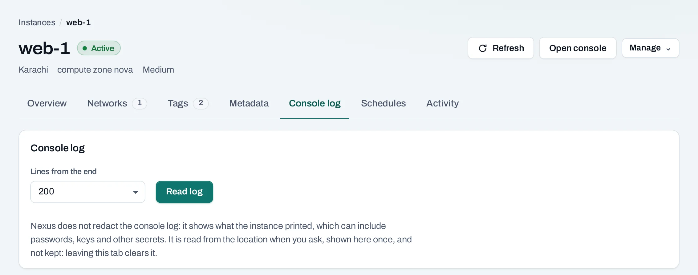
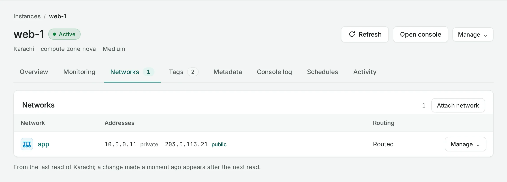

# Connect to an instance

How you and other systems reach an instance: SSH over the network, the browser console when the
network fails, the console log to see why it will not start, and the networks, public IPs and
security groups that decide what traffic gets through.

## Log in with SSH

Log in as the image's default user, for example `ubuntu` on Ubuntu images, with the
[SSH key](ssh-keys.md) you chose when you created the instance:

```bash
ssh ubuntu@203.0.113.21
```

From the Internet you need the instance's **public IP**, a security group rule that allows TCP 22
from your address, and an Internet gateway in the project. From another instance on the same
routed networks, use its private address.

## Open the browser console

**Open console** on the instance's page gives you its screen and keyboard in your browser, as if a
monitor were plugged in: for an instance you cannot reach over the network, or to watch it start.

1. Choose **Open console**. The location prepares a console; this takes a few seconds.
2. Choose **Open console ↗**. It opens in a new browser tab.

The link works once and only for a few minutes; do not share or bookmark it. The console closes
after 10 minutes; choose **Reconnect** for a new one. Project admins and project members can
open it while the instance is active or rescued.

Where a location does not offer the console here, use **Console in Horizon** on the instance's
page. A program can open a console through the API with an API key that has the **Open instance
consoles** permission; see [Service accounts](../organization/service-accounts.md).

## Read the console log

The **Console log** tab shows the last lines the instance printed: boot messages and whatever its
system and programs wrote. Choose how many lines from the end (50 to 2,000), then **Read log**.
At most the last 100 KB are shown, with **Copy** and **Download**.



The log is available only while the instance runs or is rescued. It is shown as printed, not
redacted, and can contain secrets such as host keys; it is not stored, and leaving the tab clears
it.

## Change its networks

=== "Console"

    On the instance's **Networks** tab:

    - **Attach network** gives the instance an address on another of the project's networks.
      If its system does not bring the new interface up by itself, bring it up inside the
      instance.
    - **Detach network** removes that address at once; the network stays.
    - **Forwarding…**, where the location offers it, lets an interface forward traffic for private
      ranges behind it, for example a VPN instance. See [Routing](../networking/routing.md).

    

=== "API"

    ```bash
    curl -sS -X POST "$NUBESTACK_API/v1/orgs/$ORG/projects/$PROJECT/servers/srv_01jbweb1:attach-interface" \
      -H "Authorization: Bearer $NUBESTACK_API_KEY" \
      -H "Idempotency-Key: $(uuidgen)" \
      -H "Content-Type: application/json" \
      -d '{"network_id": "net_01jbdb"}'
    ```

    `:detach-interface` takes the same body.

## Add or remove a public IP

=== "Console"

    **Manage → Add public IP** attaches a new or unattached address. **Manage → Remove public
    IP** detaches it; the address stays allocated to the project until you release it under
    [Public IPs](../networking/public-ips.md).

=== "API"

    ```bash
    curl -sS -X POST "$NUBESTACK_API/v1/orgs/$ORG/projects/$PROJECT/floating-ips/fip_01jbspare:associate" \
      -H "Authorization: Bearer $NUBESTACK_API_KEY" \
      -H "Idempotency-Key: $(uuidgen)" \
      -H "Content-Type: application/json" \
      -d '{"server_id": "srv_01jbweb1"}'
    ```

    `:disassociate` with `{}` detaches it.

## Change its security groups

=== "Console"

    **Manage → Security groups** chooses the groups the instance is in. Their rules apply on every
    network it is on. Choosing no groups means it accepts and sends nothing.

=== "API"

    ```bash
    curl -sS -X POST "$NUBESTACK_API/v1/orgs/$ORG/projects/$PROJECT/servers/srv_01jbweb1:set-security-groups" \
      -H "Authorization: Bearer $NUBESTACK_API_KEY" \
      -H "Idempotency-Key: $(uuidgen)" \
      -H "Content-Type: application/json" \
      -d '{"security_group_ids": ["sgr_01jbdefault", "sgr_01jbweb"]}'
    ```

    The list replaces the instance's groups.

## Cannot connect?

Check, in this order:

1. The instance is **Active**, and its **Console log** shows it finished starting.
2. It has a public IP, or you connect from inside its networks.
3. One of its security groups allows the port from your address.
4. The project has an Internet gateway, and the network is routed.
5. The service inside the instance listens on that port, and its own firewall allows it.

More in [Troubleshooting](../help/troubleshooting.md).

## Related

- [Security groups](../networking/security-groups.md) · [Public IPs](../networking/public-ips.md)
- [Native access](../native-access/index.md): the location's Horizon console and the OpenStack CLI
