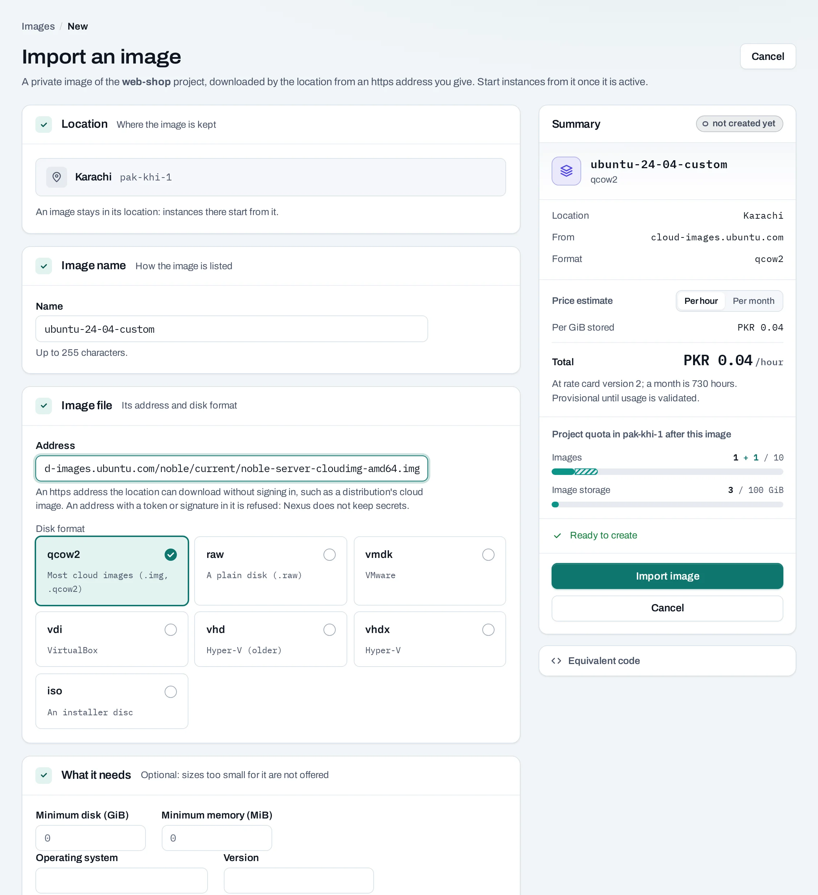

# Images

An **image** is a saved system disk that new instances start from. There are two kinds:

- **The location's images**: the operating systems NubeStack publishes in each location, such as
  Ubuntu or Debian. You choose one when you create an instance; you cannot change or delete them.
- **Your images**: private to the project. Either an instance of yours saved as it is, to start
  new instances with the same setup, or an image file you imported from an address.

Find your own under **Compute → Images**.


## Before you start

A role of project admin or project member. To save an instance, a running or stopped instance;
to import, an `https` address of the image file.

## Save an instance as an image

=== "Console"

    1. Choose **Save an instance**, or **Manage → Create image** on an instance.
    2. Choose the instance and name the image.
    3. Choose **Create image** and follow the operation.

    

=== "API"

    ```bash
    curl -sS -X POST "$NUBESTACK_API/v1/orgs/$ORG/projects/$PROJECT/servers/srv_01jbweb1:create-image" \
      -H "Authorization: Bearer $NUBESTACK_API_KEY" \
      -H "Idempotency-Key: $(uuidgen)" \
      -H "Content-Type: application/json" \
      -d '{"display_name": "web-golden"}'
    ```

The image is the instance's system disk as it is at that moment. Attached volumes are not part of
it. For a consistent copy, stop the instance first, or at least stop what writes to its disk.

## Import an image file

The location downloads the file from an address you give, such as a distribution's cloud image.

=== "Console"

    1. Choose **Import image**.
    2. **Image name**: up to 255 characters.
    3. **Image file**:
        - **Address**: an `https` address the location can download without signing in. An
          address with a token or signature in it is refused: NubeStack Cloud keeps no secrets.
        - **Disk format**: `qcow2` for most cloud images (`.img`, `.qcow2`), or `raw`, `vmdk`,
          `vdi`, `vhd`, `vhdx` or `iso`.
    4. **What it needs** (optional): the minimum disk and memory, so sizes too small for it are not
       offered, and its operating system and version, such as `ubuntu` and `24.04`.
    5. Check the summary, with the price estimate per GiB stored for owners, admins and the billing
       role, and choose **Import image**.

    

=== "API"

    ```bash
    curl -sS -X POST "$NUBESTACK_API/v1/orgs/$ORG/projects/$PROJECT/images" \
      -H "Authorization: Bearer $NUBESTACK_API_KEY" \
      -H "Idempotency-Key: $(uuidgen)" \
      -H "Content-Type: application/json" \
      -d '{
        "location": "loc_01jbkhi",
        "display_name": "ubuntu-24-04-custom",
        "source_url": "https://cloud-images.ubuntu.com/noble/current/noble-server-cloudimg-amd64.img",
        "disk_format": "qcow2",
        "min_disk_gb": 10
      }'
    ```

    Optional: `min_ram_mb`, `os_distro`, `os_version`. The answer is `202 Accepted` with an
    operation.

The image reads **importing** until the download ends. An import that fails leaves nothing
behind. **Manage → Stop import** deletes an image still importing.

## Start an instance from an image

Choose **Manage → Start an instance from it** on the image, or pick it under **Your images** when
you [create an instance](instances.md). In the API, pass `image_id` instead of `image`. You can
also make a bootable [volume](../storage/volumes.md) from it.

## Rename or delete an image

=== "Console"

    Open the image for **Rename**, or choose **Manage → Delete** and confirm.

=== "API"

    ```bash
    curl -sS -X DELETE "$NUBESTACK_API/v1/orgs/$ORG/projects/$PROJECT/images/img_01jbgolden" \
      -H "Authorization: Bearer $NUBESTACK_API_KEY" \
      -H "Idempotency-Key: $(uuidgen)"
    ```

    `PATCH …/images/{id}` with `{"display_name": "…"}` renames it.

Instances already started from a deleted image keep running; no new ones can start from it.

**What blocks a delete**

| Refusal | Why | Resolve |
|---|---|---|
| `image_protected` | The image is marked protected in the location | Remove the protection with the location's own tools, then delete |

## Limits and good practice

- An image stays in its project's location. To use the same setup in the other location, import
  the file again in a project there, or set up an instance there and save it.
- Images made with the location's own tools appear in the list too, marked **outside Nexus**.
- Your images are kept, and their size counted in your usage, until you delete them. Delete old
  ones you no longer launch.
- Prefer building instances from a public image plus user data or a launch template; keep saved
  images for setups that take long to rebuild.

## Related

- [Instances](instances.md) · [Launch templates](launch-templates.md)
- [API reference: Images](../api/reference/images.md)
