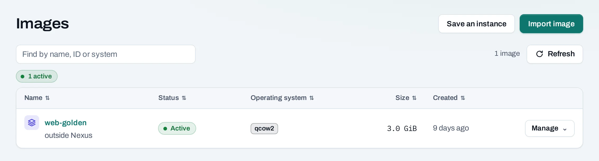
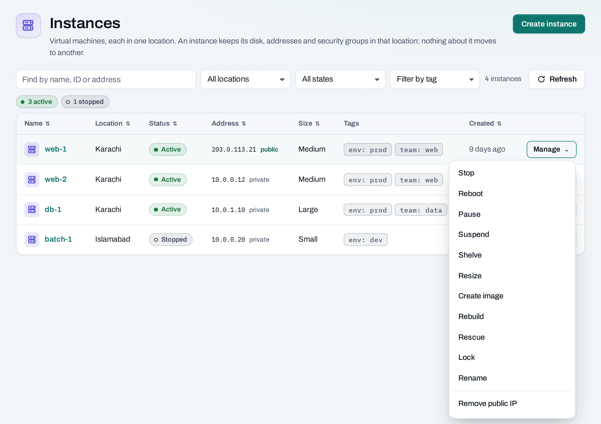
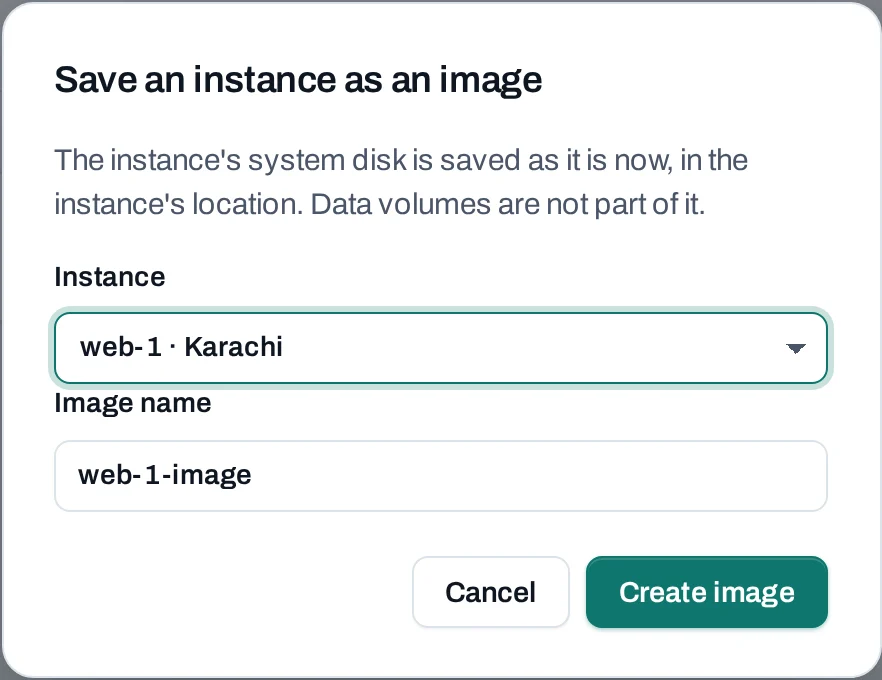

# Images

An image is a template for an instance's system disk. Use the location's published operating-system images for a fresh start, or save an existing instance as a project image to reuse its installed software.

<div class="docs-method-picker" hidden role="group" aria-label="Instruction method">
<span>Show instructions for</span>
<div><button type="button" data-interface-choice="Console" aria-pressed="true">Console</button><button type="button" data-interface-choice="API" aria-pressed="false">API</button></div>
</div>

<div class="docs-method-note" markdown>

[Set up API authentication and variables](/api/overview.md#before-you-start). Replace example IDs and catalog choices. Reuse an idempotency key for retries of one request; use a new key for each new action.

</div>




## Use an image

=== "Console"

    Open **Compute → Images** to inspect saved project images in your project's locations. Published operating-system choices are shown on **Create instance**; the project image list does not replace that catalog. During [instance creation](/compute/instances.md), choose an image offered in the selected location. Project images appear under **Your images**. An image in Karachi cannot be used directly in Islamabad.

    An image does not carry a running instance's memory, network identity or attached data volumes. Set the network, SSH key, security groups and volumes for each new instance.

=== "API"

    <span id="with-the-api" data-docs-method="API"></span>

    Use the catalog `image` name for a published image, or `image_id` for a saved project image.
    ```bash
    curl --fail-with-body -i -X POST "$NUBESTACK_API/v1/orgs/$ORG/projects/$PROJECT/servers" \
      -H "Authorization: Bearer $NUBESTACK_API_KEY" \
      -H "Idempotency-Key: $REQUEST_KEY" \
      -H "Content-Type: application/json" \
      --data '{
      "location": "loc_example",
      "display_name": "web-1",
      "offering": "medium",
      "image": "ubuntu-24-04",
      "network_id": "net_example",
      "ssh_key_id": "ssh_example"
    }'
    ```

    A `202` accepts the change. Follow `operation.href` to its final result before the next dependent action.

    [Request fields and responses](/api/reference/instances.md#post-server).


## Save an instance as an image

=== "Console"

    1. Prepare the instance. Remove temporary files and secrets you do not want copied, and stop application writes. Shut it down first if the application requires that for a consistent disk copy.
    2. Open **Compute → Instances**, then **Manage → Create image** on an active or stopped instance.
    3. Give the image a descriptive name, such as `web-base-2026-11`.
    4. Follow the operation until it succeeds, then check **Compute → Images**.
    5. Launch a test instance from the saved image and verify it before relying on it.

    

    

=== "API"

    ```bash
    curl --fail-with-body -i -X POST "$NUBESTACK_API/v1/orgs/$ORG/projects/$PROJECT/servers/$SERVER_ID:create-image" \
      -H "Authorization: Bearer $NUBESTACK_API_KEY" \
      -H "Idempotency-Key: $REQUEST_KEY" \
      -H "Content-Type: application/json" \
      --data '{
      "display_name": "web-base"
    }'
    ```

    A `202` accepts the change. Follow `operation.href` to its final result before the next dependent action.

    [Request fields and responses](/api/reference/instances.md#create-image).


## Rename and delete

=== "Console"

    Use the image's **Manage** menu to rename or delete a project image you control. Location-provided images are managed by NubeStack. Check [launch templates](/compute/launch-templates.md) and [instance groups](/compute/instance-groups.md) before deleting an image they will need for future launches or replacements.

    Deleting an image does not serve as a way to delete instances already created from it. Image storage and availability are local to each location, and quota or a resource dependency can refuse deletion.

=== "API"

    **Rename an image**

    ```bash
    curl --fail-with-body -i -X PATCH "$NUBESTACK_API/v1/orgs/$ORG/projects/$PROJECT/images/$RESOURCE_ID" \
      -H "Authorization: Bearer $NUBESTACK_API_KEY" \
      -H "Idempotency-Key: $REQUEST_KEY" \
      -H "Content-Type: application/json" \
      --data '{
      "display_name": "web-base-v2"
    }'
    ```

    A `202` accepts the change. Follow `operation.href` to its final result before the next dependent action.

    [Request fields and responses](/api/reference/images.md#update-image).

    **Delete an image**

    ```bash
    curl --fail-with-body -i -X DELETE "$NUBESTACK_API/v1/orgs/$ORG/projects/$PROJECT/images/$IMAGE_ID" \
      -H "Authorization: Bearer $NUBESTACK_API_KEY" \
      -H "Idempotency-Key: $REQUEST_KEY"
    ```

    A `202` accepts the change. Follow `operation.href` to its final result before the next dependent action.

    [Request fields and responses](/api/reference/images.md#delete-image).


## Good practice

Keep saved images free of private credentials and machine-specific configuration. Use cloud-init for settings that vary between instances. A project image is a reusable system disk, while [volume snapshots](/storage/snapshots.md) protect separate data disks.
