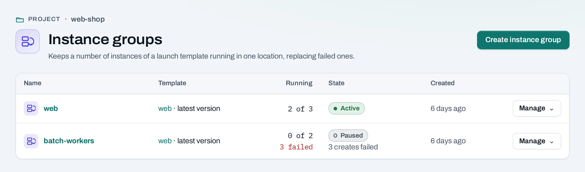
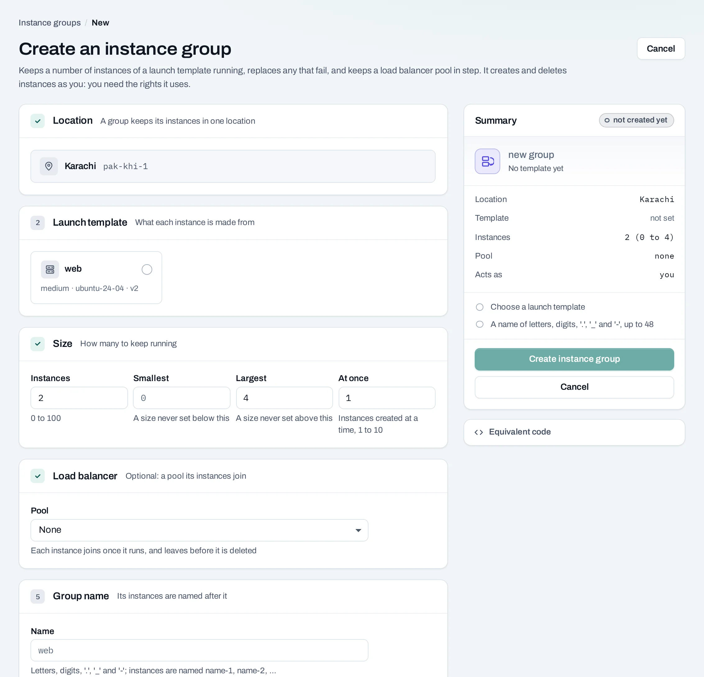
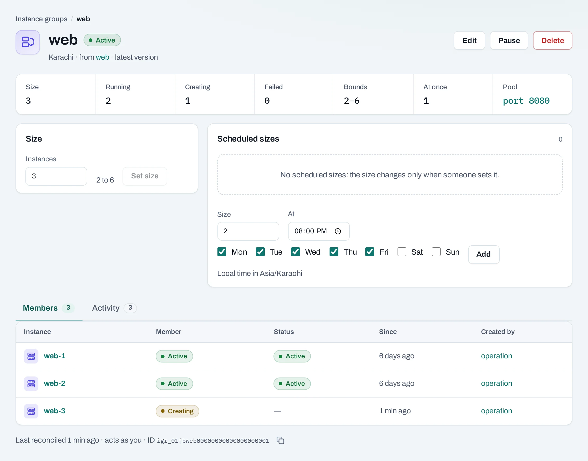
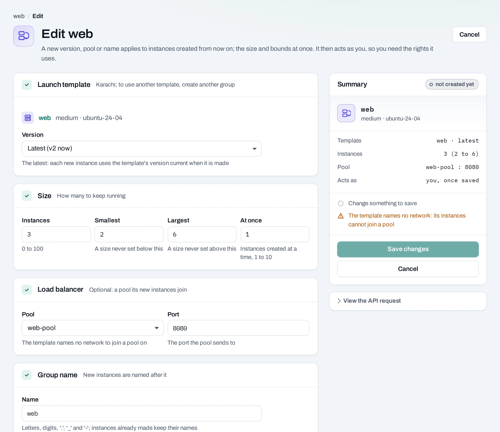

# Instance groups

An instance group keeps a desired number of instances running from a [launch template](launch-templates.md). Use it for replaceable application replicas. It can replace failed members, add or remove instances, and maintain membership in a load balancer pool.

<div class="docs-method-picker" hidden role="group" aria-label="Instruction method">
<span>Show instructions for</span>
<div><button type="button" data-interface-choice="Console" aria-pressed="true">Console</button><button type="button" data-interface-choice="API" aria-pressed="false">API</button></div>
</div>

<div class="docs-method-note" markdown>

[Set up API authentication and variables](../api/index.md#before-you-start). Replace example IDs and catalog choices. Reuse an idempotency key for retries of one request; use a new key for each new action.

</div>

This is count-based scaling with manual and scheduled changes. CPU-triggered or request-triggered autoscaling is not offered here.




## Create a group

=== "Console"

    1. Prepare a launch template with a working image, network, access and application setup.
    2. Open **Compute → Instance groups → Create instance group**.
    3. Choose a name, template and version. Pin a version for predictable new members, or use the latest version at each launch.
    4. Set the desired count, minimum and maximum. Set the creation concurrency, shown as surge, to control how many new members may be created at once.
    5. Optionally choose a load balancer pool in the same location and the application's backend port.
    6. Create the group. Its saved definition appears immediately; the instances are then created through operations.

    

=== "API"

    <span id="with-the-api" data-docs-method="API"></span>

    ```bash
    curl --fail-with-body -i -X POST "$NUBESTACK_API/v1/orgs/$ORG/projects/$PROJECT/instance-groups" \
      -H "Authorization: Bearer $NUBESTACK_API_KEY" \
      -H "Idempotency-Key: $REQUEST_KEY" \
      -H "Content-Type: application/json" \
      --data '{
      "name": "web",
      "template_id": "ltp_example",
      "template_version": 1,
      "desired": 2,
      "min": 1,
      "max": 4,
      "max_surge": 1
    }'
    ```

    Returns `201` directly. Read the returned resource or current state to verify the change.

    [Request fields and responses](../api/reference/instance-groups.md).


## Size, replacement and editing

=== "Console"

    Open the group to see members, recent activity, its template and scheduled sizes. Change **Size** to the count you need, within its bounds. Scaling down deletes members, so store persistent application data separately and design instances to be replaceable.

    

    Use **Edit** to change the name, template version, bounds, surge and optional pool. The location remains fixed. A version change affects future creations and replacements; it does not roll out a rebuild of every existing member.

    The group replaces instances it identifies as failed. It does not prove application-level health or repair a broken application configuration. [Load balancer health checks](../networking/load-balancers.md) decide whether a backend receives traffic.

    

=== "API"

    ```bash
    curl --fail-with-body -i -X PATCH "$NUBESTACK_API/v1/orgs/$ORG/projects/$PROJECT/instance-groups/$INSTANCE_GROUP_ID" \
      -H "Authorization: Bearer $NUBESTACK_API_KEY" \
      -H "Idempotency-Key: $REQUEST_KEY" \
      -H "If-Match: $ETAG" \
      -H "Content-Type: application/json" \
      --data '{
      "desired": 3
    }'
    ```

    Returns `200` directly. Read the returned resource or current state to verify the change.

    [Request fields and responses](../api/reference/instance-groups.md).


## Pause and scheduled sizes

=== "Console"

    **Pause** stops the group acting to reach its desired count. It leaves existing instances running. **Resume** allows it to reconcile the count again. Manual deletion of a member while the group is active can cause a replacement.

    In **Scheduled sizes**, set counts for particular days and local times. These are [size schedules](../storage/schedules.md). Review the time zone and the next run, and keep scheduled counts inside the group's bounds.

=== "API"

    **Pause an instance group**

    ```bash
    curl --fail-with-body -i -X POST "$NUBESTACK_API/v1/orgs/$ORG/projects/$PROJECT/instance-groups/$INSTANCE_GROUP_ID:pause" \
      -H "Authorization: Bearer $NUBESTACK_API_KEY" \
      -H "Idempotency-Key: $REQUEST_KEY" \
      -H "If-Match: $ETAG"
    ```

    Returns `200` directly. Read the returned resource or current state to verify the change.

    [Request fields and responses](../api/reference/instance-groups.md).

    **Resume an instance group**

    ```bash
    curl --fail-with-body -i -X POST "$NUBESTACK_API/v1/orgs/$ORG/projects/$PROJECT/instance-groups/$INSTANCE_GROUP_ID:resume" \
      -H "Authorization: Bearer $NUBESTACK_API_KEY" \
      -H "Idempotency-Key: $REQUEST_KEY" \
      -H "If-Match: $ETAG"
    ```

    Returns `200` directly. Read the returned resource or current state to verify the change.

    [Request fields and responses](../api/reference/instance-groups.md).

    ```bash
    curl --fail-with-body -i -X POST "$NUBESTACK_API/v1/orgs/$ORG/projects/$PROJECT/schedules" \
      -H "Authorization: Bearer $NUBESTACK_API_KEY" \
      -H "Idempotency-Key: $REQUEST_KEY" \
      -H "Content-Type: application/json" \
      --data '{
      "kind": "resize",
      "name": "morning-size",
      "target_type": "instance_group",
      "target_ids": [
        "igr_example"
      ],
      "time_zone": "Asia/Karachi",
      "desired": 3,
      "recurrence": {
        "frequency": "daily",
        "time": "08:00"
      }
    }'
    ```

    Returns `201` directly. Read the returned resource or current state to verify the change.

    [Request fields and responses](../api/reference/schedules.md).

## Delete and limits

=== "Console"

    The delete confirmation offers whether to keep or delete existing instances. Read that choice carefully: keeping them stops group management but leaves resource usage. Pool membership and size schedules also need review during cleanup. The API allows desired counts up to 100, subject to configured bounds, quota and available capacity. This group manages one location; use a separate design for another location.

=== "API"

    ```bash
    curl --fail-with-body -i -X DELETE "$NUBESTACK_API/v1/orgs/$ORG/projects/$PROJECT/instance-groups/$INSTANCE_GROUP_ID" \
      -H "Authorization: Bearer $NUBESTACK_API_KEY" \
      -H "Idempotency-Key: $REQUEST_KEY" \
      -H "If-Match: $ETAG"
    ```

    Returns `200` directly. Read the returned resource or current state to verify the change.

    [Request fields and responses](../api/reference/instance-groups.md).

    For group deletion, the `instances` query parameter defaults to `keep`. Use `instances=delete` only when you intend to delete the member instances too.
