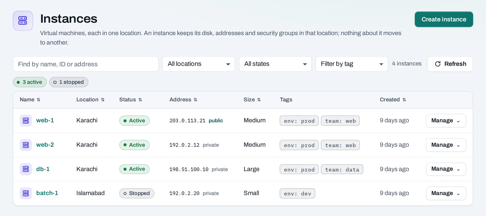
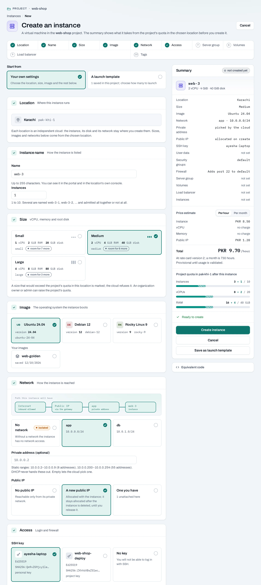
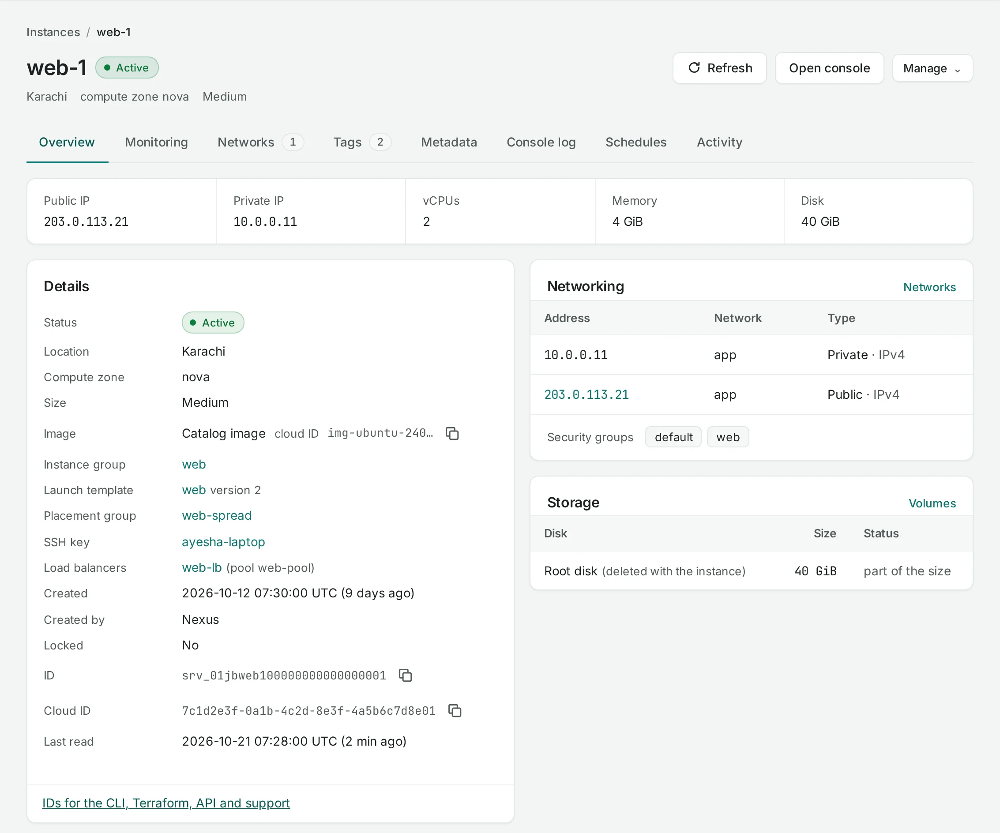
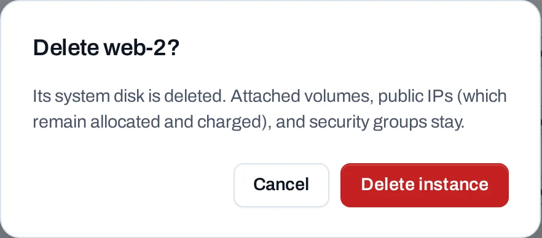

# Instances

An **instance** is a virtual machine in one of your project's locations. It keeps its disk, its
addresses and its security groups in that location; nothing about it moves to another.

**Use it for** anything you would run on a server: web and application servers, databases,
build agents, batch jobs. To start several alike, use a [launch template](launch-templates.md);
to keep a number of them running, an [instance group](instance-groups.md).

Find instances in a project under **Compute → Instances**.



## Before you start

- A role of project admin or project member. Project readers, and organization owners, admins
  and viewers, can see instances but not create them.
- A [network](../networking/networks.md) in the location. The project's first network is made
  for you when the project is created.
- An [SSH key](ssh-keys.md), to log in to a Linux instance.
- For a public IP, an [Internet gateway](../networking/internet-gateways.md) in the location.

## Create an instance

=== "Console"

    Choose **Create instance**. The summary on the right says what will be made and what the
    project's quota in that location will be afterwards.

    

    1. **Start from**: your own settings, or [a launch template](launch-templates.md).
    2. **Location**: where the instance runs. Sizes, images and networks below come from it.
    3. **Instance name**: up to 255 characters. It is also the name in the location's own
       tools, and you can rename it later. **Instances**, beside it, starts one to ten at once,
       named `name-1`, `name-2` and so on.
    4. **Size**: vCPUs, memory and root disk, from the sizes the location offers. A size that
       would go over the project's quota is marked. Change it later with
       [Resize](manage-instances.md#resize).
    5. **Image**: the operating system it starts from. The location's images come first; your
       own [images](images.md) follow under **Your images**.
    6. **Network**:
        - One of the project's networks in that location. Without a network, the instance has
          no network access at all.
        - **Private address (optional)**: leave it empty and the location picks one. A fixed
          address must come from a range the network keeps for static addresses; with DHCP off
          on the network, you must give one.
        - **Public IP**: **No public IP**, **A new public IP** (allocated with the instance, and
          kept after it is deleted until you release it), or **One you have** (an unattached
          [public IP](../networking/public-ips.md) of the project).
    7. **Access**:
        - **SSH key**: the [key](ssh-keys.md) copied into the instance. With **No key** you
          cannot log in with SSH.
        - **Firewall**: the location's `default` [security group](../networking/security-groups.md)
          is chosen to start with. **Allow SSH (port 22) from anywhere** and **Allow web traffic
          (ports 80 and 443) from anywhere** add the rules none of the chosen groups has yet, to
          the first group chosen. The page says which group gets which rule.
        - **User data (cloud-init)**: a script or cloud-init document run at the first start,
          up to 49,149 bytes. It is not kept or shown again.
    8. **Server group** (optional): a [server group](server-groups.md), to keep the instance on
       a different host from the group's others, or on the same one. It cannot change later.
    9. **Volumes** (optional): up to 8 data disks, existing available volumes or new empty
       ones, attached in the order listed once the instance runs.
    10. **Load balancer** (optional): a pool of one of the project's
        [load balancers](../networking/load-balancers.md) in this location, and the port the
        instance serves on.
    11. Choose **Create instance**. **Save as launch template** keeps these settings for later.

    The page shows **Instance requested**. The instance appears as **Creating**, then **Active**.

=== "API"

    ```bash
    curl -sS -X POST "$NUBESTACK_API/v1/orgs/$ORG/projects/$PROJECT/servers" \
      -H "Authorization: Bearer $NUBESTACK_API_KEY" \
      -H "Idempotency-Key: $(uuidgen)" \
      -H "Content-Type: application/json" \
      -d '{
        "location": "loc_01jbkhi",
        "display_name": "web-3",
        "offering": "medium",
        "image": "ubuntu-24-04",
        "network_id": "net_01jbapp",
        "ssh_key_id": "ssh_01jbayesha",
        "security_group_ids": ["sgr_01jbweb"],
        "public_ip": true,
        "volumes": [{"new": {"display_name": "web-3-data", "size_gb": 20}}],
        "tags": {"env": "prod", "team": "web"}
      }'
    ```

    `offering` and `image` are `slug`s from `GET /v1/orgs/$ORG/catalog?location=…`. Other
    fields: `fixed_ip`, `public_ip_id` (one you have), `security_group_templates` (`ssh`,
    `web`), `user_data` (plain text), `server_group_id` and `load_balancer`
    (`{pool_id, port}`).

    The answer is `202 Accepted` with the operation and the new instance's `id`. To start
    several at once, use `POST …/instance-launches`; see
    [Launch templates](launch-templates.md).

If a volume or the load balancer pool cannot be joined, the instance is kept and the operation
says **partially succeeded**. Attach the volume or add the member afterwards.

## Find an instance

=== "Console"

    The list shows each instance's location, status, address, size and tags. Type in **Find by
    name, ID or address**, or filter by location, state or tag. Instances made with a location's
    own tools are listed too.

    Open an instance for its page: **Overview**, **Networks**, **Tags**, **Metadata**,
    **Console log**, **Schedules** and **Activity**.

    

=== "API"

    ```bash
    curl -sS "$NUBESTACK_API/v1/orgs/$ORG/projects/$PROJECT/servers?location=pak-khi-1&tag=env:prod" \
      -H "Authorization: Bearer $NUBESTACK_API_KEY"
    ```

    Read one with `GET …/servers/{server_id}`, and what it is connected to with
    `GET …/servers/{server_id}/related`. Lists are paged; see [Requests](../api/requests.md).

## How instances connect

| Connected to | How |
|---|---|
| [Networks](../networking/networks.md) | One at creation; more with **Attach network** |
| [Security groups](../networking/security-groups.md) | Chosen at creation; changed with **Manage → Security groups** |
| [Public IPs](../networking/public-ips.md) | At creation, or **Manage → Add public IP** |
| [Volumes](../storage/volumes.md) | At creation, or **Manage → Attach volume** |
| [Load balancers](../networking/load-balancers.md) | At creation, or from the load balancer's **Change members** |
| [Schedules](../storage/schedules.md) | From the instance's **Schedules** tab |

## Delete an instance

=== "Console"

    Choose **Manage → Delete** and confirm. Read the dialog: it names any volume the location is
    set to delete with the instance.

    

=== "API"

    ```bash
    curl -sS -X DELETE "$NUBESTACK_API/v1/orgs/$ORG/projects/$PROJECT/servers/srv_01jbweb3" \
      -H "Authorization: Bearer $NUBESTACK_API_KEY" \
      -H "Idempotency-Key: $(uuidgen)"
    ```

What goes with it and what stays:

- **Goes:** its system disk, its addresses on its networks, and volumes the location is set to
  delete with it.
- **Stays:** attached volumes otherwise, public IPs (still allocated and counted until you
  release them), and security groups.
- If it joined a load balancer pool when it was created, it is taken out of the pool first.
  Members you added on the load balancer are not touched.

**What blocks a delete**

| Refusal | Why | Resolve |
|---|---|---|
| The instance is locked | **Lock** stops every change | **Manage → Unlock**, then delete |
| A change is still running | The instance is creating, resizing or similar | Wait for its operation to finish |

## Limits and good practice

- Up to 8 data volumes at creation, 10 security groups and 1 to 10 instances per request.
- User data up to 49,149 bytes. Keep secrets out of it where you can.
- Not offered: starting an instance from a volume, or moving one to another location. Save it as
  an [image](images.md) and start a new one in the same location.
- Keep data on volumes, not the system disk, so you can replace an instance without losing it.
- Tag instances (`env`, `team`) to filter lists and break down [costs](../organization/statements-and-costs.md).

## Related

- [Manage an instance](manage-instances.md) · [Connect to an instance](connect-to-instances.md)
- [Launch templates](launch-templates.md) · [Instance groups](instance-groups.md)
- [API reference: Instances](../api/reference/instances.md)
