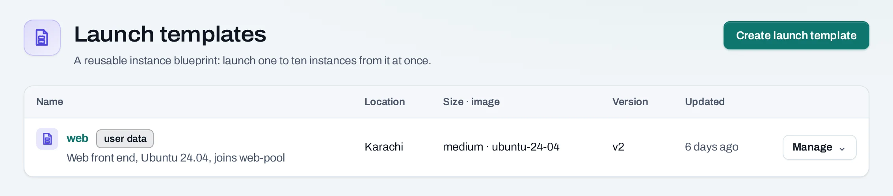
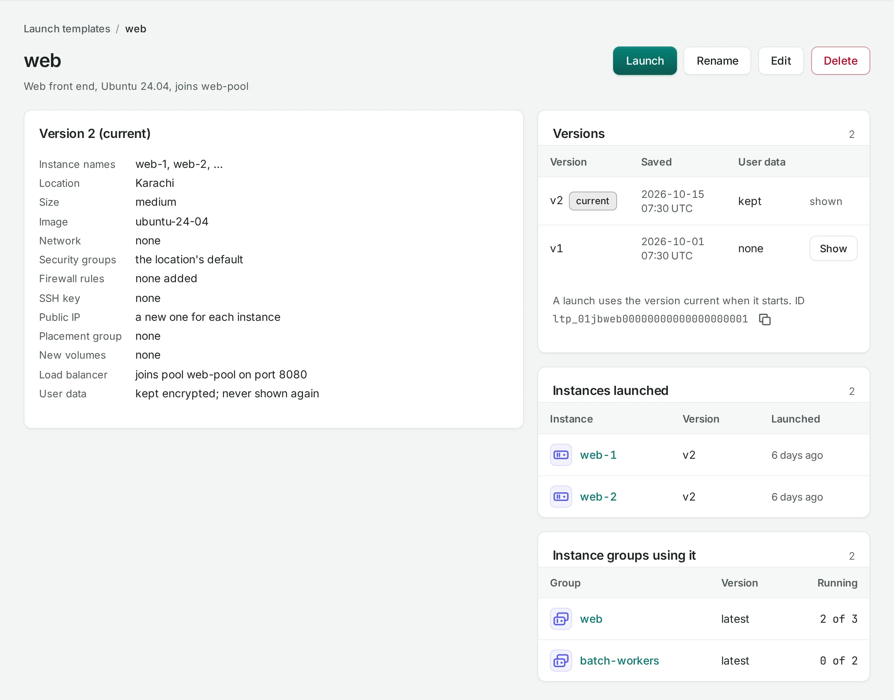

# Launch templates

A **launch template** keeps an instance's settings, so you can start one to ten instances like it
in one step: location, size, image, network, security groups and rules, SSH key, server group,
new data volumes, public IP, load balancer and user data.

**Use it for** instances you start often, and as the source of an
[instance group](instance-groups.md).

Find them under **Compute → Launch templates**.



## Save a template

=== "Console"

    1. Choose **Create launch template**.
    2. Give it a name, an optional description and the prefix its instances are named with.
    3. Choose the instance settings, as on the [instance create page](instances.md).
    4. Choose **Save launch template**. Nothing is created until you launch it.

    You can also fill in the instance create page and choose **Save as launch template** under
    the summary.

=== "API"

    `server` is what `POST …/servers` takes, without a fixed address, an existing public IP or
    existing volumes.

    ```bash
    curl -sS -X POST "$NUBESTACK_API/v1/orgs/$ORG/projects/$PROJECT/launch-templates" \
      -H "Authorization: Bearer $NUBESTACK_API_KEY" \
      -H "Idempotency-Key: $(uuidgen)" \
      -H "Content-Type: application/json" \
      -d '{
        "name": "web",
        "description": "Web front end, joins web-pool",
        "server": {
          "location": "loc_01jbkhi", "display_name": "web", "offering": "medium",
          "image": "ubuntu-24-04", "network_id": "net_01jbapp",
          "security_group_ids": ["sgr_01jbweb"], "ssh_key_id": "ssh_01jbayesha",
          "load_balancer": {"pool_id": "lbp_01jbwebpool", "port": 8080}
        }
      }'
    ```

    The answer is `201 Created`.

A template keeps nothing only one instance can use. Each instance launched from it gets a new
public IP and new volumes, if the template asks for them.

**User data** is kept with the template, encrypted, and never shown again. It is sent to each
instance you launch and deleted with the template. Keep secrets out of user data where you can;
fetch them at boot instead.



## Launch instances

=== "Console"

    Choose **Manage → Launch…** on the template, then how many instances (1 to 10). Or, on the
    instance create page, choose **Start from: A launch template**, pick the template and
    version, and say how many.

=== "API"

    ```bash
    curl -sS -X POST "$NUBESTACK_API/v1/orgs/$ORG/projects/$PROJECT/instance-launches" \
      -H "Authorization: Bearer $NUBESTACK_API_KEY" \
      -H "Idempotency-Key: $(uuidgen)" \
      -H "Content-Type: application/json" \
      -d '{"count": 3, "template": {"id": "ltp_01jbweb", "version": 2}}'
    ```

    The answer is `202 Accepted`. Follow the launch with
    `GET …/instance-launches/{launch_id}`: each instance's operation, and the launch's state.

How a launch works:

- Instances are named after the template: `web-1`, `web-2` and so on, using the next numbers no
  instance of the project has yet.
- They are admitted together or not at all. If the project's quota cannot take all of them,
  nothing is created and the page says which quota is short.
- Each is then created on its own. If one fails, the others carry on. A launch is
  **succeeded** when every instance succeeded, **failed** when none did, and **partially
  succeeded** otherwise.

## Change a template

Every save is a new **version**; **Versions** on the template's page lists them, and **Show**
opens an older one. A launch always uses the version current when it started. In the API,
`PATCH …/launch-templates/{id}` with `If-Match` renames the template or saves a new version.

A template can go out of date when a network or image it names is deleted. Launching it is then
refused, naming the setting; save a new version.

## Delete a template

=== "Console"

    Choose **Manage → Delete…** and confirm. Instances launched from it stay.

=== "API"

    ```bash
    curl -sS -X DELETE "$NUBESTACK_API/v1/orgs/$ORG/projects/$PROJECT/launch-templates/ltp_01jbweb" \
      -H "Authorization: Bearer $NUBESTACK_API_KEY" \
      -H "Idempotency-Key: $(uuidgen)" \
      -H 'If-Match: "3"'
    ```

**What blocks a delete**

| Refusal | Why | Resolve |
|---|---|---|
| `launch_template_in_use` | A launch has not yet created its instances, or an instance group uses the template | Wait for the launch to create its instances; delete the instance group that uses it |

## Limits and good practice

- Up to 50 templates per project. Names are unique in the project, ignoring case.
- Test a new version with a one-instance launch before an instance group uses it.

## Related

- [Instances](instances.md) · [Instance groups](instance-groups.md)
- [API reference: Launch templates](../api/reference/launch-templates.md)
