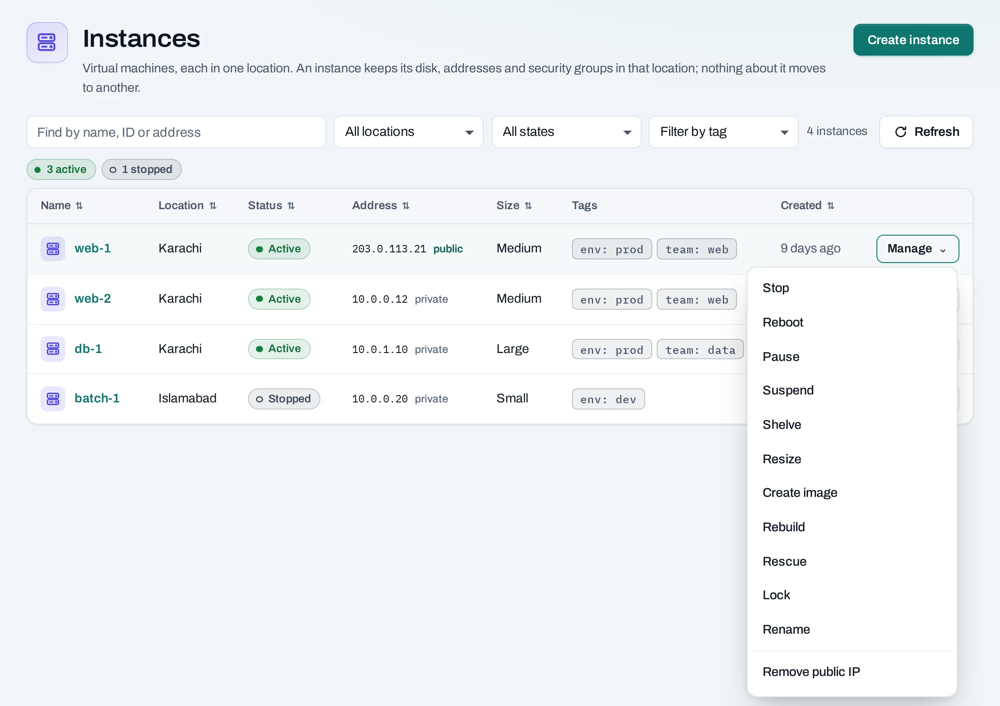
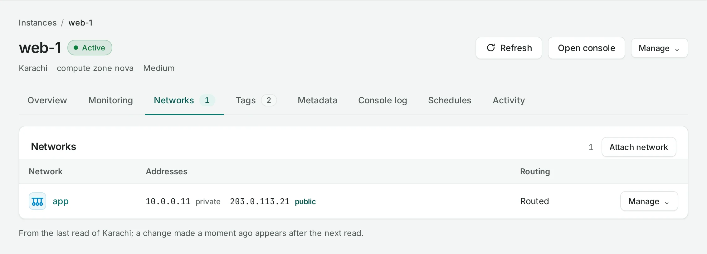
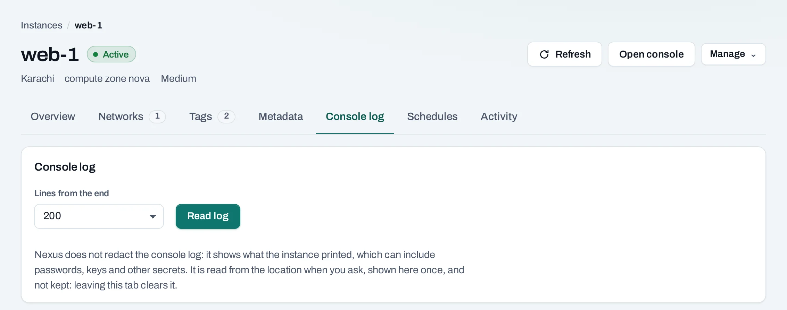
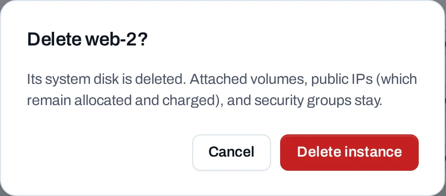

# Manage instances

Each instance has a **Manage** menu in its list and detail page. Choose the Console or API method beside the action you need. Actions depend on the current state; wait for an operation to finish before submitting a dependent change.

<div class="docs-method-picker" hidden role="group" aria-label="Instruction method">
<span>Show instructions for</span>
<div><button type="button" data-interface-choice="Console" aria-pressed="true">Console</button><button type="button" data-interface-choice="API" aria-pressed="false">API</button></div>
</div>

<div class="docs-method-note" markdown>

[Set up API authentication and variables](../api/index.md#before-you-start). Replace example IDs and catalog choices. Reuse an idempotency key for retries of one request; use a new key for each new action.

</div>




## What you can do in each state

| State | Available actions |
|---|---|
| Active | Stop, reboot, pause, suspend, shelve, resize, create image, rebuild, rescue and lock |
| Stopped | Start, shelve, resize, create image, rebuild, rescue and lock |
| Paused or suspended | Resume through the appropriate action |
| Shelved | Unshelve |
| Rescued | Unrescue |
| Error | Reboot, rebuild or rescue |
| Locked | Unlock before other changes |

A resource that is creating, resizing or rebuilding offers no new actions until it settles. A disallowed API action is refused with `server_state`.

<span id="what-each-action-does"></span>

## Start and stop an instance

=== "Console"

    Open **Compute → Instances**, choose **Manage → Stop** on an active instance and confirm. **Start** brings a stopped instance back. Its disks, addresses and settings remain while stopped. Instance allocation, disks and public IPs can continue counting in usage; see [usage and costs](../concepts/usage-and-costs.md).

=== "API"

    <span id="with-the-api" data-docs-method="API"></span>

    **Stop an instance**

    ```bash
    curl --fail-with-body -i -X POST "$NUBESTACK_API/v1/orgs/$ORG/projects/$PROJECT/servers/$SERVER_ID:stop" \
      -H "Authorization: Bearer $NUBESTACK_API_KEY" \
      -H "Idempotency-Key: $REQUEST_KEY" \
      -H "Content-Type: application/json" \
      --data '{}'
    ```

    A `202` accepts the change. Follow `operation.href` to its final result before the next dependent action.

    [Request fields and responses](../api/reference/instances.md).

    **Start an instance**

    ```bash
    curl --fail-with-body -i -X POST "$NUBESTACK_API/v1/orgs/$ORG/projects/$PROJECT/servers/$SERVER_ID:start" \
      -H "Authorization: Bearer $NUBESTACK_API_KEY" \
      -H "Idempotency-Key: $REQUEST_KEY" \
      -H "Content-Type: application/json" \
      --data '{}'
    ```

    A `202` accepts the change. Follow `operation.href` to its final result before the next dependent action.

    [Request fields and responses](../api/reference/instances.md).


## Reboot an instance

=== "Console"

    Choose **Manage → Reboot**. Running programs and network connections are interrupted. Check the guest and application after the operation succeeds; rebooting does not repair a broken application configuration.

=== "API"

    ```bash
    curl --fail-with-body -i -X POST "$NUBESTACK_API/v1/orgs/$ORG/projects/$PROJECT/servers/$SERVER_ID:reboot" \
      -H "Authorization: Bearer $NUBESTACK_API_KEY" \
      -H "Idempotency-Key: $REQUEST_KEY" \
      -H "Content-Type: application/json" \
      --data '{
      "type": "soft"
    }'
    ```

    A `202` accepts the change. Follow `operation.href` to its final result before the next dependent action.

    [Request fields and responses](../api/reference/instances.md).


## Pause, suspend and resume

=== "Console"

    **Pause** freezes an active instance in memory. **Suspend** saves its memory to disk and stops it. The menu offers **Resume** when appropriate. Follow the operation and check the resulting state before another action.

=== "API"

    **Pause an instance**

    ```bash
    curl --fail-with-body -i -X POST "$NUBESTACK_API/v1/orgs/$ORG/projects/$PROJECT/servers/$SERVER_ID:pause" \
      -H "Authorization: Bearer $NUBESTACK_API_KEY" \
      -H "Idempotency-Key: $REQUEST_KEY"
    ```

    A `202` accepts the change. Follow `operation.href` to its final result before the next dependent action.

    [Request fields and responses](../api/reference/instances.md).

    **Unpause an instance**

    ```bash
    curl --fail-with-body -i -X POST "$NUBESTACK_API/v1/orgs/$ORG/projects/$PROJECT/servers/$SERVER_ID:unpause" \
      -H "Authorization: Bearer $NUBESTACK_API_KEY" \
      -H "Idempotency-Key: $REQUEST_KEY"
    ```

    A `202` accepts the change. Follow `operation.href` to its final result before the next dependent action.

    [Request fields and responses](../api/reference/instances.md).

    **Suspend an instance**

    ```bash
    curl --fail-with-body -i -X POST "$NUBESTACK_API/v1/orgs/$ORG/projects/$PROJECT/servers/$SERVER_ID:suspend" \
      -H "Authorization: Bearer $NUBESTACK_API_KEY" \
      -H "Idempotency-Key: $REQUEST_KEY"
    ```

    A `202` accepts the change. Follow `operation.href` to its final result before the next dependent action.

    [Request fields and responses](../api/reference/instances.md).

    **Resume an instance**

    ```bash
    curl --fail-with-body -i -X POST "$NUBESTACK_API/v1/orgs/$ORG/projects/$PROJECT/servers/$SERVER_ID:resume" \
      -H "Authorization: Bearer $NUBESTACK_API_KEY" \
      -H "Idempotency-Key: $REQUEST_KEY"
    ```

    A `202` accepts the change. Follow `operation.href` to its final result before the next dependent action.

    [Request fields and responses](../api/reference/instances.md).


## Shelve and unshelve

=== "Console"

    **Shelve** shuts an instance down and gives up its place on the host. **Unshelve** starts it again and can take longer than Start. Its disks and allocated addresses remain; shelving is not deletion.

=== "API"

    **Shelve an instance**

    ```bash
    curl --fail-with-body -i -X POST "$NUBESTACK_API/v1/orgs/$ORG/projects/$PROJECT/servers/$SERVER_ID:shelve" \
      -H "Authorization: Bearer $NUBESTACK_API_KEY" \
      -H "Idempotency-Key: $REQUEST_KEY"
    ```

    A `202` accepts the change. Follow `operation.href` to its final result before the next dependent action.

    [Request fields and responses](../api/reference/instances.md).

    **Unshelve an instance**

    ```bash
    curl --fail-with-body -i -X POST "$NUBESTACK_API/v1/orgs/$ORG/projects/$PROJECT/servers/$SERVER_ID:unshelve" \
      -H "Authorization: Bearer $NUBESTACK_API_KEY" \
      -H "Idempotency-Key: $REQUEST_KEY"
    ```

    A `202` accepts the change. Follow `operation.href` to its final result before the next dependent action.

    [Request fields and responses](../api/reference/instances.md).


## Resize an instance

=== "Console"

    1. Open **Manage → Resize** on a settled active or stopped instance.
    2. Choose an offered size with a root disk at least as large as the existing one.
    3. Review quota and confirm. The instance restarts on the new size, returning to its prior running or stopped state.

    There is no trial period: to return to the previous size, resize again.

    

=== "API"

    ```bash
    curl --fail-with-body -i -X POST "$NUBESTACK_API/v1/orgs/$ORG/projects/$PROJECT/servers/$SERVER_ID:resize" \
      -H "Authorization: Bearer $NUBESTACK_API_KEY" \
      -H "Idempotency-Key: $REQUEST_KEY" \
      -H "Content-Type: application/json" \
      --data '{
      "offering": "large"
    }'
    ```

    A `202` accepts the change. Follow `operation.href` to its final result before the next dependent action.

    [Request fields and responses](../api/reference/instances.md).


## Rebuild an instance

=== "Console"

    Choose **Manage → Rebuild** and the replacement image. This replaces the system disk and destroys data written to it. Addresses, separate volumes, security groups and the original SSH key remain. Save data you need before confirming, and verify the guest and application afterward.

=== "API"

    ```bash
    curl --fail-with-body -i -X POST "$NUBESTACK_API/v1/orgs/$ORG/projects/$PROJECT/servers/$SERVER_ID:rebuild" \
      -H "Authorization: Bearer $NUBESTACK_API_KEY" \
      -H "Idempotency-Key: $REQUEST_KEY" \
      -H "Content-Type: application/json" \
      --data '{
      "image": "ubuntu-24-04"
    }'
    ```

    A `202` accepts the change. Follow `operation.href` to its final result before the next dependent action.

    [Request fields and responses](../api/reference/instances.md).


## Rescue and unrescue

=== "Console"

    Choose **Manage → Rescue** to boot a repair environment with the instance's own disk available as an extra disk. Repair the filesystem or configuration, then choose **Unrescue** to boot the original disk again. Rescue interrupts the running application.

=== "API"

    **Rescue an instance**

    ```bash
    curl --fail-with-body -i -X POST "$NUBESTACK_API/v1/orgs/$ORG/projects/$PROJECT/servers/$SERVER_ID:rescue" \
      -H "Authorization: Bearer $NUBESTACK_API_KEY" \
      -H "Idempotency-Key: $REQUEST_KEY"
    ```

    A `202` accepts the change. Follow `operation.href` to its final result before the next dependent action.

    [Request fields and responses](../api/reference/instances.md).

    **End a rescue**

    ```bash
    curl --fail-with-body -i -X POST "$NUBESTACK_API/v1/orgs/$ORG/projects/$PROJECT/servers/$SERVER_ID:unrescue" \
      -H "Authorization: Bearer $NUBESTACK_API_KEY" \
      -H "Idempotency-Key: $REQUEST_KEY"
    ```

    A `202` accepts the change. Follow `operation.href` to its final result before the next dependent action.

    [Request fields and responses](../api/reference/instances.md).


## Lock and unlock

=== "Console"

    Choose **Manage → Lock** to prevent changes and deletion until it is unlocked. Use **Unlock** before another lifecycle change. Lock is a management guard, not a backup or application-security control.

=== "API"

    **Lock an instance**

    ```bash
    curl --fail-with-body -i -X POST "$NUBESTACK_API/v1/orgs/$ORG/projects/$PROJECT/servers/$SERVER_ID:lock" \
      -H "Authorization: Bearer $NUBESTACK_API_KEY" \
      -H "Idempotency-Key: $REQUEST_KEY"
    ```

    A `202` accepts the change. Follow `operation.href` to its final result before the next dependent action.

    [Request fields and responses](../api/reference/instances.md).

    **Unlock an instance**

    ```bash
    curl --fail-with-body -i -X POST "$NUBESTACK_API/v1/orgs/$ORG/projects/$PROJECT/servers/$SERVER_ID:unlock" \
      -H "Authorization: Bearer $NUBESTACK_API_KEY" \
      -H "Idempotency-Key: $REQUEST_KEY"
    ```

    A `202` accepts the change. Follow `operation.href` to its final result before the next dependent action.

    [Request fields and responses](../api/reference/instances.md).


## Save the system disk as an image

=== "Console"

    Choose **Manage → Create image**, name the image and follow its operation. Quiesce application writes first when consistency matters. The image contains the system disk, not attached data volumes or running memory. Verify it by launching a test instance; see [Images](images.md).

=== "API"

    ```bash
    curl --fail-with-body -i -X POST "$NUBESTACK_API/v1/orgs/$ORG/projects/$PROJECT/servers/$SERVER_ID:create-image" \
      -H "Authorization: Bearer $NUBESTACK_API_KEY" \
      -H "Idempotency-Key: $REQUEST_KEY" \
      -H "Content-Type: application/json" \
      --data '{
      "display_name": "web-base"
    }'
    ```

    A `202` accepts the change. Follow `operation.href` to its final result before the next dependent action.

    [Request fields and responses](../api/reference/instances.md).


## Attach and detach volumes

=== "Console"

    Choose **Manage → Attach volume** and an available data disk in the same project and location. Format and mount a new empty disk inside the guest; do not format a restored data disk. Before **Detach volume**, stop writes and unmount the filesystem. Separate volumes remain after instance deletion. [Use persistent storage](../tutorials/persistent-storage.md) covers guest-side steps.

=== "API"

    **Attach a volume**

    ```bash
    curl --fail-with-body -i -X POST "$NUBESTACK_API/v1/orgs/$ORG/projects/$PROJECT/servers/$SERVER_ID:attach-volume" \
      -H "Authorization: Bearer $NUBESTACK_API_KEY" \
      -H "Idempotency-Key: $REQUEST_KEY" \
      -H "Content-Type: application/json" \
      --data '{
      "volume_id": "vol_example"
    }'
    ```

    A `202` accepts the change. Follow `operation.href` to its final result before the next dependent action.

    [Request fields and responses](../api/reference/instances.md).

    **Detach a volume**

    ```bash
    curl --fail-with-body -i -X POST "$NUBESTACK_API/v1/orgs/$ORG/projects/$PROJECT/servers/$SERVER_ID:detach-volume" \
      -H "Authorization: Bearer $NUBESTACK_API_KEY" \
      -H "Idempotency-Key: $REQUEST_KEY" \
      -H "Content-Type: application/json" \
      --data '{
      "volume_id": "vol_example"
    }'
    ```

    A `202` accepts the change. Follow `operation.href` to its final result before the next dependent action.

    [Request fields and responses](../api/reference/instances.md).


## Networks

=== "Console"

    On **Networks**, choose **Attach network** to add an interface on a network in the same location. Bring the interface up inside the guest if its operating system does not do so automatically. **Detach network** removes its address immediately and can interrupt your connection.

    

    For a VPN or router guest, see [forwarding](../networking/routing.md#let-an-instance-forward-traffic).

=== "API"

    **Attach an instance to a network**

    ```bash
    curl --fail-with-body -i -X POST "$NUBESTACK_API/v1/orgs/$ORG/projects/$PROJECT/servers/$SERVER_ID:attach-interface" \
      -H "Authorization: Bearer $NUBESTACK_API_KEY" \
      -H "Idempotency-Key: $REQUEST_KEY" \
      -H "Content-Type: application/json" \
      --data '{
      "network_id": "net_example"
    }'
    ```

    A `202` accepts the change. Follow `operation.href` to its final result before the next dependent action.

    [Request fields and responses](../api/reference/instances.md).

    **Detach an instance from a network**

    ```bash
    curl --fail-with-body -i -X POST "$NUBESTACK_API/v1/orgs/$ORG/projects/$PROJECT/servers/$SERVER_ID:detach-interface" \
      -H "Authorization: Bearer $NUBESTACK_API_KEY" \
      -H "Idempotency-Key: $REQUEST_KEY" \
      -H "Content-Type: application/json" \
      --data '{
      "network_id": "net_example"
    }'
    ```

    A `202` accepts the change. Follow `operation.href` to its final result before the next dependent action.

    [Request fields and responses](../api/reference/instances.md).


## Change security groups

=== "Console"

    Use **Manage → Security groups** and select the complete intended set. Rules from attached groups are additive. Check shared groups before changing them, and keep a rule allowing your administrative connection if you still need it.

=== "API"

    ```bash
    curl --fail-with-body -i -X POST "$NUBESTACK_API/v1/orgs/$ORG/projects/$PROJECT/servers/$SERVER_ID:set-security-groups" \
      -H "Authorization: Bearer $NUBESTACK_API_KEY" \
      -H "Idempotency-Key: $REQUEST_KEY" \
      -H "Content-Type: application/json" \
      --data '{
      "security_group_ids": [
        "sgr_example"
      ]
    }'
    ```

    A `202` accepts the change. Follow `operation.href` to its final result before the next dependent action.

    [Request fields and responses](../api/reference/instances.md).


## Add or remove a public IP

=== "Console"

    Use **Manage → Add public IP** to allocate an address or select an available allocation in the location. **Remove public IP** detaches it. The address stays allocated until you release it under **Public IPs**. A routed network and Internet gateway are needed for the Internet path.

=== "API"

    **Allocate a public IP**

    ```bash
    curl --fail-with-body -i -X POST "$NUBESTACK_API/v1/orgs/$ORG/projects/$PROJECT/floating-ips" \
      -H "Authorization: Bearer $NUBESTACK_API_KEY" \
      -H "Idempotency-Key: $REQUEST_KEY" \
      -H "Content-Type: application/json" \
      --data '{
      "location": "loc_example",
      "tags": {
        "env": "prod",
        "team": "web"
      }
    }'
    ```

    A `202` accepts the change. Follow `operation.href` to its final result before the next dependent action.

    [Request fields and responses](../api/reference/public-ips.md).

    **Attach a public IP**

    ```bash
    curl --fail-with-body -i -X POST "$NUBESTACK_API/v1/orgs/$ORG/projects/$PROJECT/floating-ips/$ADDRESS_ID:associate" \
      -H "Authorization: Bearer $NUBESTACK_API_KEY" \
      -H "Idempotency-Key: $REQUEST_KEY" \
      -H "Content-Type: application/json" \
      --data '{
      "server_id": "srv_example"
    }'
    ```

    A `202` accepts the change. Follow `operation.href` to its final result before the next dependent action.

    [Request fields and responses](../api/reference/public-ips.md).

    **Detach a public IP**

    ```bash
    curl --fail-with-body -i -X POST "$NUBESTACK_API/v1/orgs/$ORG/projects/$PROJECT/floating-ips/$ADDRESS_ID:disassociate" \
      -H "Authorization: Bearer $NUBESTACK_API_KEY" \
      -H "Idempotency-Key: $REQUEST_KEY" \
      -H "Content-Type: application/json" \
      --data '{}'
    ```

    A `202` accepts the change. Follow `operation.href` to its final result before the next dependent action.

    [Request fields and responses](../api/reference/public-ips.md).


## Metadata

=== "Console"

    On **Metadata**, choose **Change metadata** to set or remove keys. A key is 1–64 letters, digits, `-` or `_`; a value is at most 255 characters. Keys beginning `nexus` are reserved. Existing metadata can also be inspected with the location's native tools.

=== "API"

    ```bash
    curl --fail-with-body -i -X POST "$NUBESTACK_API/v1/orgs/$ORG/projects/$PROJECT/servers/$SERVER_ID:set-metadata" \
      -H "Authorization: Bearer $NUBESTACK_API_KEY" \
      -H "Idempotency-Key: $REQUEST_KEY" \
      -H "Content-Type: application/json" \
      --data '{
      "metadata": {
        "environment": "production",
        "obsolete_key": null
      }
    }'
    ```

    A `202` accepts the change. Follow `operation.href` to its final result before the next dependent action.

    [Request fields and responses](../api/reference/instances.md).


## Open the instance's console

=== "Console"

    Choose **Open console** on the instance page, wait for the request, then follow **Open console ↗**. It opens the instance's screen and keyboard in another browser tab. Project members and admins can use it while the instance is active or rescued.

    The link is a short-lived, one-time credential. Do not share it. The browser console closes after ten minutes; use **Reconnect** for another session. **Console in Horizon** is a separate link to the native dashboard.

=== "API"

    ```http
    POST /v1/orgs/{org_id}/projects/{project_id}/servers/$SERVER_ID:request-console
    ```

    Generate an EC P-256 key pair locally. Send its public JWK with `protocol: "novnc"`. Keep the private key locally; after the operation succeeds, collect the encrypted result through the returned console request and decrypt it. The one-time console URL is a credential.

    A `202` accepts the change. Follow `operation.href` to its final result before the next dependent action.

    [Request fields and responses](../api/reference/instances.md).


## Read the console log

=== "Console"

    Open **Console log**, choose 50–2,000 trailing lines and select **Read log**. Copy or download the result if needed; leaving the tab clears it. The displayed log is limited to 100 KB and can include secrets printed by the guest.

    

=== "API"

    ```http
    POST /v1/orgs/{org_id}/projects/{project_id}/servers/$SERVER_ID:request-console-output
    ```

    Generate an EC P-256 key pair locally. Send its public JWK with `lines` (for example 200). After the operation succeeds, collect the encrypted log through the console request and decrypt it locally. Logs may contain secrets.

    A `202` accepts the change. Follow `operation.href` to its final result before the next dependent action.

    [Request fields and responses](../api/reference/instances.md).


## Rename an instance

=== "Console"

    Use **Manage → Rename** and save the new display name. This changes its cloud display name; review guest and application names separately.

=== "API"

    ```bash
    curl --fail-with-body -i -X PATCH "$NUBESTACK_API/v1/orgs/$ORG/projects/$PROJECT/servers/$RESOURCE_ID" \
      -H "Authorization: Bearer $NUBESTACK_API_KEY" \
      -H "Idempotency-Key: $REQUEST_KEY" \
      -H "Content-Type: application/json" \
      --data '{
      "display_name": "web-1-renamed"
    }'
    ```

    A `202` accepts the change. Follow `operation.href` to its final result before the next dependent action.

    [Request fields and responses](../api/reference/instances.md).


## Delete an instance

=== "Console"

    Choose **Manage → Delete** and read what the confirmation will remove and retain. The system disk is deleted. Separate data volumes, allocated public IPs and security groups remain unless the dialog explicitly says otherwise.

    

    An active [instance group](instance-groups.md) can replace a deleted member; lower its desired count or stop group management first. Remove manually configured load balancer members and release unwanted public IPs separately.

=== "API"

    ```bash
    curl --fail-with-body -i -X DELETE "$NUBESTACK_API/v1/orgs/$ORG/projects/$PROJECT/servers/$SERVER_ID" \
      -H "Authorization: Bearer $NUBESTACK_API_KEY" \
      -H "Idempotency-Key: $REQUEST_KEY"
    ```

    A `202` accepts the change. Follow `operation.href` to its final result before the next dependent action.

    [Request fields and responses](../api/reference/instances.md).
