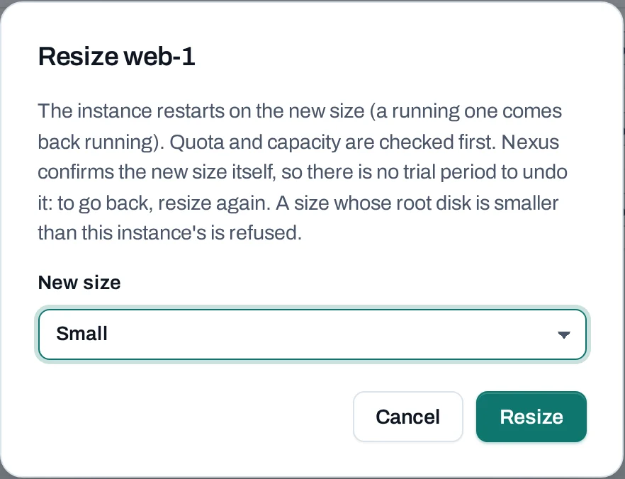

# Manage an instance

Every instance has a **Manage** menu, in the list and on its page. It offers only what the
instance's state allows. Each action is an [operation](../concepts/operations.md): the console
accepts it at once and the location carries it out.


## Before you start

You need a role of project admin or project member. A locked instance offers only **Unlock**.

## What each state allows

| State | Actions |
|---|---|
| Active | Stop, Reboot, Pause, Suspend, Shelve, Resize, Create image, Rebuild, Rescue, Lock |
| Stopped | Start, Shelve, Resize, Create image, Rebuild, Rescue, Lock |
| Paused | Resume |
| Suspended | Resume |
| Shelved | Unshelve |
| Rescued | Unrescue |
| Error | Reboot, Rebuild, Rescue |
| Locked | Unlock, and nothing else |

**Rename** and **Delete** are always offered, except while the instance is changing.

## What each action does

| Action | Effect | API |
|---|---|---|
| **Stop** / **Start** | Shuts it down and starts it again. Disks, addresses, settings and its place on its host stay. | `:stop`, `:start` |
| **Reboot** | Restarts it. Programs are interrupted and connections drop. | `:reboot` (`type`: `soft` or `hard`) |
| **Pause** / **Resume** | Freezes it in memory; nothing runs until you resume. | `:pause`, `:unpause` |
| **Suspend** / **Resume** | Saves its memory to disk and stops it. | `:suspend`, `:resume` |
| **Shelve** / **Unshelve** | Shuts it down and gives up its place on its host. Unshelving takes longer than a start. | `:shelve`, `:unshelve` |
| **Resize** | Moves it to another size; see below. | `:resize` |
| **Rebuild** | Replaces its system disk with a fresh copy of an image; see below. | `:rebuild` |
| **Rescue** / **Unrescue** | Restarts it from a fresh copy of its image, with its own disk attached for repair. | `:rescue`, `:unrescue` |
| **Lock** / **Unlock** | Stops anyone changing or deleting it until it is unlocked. | `:lock`, `:unlock` |
| **Create image** | Saves its system disk as one of the project's [images](images.md). | `:create-image` |
| **Rename** | Changes its name, here and in the location's tools. | `PATCH` |

Every action is a `POST` to `…/servers/{server_id}:<action>` and answers `202 Accepted`:

```bash
curl -sS -X POST "$NUBESTACK_API/v1/orgs/$ORG/projects/$PROJECT/servers/srv_01jbweb1:stop" \
  -H "Authorization: Bearer $NUBESTACK_API_KEY" \
  -H "Idempotency-Key: $(uuidgen)" \
  -H "Content-Type: application/json" \
  -d '{}'
```

## Resize

Resize moves an instance to another size. It restarts on the new size and comes back as it was,
running or stopped.

=== "Console"

    1. Choose **Manage → Resize**.
    2. Pick the **New size** from the sizes the location offers.
    3. Choose **Resize** and follow the operation.

    

=== "API"

    ```bash
    curl -sS -X POST "$NUBESTACK_API/v1/orgs/$ORG/projects/$PROJECT/servers/srv_01jbweb1:resize" \
      -H "Authorization: Bearer $NUBESTACK_API_KEY" \
      -H "Idempotency-Key: $(uuidgen)" \
      -H "Content-Type: application/json" \
      -d '{"offering": "large"}'
    ```

Quota and capacity are checked first. A size with a smaller root disk is refused. There is no
trial period: to go back, resize again.

## Rebuild

Rebuild replaces the system disk with a fresh copy of an image you choose. **Everything written
to that disk is lost.** Its addresses, volumes, security groups and SSH key stay.

=== "Console"

    Choose **Manage → Rebuild**, pick the **Image** and choose **Rebuild instance**.

=== "API"

    ```bash
    curl -sS -X POST "$NUBESTACK_API/v1/orgs/$ORG/projects/$PROJECT/servers/srv_01jbweb1:rebuild" \
      -H "Authorization: Bearer $NUBESTACK_API_KEY" \
      -H "Idempotency-Key: $(uuidgen)" \
      -H "Content-Type: application/json" \
      -d '{"image": "ubuntu-24-04"}'
    ```

## Rescue a broken instance

When an instance no longer starts, **Rescue** starts it from a fresh copy of its image, with its
own disk attached as an extra disk. Log in, mount the disk, fix it, then choose **Unrescue** to
start from its own disk again. The [console log](connect-to-instances.md#read-the-console-log)
often shows why it would not start.

## Tags and metadata

- **Tags** tab: `key: value` labels for filtering lists and grouping costs. See
  [Tags](../concepts/tags.md).
- **Metadata** tab: choose **Change metadata** to set or remove keys the instance reads from
  inside. A key is 1 to 64 letters, digits, `-` or `_`; a value at most 255 characters. Keys
  starting with `nexus` are reserved. The console cannot list the keys an instance already has;
  the location's own tools show them.

## Good practice

- **Stop** keeps an instance's place on its host and starts quickly. **Shelve** frees the place;
  use it for an instance you will not need for a while.
- A stopped instance still counts for its disks and public IPs. See
  [Usage and costs](../concepts/usage-and-costs.md).
- **Lock** production instances so nobody stops or deletes them by mistake.
- To stop and start instances on a timetable, use a [power schedule](../storage/schedules.md).

## Related

- [Instances](instances.md) · [Connect to an instance](connect-to-instances.md)
- [Operations](../concepts/operations.md)
- [API reference: Instances](../api/reference/instances.md)
