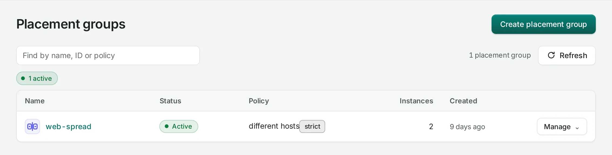
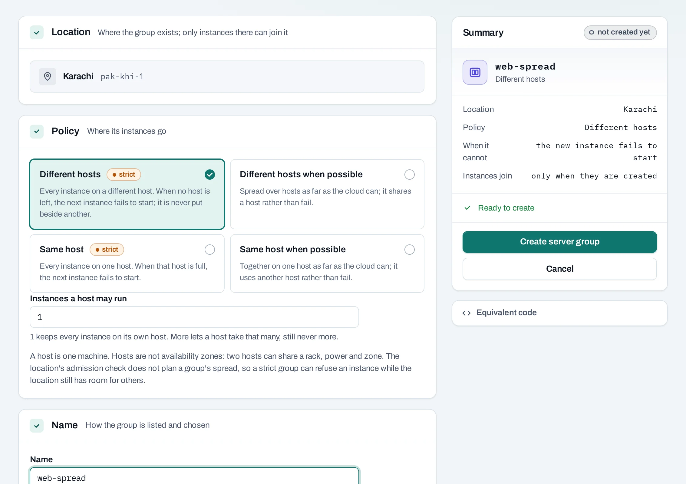

# Server groups

A server group controls whether instances run on the same physical host or on different hosts in one location. Use a group to spread application replicas or keep a tightly coupled workload together. A server group does not keep a desired number of instances running; use an [instance group](/compute/instance-groups.md) for that.

<div class="docs-method-picker" hidden role="group" aria-label="Instruction method">
<span>Show instructions for</span>
<div><button type="button" data-interface-choice="Console" aria-pressed="true">Console</button><button type="button" data-interface-choice="API" aria-pressed="false">API</button></div>
</div>

<div class="docs-method-note" markdown>

[Set up API authentication and variables](/api/overview.md#before-you-start). Replace example IDs and catalog choices. Reuse an idempotency key for retries of one request; use a new key for each new action.

</div>




## Create a server group

=== "Console"

    1. Open **Compute → Server groups → Create server group**.
    2. Choose a location and name, such as `web-spread`.
    3. Select a policy.
    4. For strict anti-affinity, optionally set the maximum instances allowed per host.
    5. Create the group and follow the operation.

    

    | Policy | Behavior |
    |---|---|
    | Anti-affinity | Use different hosts; a launch fails if the rule cannot be met |
    | Affinity | Use the same host; a launch fails if the rule cannot be met |
    | Soft anti-affinity | Prefer different hosts, allowing a launch when that is unavailable |
    | Soft affinity | Prefer the same host, allowing a launch when that is unavailable |

    These policies refer to hosts within a location. They do not create separate availability zones or put instances in another location.

=== "API"

    <span id="with-the-api" data-docs-method="API"></span>

    ```bash
    curl --fail-with-body -i -X POST "$NUBESTACK_API/v1/orgs/$ORG/projects/$PROJECT/server-groups" \
      -H "Authorization: Bearer $NUBESTACK_API_KEY" \
      -H "Idempotency-Key: $REQUEST_KEY" \
      -H "Content-Type: application/json" \
      --data '{
      "location": "loc_example",
      "display_name": "web-spread",
      "policy": "anti-affinity"
    }'
    ```

    A `202` accepts the change. Follow `operation.href` to its final result before the next dependent action.

    [Request fields and responses](/api/reference/server-groups.md#post-server-group).


## Launch instances in the group

=== "Console"

    Choose **Create an instance in it** from the group's menu, or select the group in the **Server group** section of **Create instance**. The location must match. An instance joins at creation; it cannot join, leave or switch server groups later.

    The group's row shows its members. Open an instance to see its group link. The group's name and policy are fixed; create another group to change the arrangement.

=== "API"

    ```bash
    curl --fail-with-body -i -X POST "$NUBESTACK_API/v1/orgs/$ORG/projects/$PROJECT/servers" \
      -H "Authorization: Bearer $NUBESTACK_API_KEY" \
      -H "Idempotency-Key: $REQUEST_KEY" \
      -H "Content-Type: application/json" \
      --data '{
      "location": "loc_example",
      "display_name": "web-1",
      "offering": "medium",
      "image": "ubuntu-24-04",
      "network_id": "net_example",
      "ssh_key_id": "ssh_example",
      "server_group_id": "sgp_example"
    }'
    ```

    A `202` accepts the change. Follow `operation.href` to its final result before the next dependent action.

    [Request fields and responses](/api/reference/instances.md#post-server).

## Delete and limits

=== "Console"

    A group with members cannot be deleted. Delete the member instances or replace them with instances outside this group first. The confirmation names remaining members.

    Strict spreading needs enough hosts and capacity. A capacity refusal may require fewer instances, a softer policy or a support request; retrying the same strict request does not create capacity. The API's anti-affinity maximum per host is 1–10, defaulting to one.

=== "API"

    ```bash
    curl --fail-with-body -i -X DELETE "$NUBESTACK_API/v1/orgs/$ORG/projects/$PROJECT/server-groups/$SERVER_GROUP_ID" \
      -H "Authorization: Bearer $NUBESTACK_API_KEY" \
      -H "Idempotency-Key: $REQUEST_KEY"
    ```

    A `202` accepts the change. Follow `operation.href` to its final result before the next dependent action.

    [Request fields and responses](/api/reference/server-groups.md#delete-server-group).
