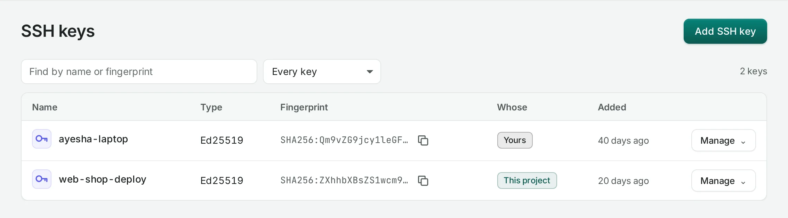
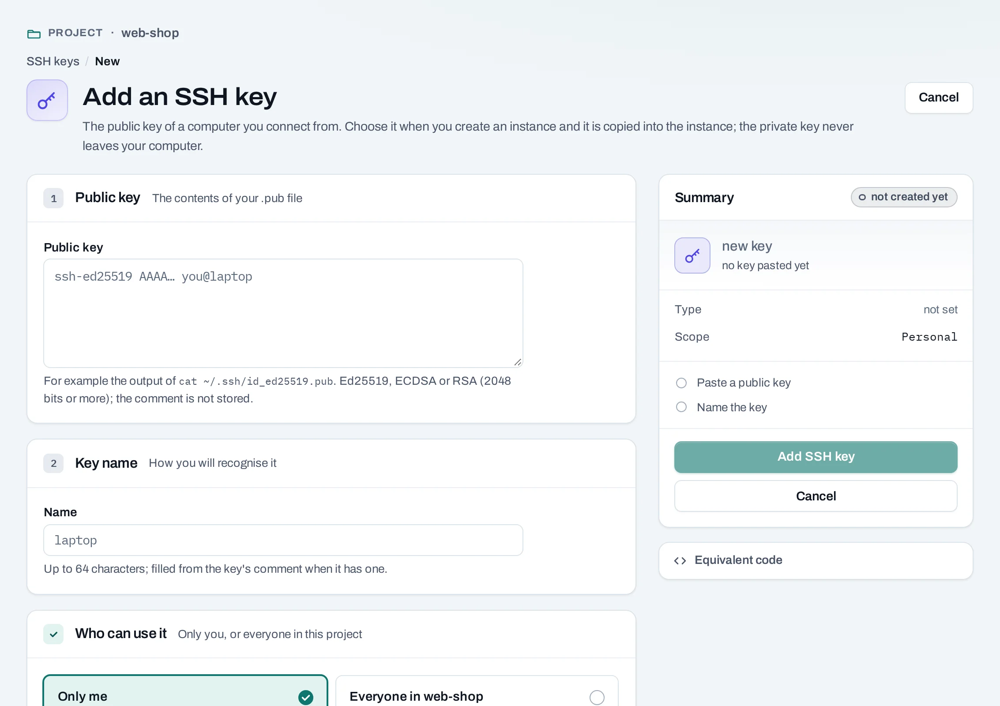

# SSH keys

Add the public key of the computer you connect from, then choose it when you create an
instance. It is copied into the instance, and you log in with SSH without a password. The private
key never leaves your computer; NubeStack Cloud never makes one for you.

Find them in a project under **Compute → SSH keys**. Keys are kept once for the organization, so a
personal key you add is offered in every project you work in. In the organization scope, owners
and admins see every person's and every project's keys there; keys are added from a project.



## Before you start

You need a key pair on your computer. No key yet? Make one:

```bash
ssh-keygen -t ed25519
cat ~/.ssh/id_ed25519.pub
```

Ed25519, ECDSA and RSA keys of 2048 bits or more work, including security-key (`sk-`) keys.

## Add a key

=== "Console"

    1. Choose **Add SSH key**.
    2. **Public key**: paste the whole line, starting `ssh-ed25519`, `ecdsa-sha2-…` or
       `ssh-rsa`. A private key is refused; if you pasted one, make a new key pair.
    3. **Name**: up to 64 characters, filled from the key's comment when it has one.
    4. **Who can use it**:
        - **Only me**: a personal key, offered to you in every project of the organization.
        - **Everyone in** the project: offered to every member of this project. Only a project
          admin can share a key with the project.
    5. Choose **Add SSH key**.

    

=== "API"

    ```bash
    curl -sS -X POST "$NUBESTACK_API/v1/orgs/$ORG/ssh-keys" \
      -H "Authorization: Bearer $NUBESTACK_API_KEY" \
      -H "Idempotency-Key: $(uuidgen)" \
      -H "Content-Type: application/json" \
      -d "{\"display_name\": \"ci-runner\", \"project_id\": \"$PROJECT\", \"public_key\": \"$(cat ~/.ssh/id_ed25519.pub)\"}"
    ```

    The answer is `201 Created`. With `project_id`, the key is shared with that project;
    without it, the key belongs to the caller.

The public key and its fingerprint are stored; its comment is not.

## Use a key

Choose the key under **Access → SSH key** when you [create an instance](instances.md). Log in
as the image's default user:

```bash
ssh ubuntu@203.0.113.21
```

A key is copied into an instance only when the instance is created. To change the keys of a
running instance, edit `~/.ssh/authorized_keys` inside it. **Rebuild** keeps the key the
instance was created with.

## Remove a key

=== "Console"

    Choose **Manage → Delete** on the key. Instances already started with it keep it.

=== "API"

    ```bash
    curl -sS -X DELETE "$NUBESTACK_API/v1/orgs/$ORG/ssh-keys/ssh_01jbci" \
      -H "Authorization: Bearer $NUBESTACK_API_KEY" \
      -H "Idempotency-Key: $(uuidgen)"
    ```

    The answer is `200 OK`; nothing runs in a location.

Nothing blocks removing a key. You can remove your own personal keys. Project admins, and
organization owners and admins, can remove any key in the project, which is why other members'
keys are listed. When someone leaves the organization, their personal keys are deleted.

## Good practice

- Use one key per computer, so you can remove one without locking yourself out everywhere.
- Never paste or send a private key. If one leaks, make a new pair and remove the old key.
- Share a project key for a team's shared access instead of copying personal keys around.

## Related

- [Instances](instances.md) · [Connect to an instance](connect-to-instances.md)
- [API reference: SSH keys](../api/reference/ssh-keys.md)
