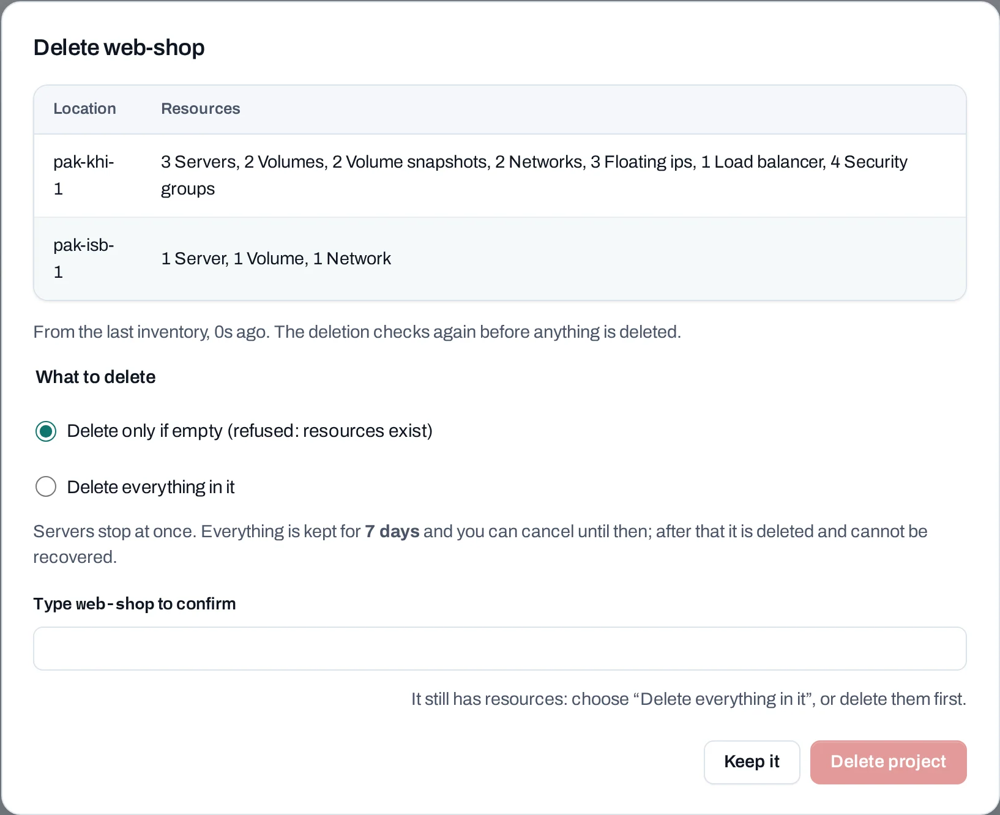

# Deletion and retention

Deleting one resource is final after its operation succeeds; acceptance is not immediate completion. Deleting a whole project, or closing the
organization, has a **recovery window** during which you can change your mind.

<div class="docs-method-picker" hidden role="group" aria-label="Instruction method">
<span>Show instructions for</span>
<div><button type="button" data-interface-choice="Console" aria-pressed="true">Console</button><button type="button" data-interface-choice="API" aria-pressed="false">API</button></div>
</div>

<div class="docs-method-note" markdown>

[Set up API authentication and variables](/api/overview.md#before-you-start). Replace example IDs and catalog choices. Reuse an idempotency key for retries of one request; use a new key for each new action.

</div>


## Deleting a resource

An instance, a volume, a snapshot, a network or any other resource is deleted when its operation
finishes, and cannot be recovered. Before you confirm, each dialog says what goes with it and what
stays. The rules worth knowing:

| You delete | What goes with it | What stays |
|---|---|---|
| An instance | Its system disk, its addresses on its networks | Attached volumes, public IPs (still allocated), security groups |
| A volume | Its data | Nothing; delete its snapshots first |
| A snapshot | The copy | Volumes already made from it |
| A load balancer | Its listeners, pools and health checks | The instances behind it; a public IP on it, detached but still allocated |
| A network | Its range and its routing attachment | Other networks, private routing |
| An instance group | Nothing, by default: its instances become ordinary instances | You can choose to delete its instances with it |
| A schedule | Nothing | The snapshots it made |
| A launch template | Its versions and its kept user data | Instances launched from it |
| A certificate | The uploaded certificate and key | Nothing |

### What blocks a delete

Some deletes are refused until something else is gone. The refusal names what is in the way and
links to it:

- a **volume** that is attached, or has snapshots;
- a **snapshot** while a volume is being made from it;
- a **network** while instances, load balancers or anything else still have addresses on it;
- a **security group** while an instance or load balancer uses it;
- a **server group** with instances in it;
- an **Internet gateway** while a public IP in that location is attached;
- a **certificate** while a listener serves it;
- a **launch template** while an instance group uses it, or a launch from it is still creating its
  instances;
- a **pool** that a listener still sends traffic to, or that still has members or a health check.

## Delete a project

=== "Console"

    Project admins, owners and admins delete projects, from the project's **Settings**, tab
    **Danger zone**, or from **Manage → Delete project** on the **Projects** list.

    

    1. Choose **Delete project**. The dialog lists what the project holds in each location.
    2. **What to delete**:
       - **Delete only if empty**: refused while anything is left. Delete things yourself first.
       - **Delete everything in it**: instances, load balancers, public IPs, routers, networks and
         security groups are deleted within minutes. Volumes, snapshots and images are kept for the
         recovery window.
    3. Type the project's name and choose **Delete project**.

    The dialog shows the recovery window, normally **7 days**. Until it ends:

    - the project is suspended: its instances are stopped and nothing new can be made in it;
    - **Cancel deletion** stops the deletion. The project stays suspended until a project admin
      chooses **Resume project**; then start its instances again. If you deleted everything, only the
      volumes, snapshots and images come back: networks, public IPs and instances have to be made
      again;
    - **Delete now** ends the window early. Everything left is deleted within minutes and cannot be
      recovered. You may be asked for your second factor.

    When the window ends, everything left is deleted in every location and the project is gone. The
    project's page shows each location's progress. Once the deletion has started, it cannot be
    cancelled. The project's schedules pause when its deletion is requested, and its launch templates,
    schedules and instance groups go with it.

    If something stops the deletion, such as a resource that cannot be deleted or a location that
    cannot be checked, the page says what and why. Stacks and Kubernetes clusters made with a
    location's own tools must be deleted with those tools. Delete what the page names, and the deletion
    carries on by itself.

    **Removing a location** from a project works the same way, for that location only.

    Activity and usage records of a deleted project are kept.

=== "API"

    <span id="with-the-api" data-docs-method="API"></span>

    **Delete a project**

    ```bash
    curl --fail-with-body -i -X DELETE "$NUBESTACK_API/v1/orgs/$ORG/projects/$PROJECT" \
      -H "Authorization: Bearer $NUBESTACK_API_KEY" \
      -H "Idempotency-Key: $REQUEST_KEY" \
      -H "Content-Type: application/json" \
      --data '{
      "cascade": false
    }'
    ```

    A `202` accepts the change. Follow `operation.href` to its final result before the next dependent action.

    [Request fields and responses](/api/reference/projects.md#delete-project).

    **Cancel a project's deletion**

    ```bash
    curl --fail-with-body -i -X POST "$NUBESTACK_API/v1/orgs/$ORG/projects/$PROJECT:cancel-deletion" \
      -H "Authorization: Bearer $NUBESTACK_API_KEY" \
      -H "Idempotency-Key: $REQUEST_KEY"
    ```

    A `202` accepts the change. Follow `operation.href` to its final result before the next dependent action.

    [Request fields and responses](/api/reference/projects.md#cancel-project).

    **End a deletion's retention early**

    ```bash
    curl --fail-with-body -i -X POST "$NUBESTACK_API/v1/orgs/$ORG/projects/$PROJECT:delete-now" \
      -H "Authorization: Bearer $NUBESTACK_API_KEY" \
      -H "Idempotency-Key: $REQUEST_KEY" \
      -H "Content-Type: application/json" \
      --data '{
      "confirm": "web-shop"
    }'
    ```

    Returns `200` directly. Read the returned resource or current state to verify the change.

    [Request fields and responses](/api/reference/projects.md#delete-now).

    **Resume a project**

    ```bash
    curl --fail-with-body -i -X POST "$NUBESTACK_API/v1/orgs/$ORG/projects/$PROJECT:resume" \
      -H "Authorization: Bearer $NUBESTACK_API_KEY" \
      -H "Idempotency-Key: $REQUEST_KEY"
    ```

    A `202` accepts the change. Follow `operation.href` to its final result before the next dependent action.

    [Request fields and responses](/api/reference/projects.md#resume-project).


## Close the organization

=== "Console"

    Owners only, from **Settings**, tab **Danger zone**, **Close organization**. The dialog lists every
    project it will delete and asks you to type the organization's name.

    | When | What happens |
    |---|---|
    | Right away | Every instance stops and pending invitations are revoked. Nothing can be changed; owners can still read everything |
    | During the recovery window | Everything is kept. **Cancel closure** on the same tab brings it back. The window is normally **30 days**; the page shows the date |
    | When the window ends | Every project is deleted in every location, and every member is removed. This cannot be undone |
    | Afterwards | The audit log and usage records are kept for the period the page shows |

    While the organization is closing, an owner can download a copy of its records: see
    [Organization settings](/organization/settings.md#take-a-copy-of-your-data).

=== "API"

    **Close the organization**

    ```bash
    curl --fail-with-body -i -X POST "$NUBESTACK_API/v1/orgs/$ORG:close" \
      -H "Authorization: Bearer $NUBESTACK_API_KEY" \
      -H "Idempotency-Key: $REQUEST_KEY" \
      -H "Content-Type: application/json" \
      --data '{}'
    ```

    A `202` accepts the change. Follow `operation.href` to its final result before the next dependent action.

    [Request fields and responses](/api/reference/organizations.md#close-org).

    **Cancel the organization's closure**

    ```bash
    curl --fail-with-body -i -X POST "$NUBESTACK_API/v1/orgs/$ORG:cancel-closure" \
      -H "Authorization: Bearer $NUBESTACK_API_KEY" \
      -H "Idempotency-Key: $REQUEST_KEY"
    ```

    A `202` accepts the change. Follow `operation.href` to its final result before the next dependent action.

    [Request fields and responses](/api/reference/organizations.md#cancel-org-closure).


## People leaving

- **Removing a member** ends their access at once, deletes their personal SSH keys and signs them
  out of every location within 15 minutes. What they made stays.
- **Deleting a service account** stops its API keys at once, ends its project access and deletes
  its cloud credentials in every location.
