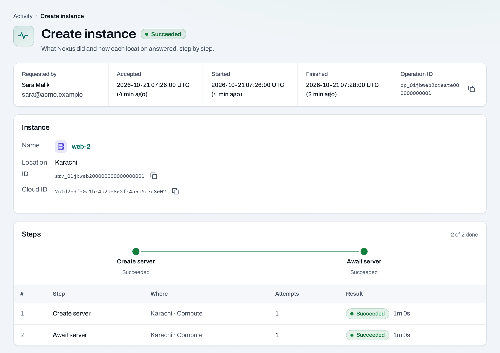
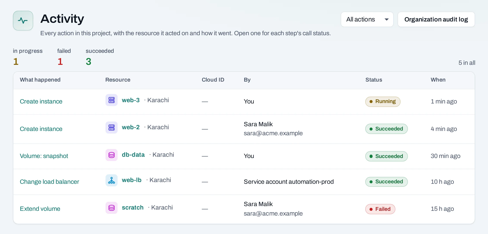

# Operations

When you create, change or delete something that lives in a location, such as an instance, a
network or a volume, NubeStack Cloud does not keep you waiting while the location does the work.
It records the request, answers at once, and carries the work out in the background. That record is
an **operation**.

<div class="docs-method-picker" hidden role="group" aria-label="Instruction method">
<span>Show instructions for</span>
<div><button type="button" data-interface-choice="Console" aria-pressed="true">Console</button><button type="button" data-interface-choice="API" aria-pressed="false">API</button></div>
</div>

<div class="docs-method-note" markdown>

[Set up API authentication and variables](/api/overview.md#before-you-start). Replace example IDs and catalog choices. Reuse an idempotency key for retries of one request; use a new key for each new action.

</div>

Some saved definitions return immediately without an operation, such as an invitation, SSH key,
quota preset, schedule or instance group's settings. Changes to roles and quota can return an
operation when native access or a location must be updated. Follow the status and body returned
for the particular change.

<figure class="docs-diagram">
<div>
<!-- diagram: operation-lifecycle -->
</div>
<figcaption>Follow the accepted operation through to a final result before relying on the resource.</figcaption>
</figure>


## Follow an operation

After you make a change, the page says what was requested, for example **Instance requested**,
with a link to follow the operation. The operation page shows:

- **Requested by**: you, a colleague, a service account, or NubeStack Cloud itself (a schedule or
  an instance group acting for the person who set it up).
- **Accepted**, **Started** and **Finished**: when the request was taken, begun and ended.
- Each **step**, with the location it ran in and how that location answered.



Every operation of a project is under **Activity**, at the bottom of the project's left panel, and
each resource has an **Activity** tab with its own. The organization's
[audit log](/organization/activity.md) has every change, refusal and security event.



## What each state means

| State | What it means | What to do |
|---|---|---|
| Queued | Accepted and waiting its turn | Nothing; it starts on its own |
| Running | A location is doing the work | Wait; the page updates on its own |
| Succeeded | Done | Nothing |
| Partially succeeded | Some steps finished, others did not | Read the failed step; what finished stays |
| Failed | The work did not finish | Read the failed step, fix the cause, make the change again |
| Cancelling, Cancelled | Someone stopped it | Make the change again if you still want it |

A failed step says why in plain words, for example that the project's quota in that location is
used up, or that the location is not taking new work right now. A finished operation is never
retried by itself: to try again, make the same change again. That is a new operation.

## Why a change can fail after it was accepted

Before accepting a request, NubeStack Cloud checks what it can: your role, the names and values you
gave, and the quota it last saw. The location has the final word. It can still refuse because:

- the quota was used up by something made at the same time, or with the location's own tools;
- the location has no room for that size right now;
- the location is in maintenance or cannot be reached;
- the resource changed in the meantime, for example someone stopped the instance you wanted to
  resize.

Work that a location cannot start in time, normally 15 minutes, fails rather than running late,
so a change never lands long after you stopped expecting it.

## Cancel an operation

=== "Console"

    A project admin, or the person who asked, can cancel an operation that has not started: open it
    and choose **Cancel operation**. Steps already done stay done. Nothing is rolled back.

=== "API"

    <span id="with-the-api" data-docs-method="API"></span>

    ```bash
    curl --fail-with-body -i -X POST "$NUBESTACK_API/v1/orgs/$ORG/operations/$OPERATION_ID:cancel" \
      -H "Authorization: Bearer $NUBESTACK_API_KEY" \
      -H "Idempotency-Key: $REQUEST_KEY"
    ```

    Returns `200` directly. Read the returned resource or current state to verify the change.

    [Request fields and responses](/api/reference/operations.md#cancel-operation).


## What a failed create leaves behind

=== "Console"

    Something that failed to create stays in its list, marked failed, so you can see what happened.
    The project's **Overview** gathers them under **Failed to create**. Choose **Remove** beside one to
    clear it from the list. Anything made before the failure, such as a new public IP, stays until you
    delete it, and the operation lists it.

=== "API"

    ```bash
    curl --fail-with-body -i -X POST "$NUBESTACK_API/v1/orgs/$ORG/projects/$PROJECT/$COLLECTION/$ITEM_ID:dismiss" \
      -H "Authorization: Bearer $NUBESTACK_API_KEY" \
      -H "Idempotency-Key: $REQUEST_KEY"
    ```

    Returns `200` directly. Read the returned resource or current state to verify the change.

    [Request fields and responses](/api/reference/resources-all-types.md#dismiss-failed).


## Why a list can be out of date

=== "Console"

    Lists show what each location last reported, and say when that was (**Last read**). A location that
    has not answered for a while is marked stale; its rows stay, with the time they are from.

    Choose **Refresh** above a list, or **Refresh** on a resource's page, to read it again from its
    location now. Anything made with the location's own tools appears after the next regular read, or
    at once after a refresh.

    Through the API, see [Operations and polling](/api/operations.md).

=== "API"

    ```bash
    curl --fail-with-body -i -X POST "$NUBESTACK_API/v1/orgs/$ORG/projects/$PROJECT/$COLLECTION/$ITEM_ID:refresh" \
      -H "Authorization: Bearer $NUBESTACK_API_KEY" \
      -H "Idempotency-Key: $REQUEST_KEY"
    ```

    A `202` accepts the change. Follow `operation.href` to its final result before the next dependent action.

    [Request fields and responses](/api/reference/resources-all-types.md#refresh-item).
