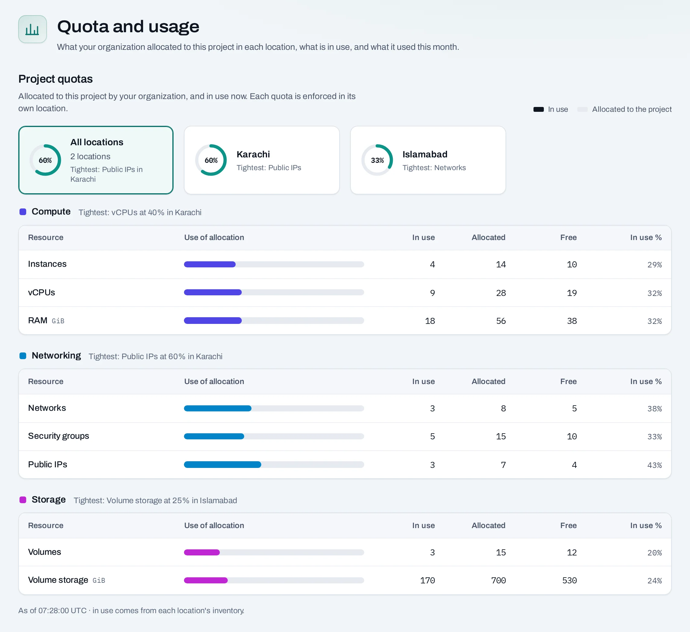

# Projects and quotas

A **project** groups what you run and who may use it. It runs in one
[location](locations.md), chosen when it is created, and has its own quota there. Every instance,
network and volume belongs to exactly one project.

## One location per project

A project's location never changes. Its networks, instances, volumes, public IPs, security groups
and quota are all in that location, so a project's pages never ask you to choose one.

To run in Karachi and Islamabad, make a project in each, for example `web-shop` in Karachi and
`web-shop-dr` in Islamabad, and give the same people a role on both. Usage, costs and the audit
log cover the whole organization.

## Who can use a project

An organization role alone does not let anyone use a project's resources. People and service
accounts use a project through a **project role**: project admin, project member or project
reader, or a [custom role](../organization/custom-roles.md). The project's **IAM → People** lists
who holds which. See [Roles and permissions](roles-and-permissions.md).

## Quota

**Quota** is how much a project may hold: instances, vCPUs, memory, volumes, storage, networks,
public IPs and the rest. It is set in two layers:

1. **NubeStack sets the organization's budget** in each location.
2. **Owners and admins share that budget between the projects** in the location. A new project
   starts from a **quota preset**.

<figure class="ns-diagram">
--8<-- "quota-layers.svg"
<figcaption>Two layers, per location: the organization's budget from NubeStack, and each project's share of it.</figcaption>
</figure>

The location enforces the quota. A request over it is refused, even if the console's check let it
through, for example because something was made at the same moment with the location's own tools.

Everyone with a role on the project sees its quota, and what it used this month, under **Quota**
at the bottom of the menu. How owners and admins set it: [Quota](../organization/quota.md).

## Quota is not capacity

Quota says how much you may use. Whether a location has room right now is separate: a request
within quota can still fail when a location has no room for that size. The operation says so;
try another size, or try again later.

## Names

A project has a name (up to 200 characters) and a short name (lower-case letters, digits and
dashes) used in addresses and in the location's own tools. Neither can change after creation.

## Related

- [Create a project](../get-started/create-a-project.md) · [Projects](../organization/projects.md) · [Quota](../organization/quota.md)
