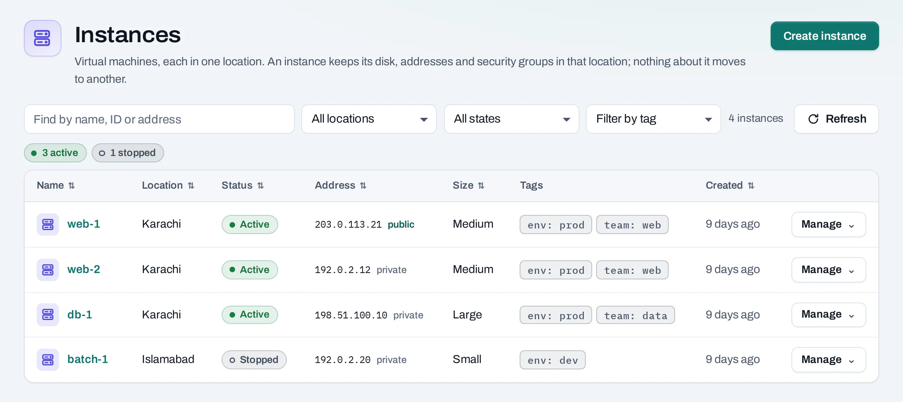
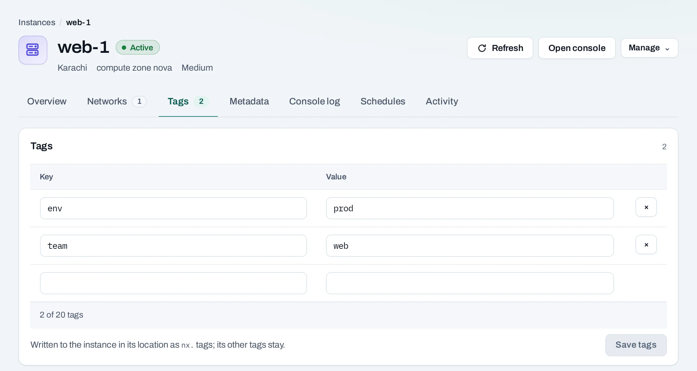

# Tags

A **tag** is a label `key: value` on an instance, a volume, a network or a public IP, such as
`env: prod` or `team: data`. Lists filter by tags, and the
[cost explorer](../organization/statements-and-costs.md#cost-explorer) adds up cost by each key.



## Set tags

=== "Console"

    - **When you create one:** the create pages of instances, volumes and networks, and allocating a
      public IP, have a **Tags** section. Leave a row empty to skip it.
    - **Later:** open the resource and choose its **Tags** tab. Change the rows and choose
      **Save tags**. The whole set is replaced: a row you remove is removed.

    

=== "API"
    **Set an instance's tags**

    ```bash
    curl -sS -X PUT "$NUBESTACK_API/v1/orgs/$ORG/projects/$PROJECT/servers/$RESOURCE_ID/tags" \
      -H "Authorization: Bearer $NUBESTACK_API_KEY" \
      -H "Idempotency-Key: $(uuidgen)" \
      -H "If-Match: $ETAG" \
      -H "Content-Type: application/json" \
      --data '{
      "tags": {
        "env": "prod"
      }
    }'
    ```

    The answer is `202 Accepted` with an operation. [Follow it](../api/operations.md) until it succeeds.

    **Set a volume's tags**

    ```bash
    curl -sS -X PUT "$NUBESTACK_API/v1/orgs/$ORG/projects/$PROJECT/volumes/$RESOURCE_ID/tags" \
      -H "Authorization: Bearer $NUBESTACK_API_KEY" \
      -H "Idempotency-Key: $(uuidgen)" \
      -H "If-Match: $ETAG" \
      -H "Content-Type: application/json" \
      --data '{
      "tags": {
        "env": "prod"
      }
    }'
    ```

    The answer is `202 Accepted` with an operation. [Follow it](../api/operations.md) until it succeeds.

    **Set a network's tags**

    ```bash
    curl -sS -X PUT "$NUBESTACK_API/v1/orgs/$ORG/projects/$PROJECT/networks/$RESOURCE_ID/tags" \
      -H "Authorization: Bearer $NUBESTACK_API_KEY" \
      -H "Idempotency-Key: $(uuidgen)" \
      -H "If-Match: $ETAG" \
      -H "Content-Type: application/json" \
      --data '{
      "tags": {
        "env": "prod"
      }
    }'
    ```

    The answer is `202 Accepted` with an operation. [Follow it](../api/operations.md) until it succeeds.

    **Set a public IP's tags**

    ```bash
    curl -sS -X PUT "$NUBESTACK_API/v1/orgs/$ORG/projects/$PROJECT/floating-ips/$RESOURCE_ID/tags" \
      -H "Authorization: Bearer $NUBESTACK_API_KEY" \
      -H "Idempotency-Key: $(uuidgen)" \
      -H "If-Match: $ETAG" \
      -H "Content-Type: application/json" \
      --data '{
      "tags": {
        "env": "prod"
      }
    }'
    ```

    The answer is `202 Accepted` with an operation. [Follow it](../api/operations.md) until it succeeds.

## The rules

| | |
|---|---|
| Key | 1 to 32 of `a-z`, `0-9`, `_`, `.`, `-`, starting with a letter |
| Value | up to 24 of `A-Z`, `a-z`, `0-9`, `_`, `.`, `:`, `-`; it may be empty |
| Tags on one resource | at most 20 |
| Keys in your organization | at most 50; a new key past that is refused (`tag_keys_limit`) |

## Filter lists

=== "Console"

    On the instances, volumes, networks and public IPs lists, choose a tag in **Filter by tag**. It
    becomes a chip; add more, and only resources with all of them stay. Remove a chip with its ×. The
    filter is in the page's address, so you can send the link to someone.

=== "API"

    Use the list endpoint's documented tag filters and keep filters unchanged while following pagination.
    ```bash
    curl -sS -X GET "$NUBESTACK_API/v1/orgs/$ORG/projects/$PROJECT/$COLLECTION" \
      -H "Authorization: Bearer $NUBESTACK_API_KEY"
    ```

    The answer is `200 OK`.

## In the location's own tools

Your tags are written to the resource in its location, so they show in the location's dashboard
and CLI. An instance, a network or a public IP gets the tag `nx.<key>=<value>`; a volume gets the
metadata key `nx.<key>`. Tags you set there yourself, without the `nx.` prefix, are yours and are
kept as they are.

If someone changes an `nx.` tag there, the resource's page says **Tags changed outside Nexus** and
shows what the location has. It is not changed back. Lists, filters and cost keep using the tags
held in NubeStack Cloud; set them again on the **Tags** tab to write them back.

## Cost by tag

In the cost explorer, choose **Tag** and pick a key. Each value of that key gets its share of the
month's cost, and the hours of resources without the key are one **Untagged** row, so the rows add
up to the month's total. A resource with two keys is counted once under each key, never twice under
one.

A change of tags counts from the moment you save it: the hour it happened in is split, part at the
old tags and part at the new.

Tags are labels only. They never decide which project owns a resource or what is deleted.
