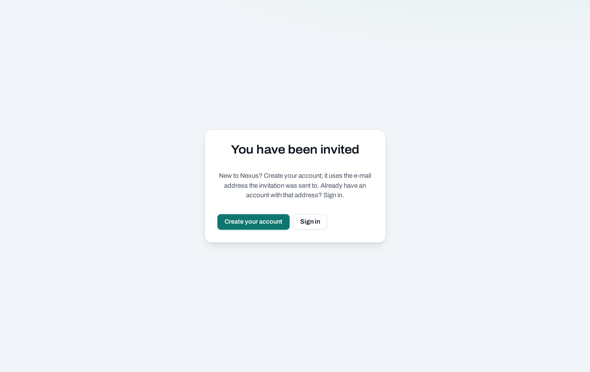
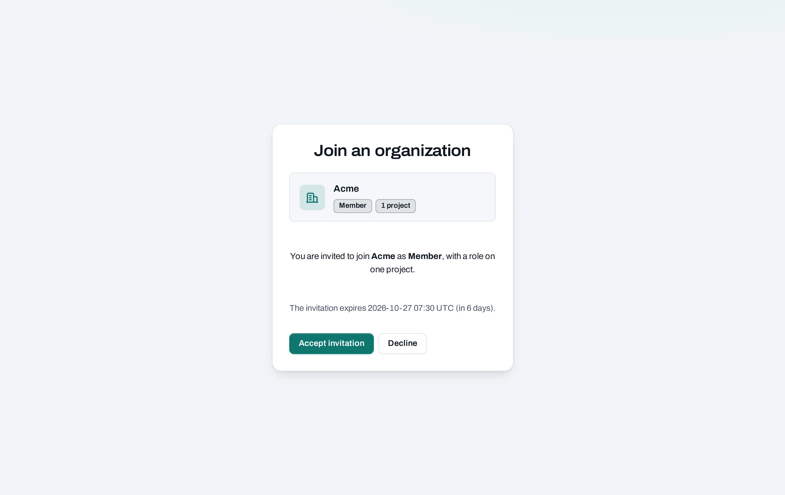
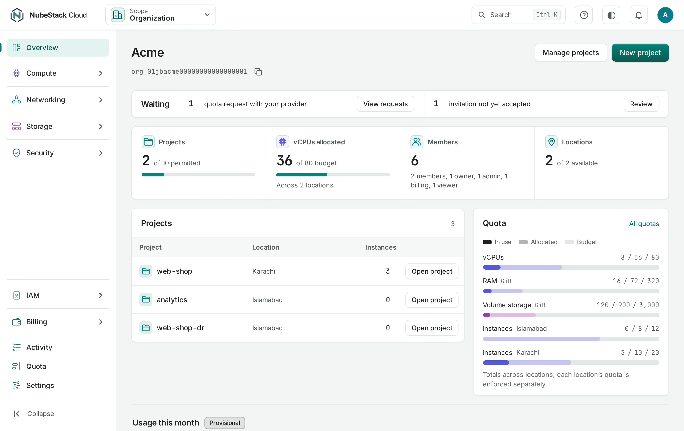

# Create your account

NubeStack Cloud is open by invitation. Someone in your organization, or NubeStack when your
organization is new, invites you by e-mail address. You create your account from that invitation.

## Accept your invitation

The invitation comes as a link, by e-mail or from the person who invited you. The link works once,
only for the e-mail address it was sent to, and for seven days.

1. Open the link. If you are not signed in, the page offers two ways on.

   

2. New to NubeStack Cloud? Choose **Create your account**. Your account uses the e-mail address
   the invitation was sent to. Choose a password.

   Already have an account with that address, for another organization? Choose **Sign in**.
3. Set up your second factor when asked: scan the code with an authenticator app on your phone,
   then type the six-digit code the app shows. From now on you type a fresh code from the app
   whenever you are asked for your second factor.
4. Check the organization and the role you are offered, then choose **Accept invitation**.

   

   If you are offered the owner or admin role, you confirm with your second factor again.

**Decline** turns the invitation down; the person who invited you can send a new one later.

!!! note "The link says ‘Invitation not valid’"

    It was used, replaced or has expired. Ask the person who invited you for a new one. Signed in with
    a different address than the one invited? Choose **Sign out**, sign in with the invited address,
    and open the link again.

## Sign in

Open the console and sign in with your e-mail address and password. You are asked for your second
factor:

- always, if you are an owner or admin of an organization;
- always, when you sign in to a location's own dashboard or the OpenStack CLI
  ([native access](/native-access/overview.md));
- otherwise when your organization requires it for every member
  ([Organization settings](/organization/settings.md#security)).

If you belong to several organizations, the console asks which one to open. Tick **Open this one
next time** to skip the question. You can switch at any time with the **Organization** list at the
top of every page.

What you see first depends on your role. Owners and admins land on the organization's
**Overview**: projects, budgets and anything waiting on someone. Everyone else lands on their
projects.

!!! note "The console says ‘Nexus’"

    NubeStack Cloud runs on Nexus, a control plane for OpenStack clouds. You will see its name in a few
    places: the logo at the top left, a resource **Created by: Nexus**, or one marked **outside Nexus**
    because it was made with a location's own tools. See the [glossary](/help/glossary.md#nexus).

## Lost your password or your phone

There is no self-service reset yet. Contact [NubeStack support](/help/support.md). Support sends
you a one-time reset link: opening it signs you in once, your old password and second factor stop
working, and you set new ones.

## Next

- [Organizations, members and roles](/get-started/organizations.md): what your role lets you do.
- [Create a project](/get-started/create-a-project.md).
