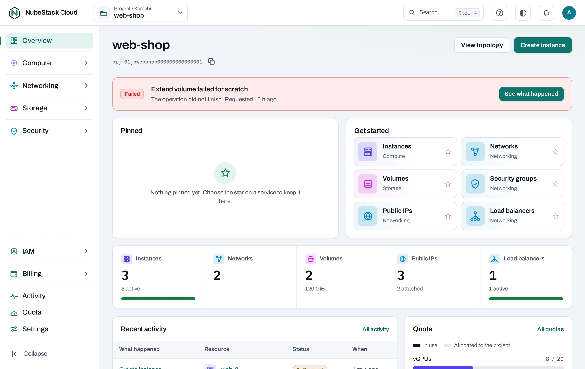
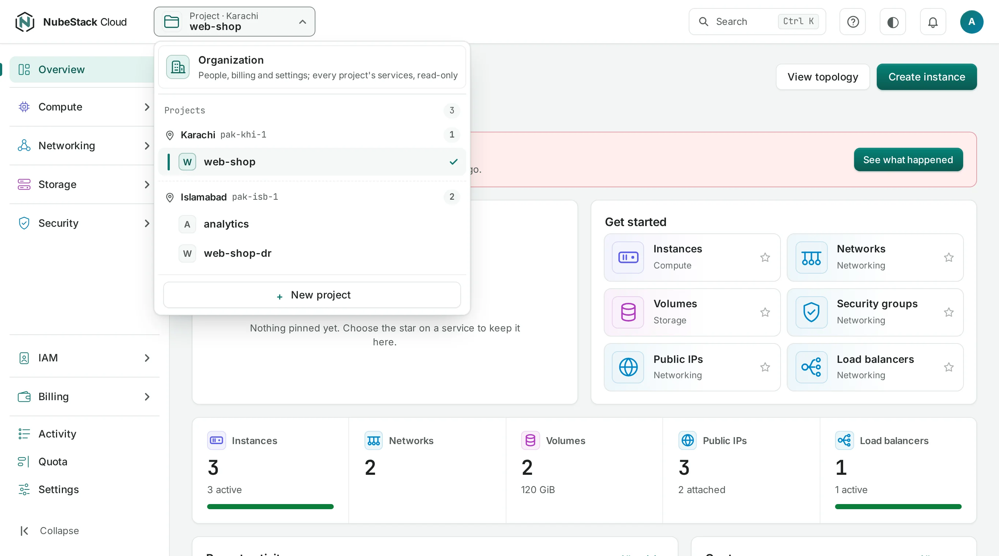
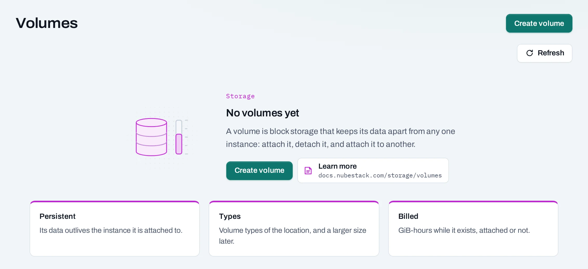

# The console

The console shows one **scope** at a time: your **organization**, or one of its **projects**. You
choose it at the top of the page. The menu on the left is the same in both; each entry shows what
belongs to the scope you chose.

## The top bar

From left to right:

- **The logo** takes you back to the scope you used last.
- **The organization selector** lists your organizations with your roles in each. It is there
  only if you belong to more than one.
- **The scope selector** shows where you are: **Organization**, or **Project ·** its location
  over the project's name, such as **Project · Karachi** over `web-shop`. Open it to switch:
    - **Organization** comes first, as a card of its own, for owners, admins, viewers and the
      billing role. Members work in their projects and do not see it.
    - Then **Projects**, under a heading for each location with its name, code and how many
      projects it has. The one you are in has a check mark. Above eight projects, type in
      **Find a project**.
    - Under the list, **New project**, for people who may create projects.
- **Search** (++ctrl+k++, or ++cmd+k++ on a Mac) goes to a page, opens a project or starts a
  create page.
- **Help** opens these docs, the API reference, the CLI page and the keyboard shortcuts.
- **The theme icon** switches between the light and dark theme.
- **The bell** keeps the warnings pages show, such as a quota nearly used up, after you close
  them.
- **Your initial** opens your menu: **Password and sign-in**, **E-mail notices** and **Sign
  out**.

## The menu

The menu's entries never change. In a project you create and change things; in the organization
you manage people, billing and settings, and see every project's resources read-only.

| Entry | In a project | In the organization |
|---|---|---|
| **Overview** | The project's resources, quota and recent activity | Projects by location, budgets and cost (owners and admins) |
| **Compute**, **Networking**, **Storage**, **Security** | The project's resources, to create and change | Every project's, read-only, each row naming its project |
| **IAM → People** | Who can use the project, and with which role | Everyone in the organization, and pending invitations |
| **IAM → Roles** | The roles you can give in the project | The organization's roles, and custom roles |
| **IAM → Service accounts** | Your own service account on the project | Every service account, its keys and credentials |
| **Billing** | The project's usage and cost | Usage, cost explorer, statements and prices |
| **Activity** | The project's operations | The audit log |
| **Quota** | The project's quota and what it uses | Budgets and each project's quota |
| **Settings** | **General**, **Consoles and CLI**, **Danger zone** | **General**, **Projects**, **Security**, **Audit and retention**, **Danger zone** |

You see the entries your role may open. **SSH keys** are under **Compute** in both scopes:
everyone adds their own. Each group heading opens its group and closes the one open before it.
**Collapse**, at the bottom, folds the menu to its icons.

The scope selector always names the scope you are in, and a project's or organization's overview
is headed with its name and ID. Switching scope keeps you on the same entry where it can: from a
project's **Instances** you land on the organization's **Instances**.

## Lists

A list shows the project's resources of one kind. Type a name, ID or address into the search
box, or filter by state or tag. Lists show what the location last reported; point at **Refresh**
to see when that was. A list the location has not answered for a while is marked **Stale**; its
rows stay. **Refresh** reads the list again from the location now.

Open a resource for its page: its settings, what it is connected to, and its activity. Its
**Details** show its **ID** (what the API, the `nexus` CLI and Terraform call it) and its **Cloud
ID** (what the location's own tools call it). **IDs for the CLI, Terraform, API and support**,
under them, adds the project, location and organization IDs, the project's ID in the cloud, the
command for each tool (a `terraform import` among them), and **Copy for a support request**.
**Manage**, on a row or on a resource's page, holds the actions you can take now. An action that
is greyed out says why when you point at it: your role, a change still running, or another
resource in the way.

### Acting on several at once

On **Instances**, **Volumes**, **Snapshots**, **Images**, **Security groups**, **Public IPs** and
**Load balancers**, tick the box at the start of each row you want, or the box in the header for
every row the list shows (after any search or filter). A bar above the list counts what is
selected and offers what can be done to all of them: **Start**, **Stop**, **Reboot** and
**Delete** for instances; **Delete** (or **Release** for public IPs) elsewhere.

Before anything is sent, a dialog lists what will be done and what is left out and why, for
example a volume still attached to an instance, or an instance that is already stopped. To delete
more than one, type the count it shows, such as `delete 3`. At most 100 are sent at a time.

Each item then becomes its own operation, exactly as if you had chosen it from its row, and the
dialog shows each one's outcome: **Accepted** with a link to follow it, or why it was refused.
**Retry** sends again only the refused ones. The boxes are there only if your role can change the
project, and not on a phone.

An empty list explains the resource: what it is, three facts about it, and a link to its page in
these docs.

## Create pages

Creating something opens a page of numbered steps, with a summary on the right. The summary lists
what is still to do, and what the project's quota will be afterwards.

- **Price estimate**: on pages that create something billed (instances, volumes, load balancers,
  public IPs, image imports), owners, admins and the billing role see the price per hour or per
  month at NubeStack's current rates. It is an estimate, provisional like all
  [usage and costs](../concepts/usage-and-costs.md).
- **Equivalent code**: the same change as an API request, a `nexus` command, Terraform and
  `curl`, made from what the page would send. See [NubeStack CLI](../tools/cli.md).

Leaving a page with something entered asks you first.

## Follow a change

Creating, changing or deleting something in a location takes a moment. The console accepts the
request at once and shows a notice such as **Instance requested**, with **Follow the operation**.
The operation page shows each step and how the location answered. The project's operations are
under **Activity**. See [Operations](../concepts/operations.md).

## Words the console uses

- **Created by: Nexus** means NubeStack Cloud's own automation made the resource, for example
  the network built with a new project. Nexus is the name of the platform NubeStack Cloud runs
  on.
- **outside Nexus** marks a resource made with a location's own tools, such as Horizon or the
  OpenStack CLI.

The [glossary](../help/glossary.md) explains the other terms.

## Next

- [Understand your organization and its roles](organizations.md).
- [Create a project](create-a-project.md).
