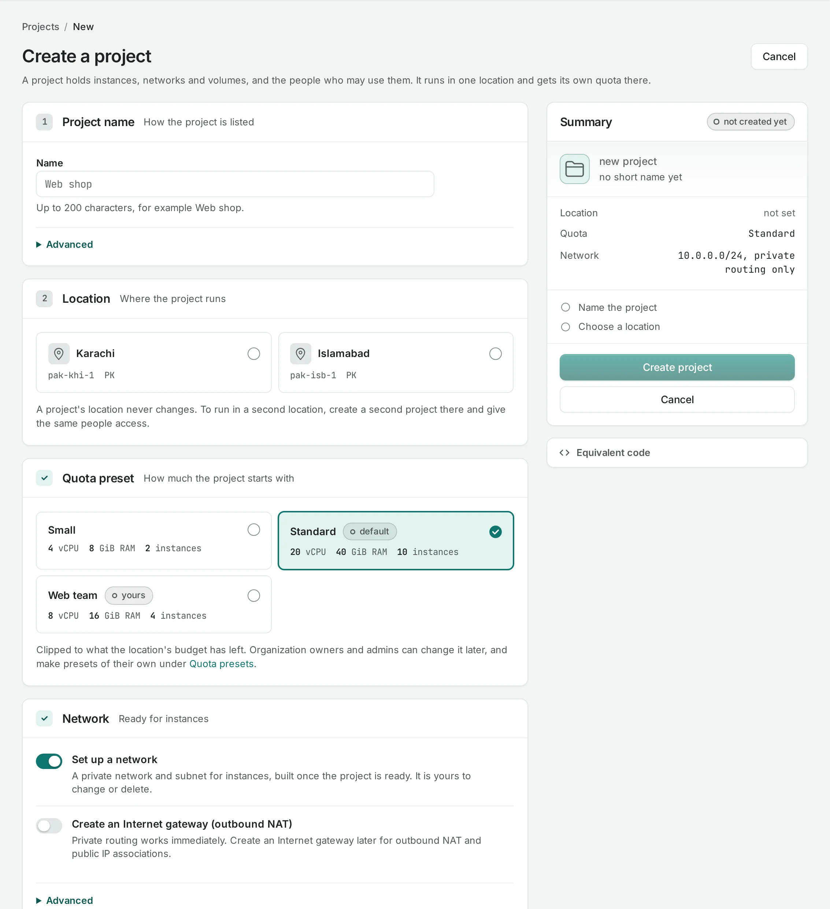

# Create a project

A project holds your instances, networks and volumes, and the people who may use them. It runs in
the locations you choose and has its own quota in each.

<div class="docs-method-picker" hidden role="group" aria-label="Instruction method">
<span>Show instructions for</span>
<div><button type="button" data-interface-choice="Console" aria-pressed="true">Console</button><button type="button" data-interface-choice="API" aria-pressed="false">API</button></div>
</div>

<div class="docs-method-note" markdown>

[Set up API authentication and variables](/api/overview.md#before-you-start). Replace example IDs and catalog choices. Reuse an idempotency key for retries of one request; use a new key for each new action.

</div>

Skip this page if you were given a role on a project already: open it from **Projects**, or pick
it in **Workspace** at the top of the console.


## Who can create one

Owners and admins create projects. Members can too when the organization allows it
(**Settings → Members may create projects**). Whoever creates a project becomes its project admin.

## Create your project {#in-the-console}

=== "Console"

    1. In the organization's left panel, choose **Projects**, then **New project**.

       

    2. **Name**: how the project is listed, up to 200 characters, for example `web-shop`.
       Under **Advanced**, the **short name** is filled in from the name: lower-case letters, digits
       and dashes, unique in the organization. It is used in addresses and in each location's own
       tools. Neither name can change once the project exists.
    3. **Location**: where the project runs. One is usual. Tick **Place it in more than one location**
       only if you need the project in both: each location is an independent cloud, so the project
       gets separate networks, volumes, images and quota in each. You can add or remove locations
       later in the project's settings.
    4. **Quota preset**: how much the project starts with in each location. Keep the default unless an
       owner or admin told you otherwise. The project gets the preset's figures, or what is left of
       the organization's budget there, whichever is less. See [Quota](/organization/quota.md).
    5. **Network**: leave **Set up a network** on. A private network is built in each location once
       the project is ready, `192.0.2.0/24` unless you choose another range. Pick another range if you
       will connect this network to one that already uses `192.0.2.0/24`.
    6. **Create an Internet gateway (outbound NAT)**: turn it on if your instances should reach the
       Internet or have public IPs. You can [create one later](/networking/internet-gateways.md) instead.
    7. Check the summary on the right and choose **Create project**.

    The project is ready in each location within a few minutes. While it is being set up, its
    location shows **setting up**; open the project to follow it.

=== "API"

    <span id="with-the-api" data-docs-method="API"></span>

    ```bash
    curl --fail-with-body -i -X POST "$NUBESTACK_API/v1/orgs/$ORG/projects" \
      -H "Authorization: Bearer $NUBESTACK_API_KEY" \
      -H "Idempotency-Key: $REQUEST_KEY" \
      -H "Content-Type: application/json" \
      --data '{
      "slug": "web-shop",
      "display_name": "web-shop",
      "locations": [
        "loc_example"
      ]
    }'
    ```

    A `202` accepts the change. Follow `operation.href` to its final result before the next dependent action.

    [Request fields and responses](/api/reference/projects.md#post-project).

## Next

- [Your first instance](/get-started/first-instance.md).
- [Give others access to the project](/concepts/projects-and-quotas.md#who-can-use-a-project).
