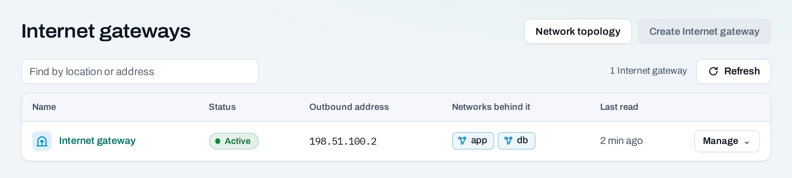
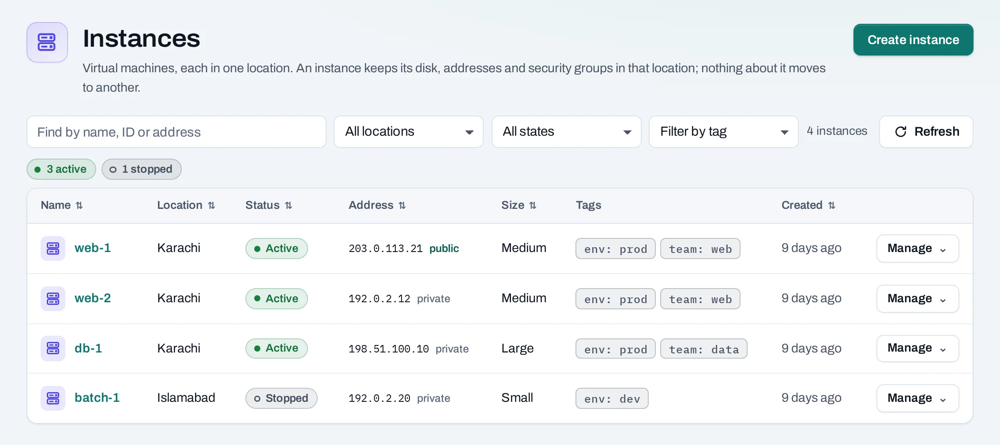

# Your first instance

This walk-through starts an Ubuntu instance in Karachi that you can log in to over SSH from your
computer, then removes everything again. It takes about ten minutes. You need a role of project
admin or project member on a project, here `web-shop`.

<div class="docs-method-picker" hidden role="group" aria-label="Instruction method">
<span>Show instructions for</span>
<div><button type="button" data-interface-choice="Console" aria-pressed="true">Console</button><button type="button" data-interface-choice="API" aria-pressed="false">API</button></div>
</div>

<div class="docs-method-note" markdown>

[Set up API authentication and variables](/api/overview.md#before-you-start). Replace example IDs and catalog choices. Reuse an idempotency key for retries of one request; use a new key for each new action.

</div>


## 1. Add your SSH key

=== "Console"

    1. On your computer, print your public key. No key yet? Make one with `ssh-keygen -t ed25519`.

       ```bash
       cat ~/.ssh/id_ed25519.pub
       ```

    2. In the console, pick the project in **Workspace**. In the left panel, under **Compute**, choose
       **SSH keys**, then **Add SSH key**.
    3. Paste the whole line into **Public key**. Never paste the private key: the console refuses it.
    4. Leave **Who can use it** on **Only me** and choose **Add SSH key**.

    [SSH keys](/compute/ssh-keys.md) has the details.

=== "API"

    <span id="the-same-with-the-api" data-docs-method="API"></span>

    ```bash
    curl --fail-with-body -i -X POST "$NUBESTACK_API/v1/orgs/$ORG/ssh-keys" \
      -H "Authorization: Bearer $NUBESTACK_API_KEY" \
      -H "Idempotency-Key: $REQUEST_KEY" \
      -H "Content-Type: application/json" \
      --data '{
      "display_name": "my-laptop",
      "public_key": "REPLACE_WITH_YOUR_COMPLETE_PUBLIC_SSH_KEY"
    }'
    ```

    Returns `201` directly. Read the returned resource or current state to verify the change.

    [Request fields and responses](/api/reference/ssh-keys.md#post-key).


## 2. Make sure the network reaches the Internet

=== "Console"

    A public IP needs a routed network and an **Internet gateway** in the location.

    1. Under **Networking**, choose **Networks**. The project's network, `app` with `192.0.2.0/24`,
       was made with the project. No network in Karachi? Choose **Set up network** in the notice at the
       top, or [create one](/networking/networks.md#create-a-network) as **Routed**.
    2. Under **Networking**, choose **Internet gateways**. If Karachi is not listed, choose **Create
       Internet gateway**, pick **Karachi** and confirm. The gateway is ready when its **Outbound
       address** shows.

    

=== "API"

    **Create a network**

    ```bash
    curl --fail-with-body -i -X POST "$NUBESTACK_API/v1/orgs/$ORG/projects/$PROJECT/networks" \
      -H "Authorization: Bearer $NUBESTACK_API_KEY" \
      -H "Idempotency-Key: $REQUEST_KEY" \
      -H "Content-Type: application/json" \
      --data '{
      "location": "loc_example",
      "display_name": "app",
      "routed": true,
      "subnet": {
        "cidr": "<private-ipv4-cidr>",
        "enable_dhcp": true
      },
      "tags": {
        "env": "prod"
      }
    }'
    ```

    A `202` accepts the change. Follow `operation.href` to its final result before the next dependent action.

    [Request fields and responses](/api/reference/networking.md#post-network).

    **Add an Internet gateway**

    ```bash
    curl --fail-with-body -i -X POST "$NUBESTACK_API/v1/orgs/$ORG/projects/$PROJECT/placements/$PLACEMENT_ID/internet-gateway" \
      -H "Authorization: Bearer $NUBESTACK_API_KEY" \
      -H "Idempotency-Key: $REQUEST_KEY" \
      -H "Content-Type: application/json" \
      --data '{}'
    ```

    A `202` accepts the change. Follow `operation.href` to its final result before the next dependent action.

    [Request fields and responses](/api/reference/networking.md#create-internet-gateway).


## 3. Create the instance

=== "Console"

    1. Under **Compute**, choose **Instances**, then **Create instance**.
    2. **Location**: Karachi.
    3. **Name**: `web-1`.
    4. **Size**: Small or Medium. You can resize later.
    5. **Image**: Ubuntu 24.04.
    6. **Network**: `app`. Under **Public IP**, choose **A new public IP**.
    7. **Access**: choose your SSH key and turn on **Allow SSH (port 22) from anywhere**.
    8. Check the summary on the right, then choose **Create instance**.

    The page shows **Instance requested** with a link to follow the operation. The instance appears
    in the list as **Creating**, then **Active**, usually within a minute or two.

    

=== "API"

    ```bash
    curl --fail-with-body -i -X POST "$NUBESTACK_API/v1/orgs/$ORG/projects/$PROJECT/servers" \
      -H "Authorization: Bearer $NUBESTACK_API_KEY" \
      -H "Idempotency-Key: $REQUEST_KEY" \
      -H "Content-Type: application/json" \
      --data '{
      "location": "loc_example",
      "display_name": "web-1",
      "offering": "medium",
      "image": "ubuntu-24-04",
      "network_id": "net_example",
      "ssh_key_id": "ssh_example",
      "public_ip": true,
      "security_group_templates": ["ssh"]
    }'
    ```

    A `202` accepts the change. Follow `operation.href` to its final result before the next dependent action.

    [Request fields and responses](/api/reference/instances.md#post-server).


## 4. Log in

=== "Console"

    The list shows the public IP beside the instance, marked **public**. Log in as the image's default
    user, `ubuntu` on Ubuntu images:

    ```bash
    ssh ubuntu@203.0.113.21
    ```

    !!! tip "Refused or timing out?"

        Check, in this order: the instance is **Active**; it has a public IP; one of its security groups
        allows TCP 22 from your address; the location has an Internet gateway. The instance's
        **Console log** tab shows whether it booted. More in [Troubleshooting](/help/troubleshooting.md).


    Once you are in, narrow SSH to your own addresses: add a rule for your office range in the
    [security group](/networking/security-groups.md#add-and-remove-rules), then remove the rule open to
    `0.0.0.0/0`.

=== "API"

    Use the public address returned on the instance. SSH is the same guest connection for either creation method:

    ```bash
    ssh ubuntu@203.0.113.21
    ```

    Replace the documentation address with your allocated address. An API key does not replace the instance's private SSH key. After confirming access, [narrow the SSH rule](/networking/security-groups.md#add-and-remove-rules) to your own address range.


## 5. Clean up

=== "Console"

    Delete what you made so it stops counting in your usage:

    1. **Instances**: choose **Manage → Delete** on `web-1` and confirm. Its system disk goes with it.
    2. **Public IPs**: the address stays allocated to the project after the instance is gone. Choose
       **Manage → Release** on it and confirm.
    3. Optional: the Internet gateway counts as **Internet gateway hours** while it exists. If you made
       it only for this, choose **Manage → Delete gateway** under **Internet gateways**.
    4. Optional: remove the SSH rule you added, or the key, if you no longer need them.

=== "API"

    **Delete an instance**

    ```bash
    curl --fail-with-body -i -X DELETE "$NUBESTACK_API/v1/orgs/$ORG/projects/$PROJECT/servers/$SERVER_ID" \
      -H "Authorization: Bearer $NUBESTACK_API_KEY" \
      -H "Idempotency-Key: $REQUEST_KEY"
    ```

    A `202` accepts the change. Follow `operation.href` to its final result before the next dependent action.

    [Request fields and responses](/api/reference/instances.md#delete-server).

    **Release a public IP**

    ```bash
    curl --fail-with-body -i -X DELETE "$NUBESTACK_API/v1/orgs/$ORG/projects/$PROJECT/floating-ips/$ADDRESS_ID" \
      -H "Authorization: Bearer $NUBESTACK_API_KEY" \
      -H "Idempotency-Key: $REQUEST_KEY"
    ```

    A `202` accepts the change. Follow `operation.href` to its final result before the next dependent action.

    [Request fields and responses](/api/reference/public-ips.md#release-address).

    **Remove the Internet gateway**

    ```bash
    curl --fail-with-body -i -X DELETE "$NUBESTACK_API/v1/orgs/$ORG/projects/$PROJECT/placements/$PLACEMENT_ID/internet-gateway" \
      -H "Authorization: Bearer $NUBESTACK_API_KEY" \
      -H "Idempotency-Key: $REQUEST_KEY"
    ```

    A `202` accepts the change. Follow `operation.href` to its final result before the next dependent action.

    [Request fields and responses](/api/reference/networking.md#delete-internet-gateway).
