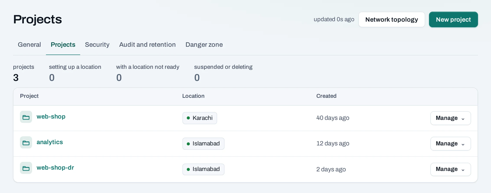

# Organizations, members and roles

Everything in NubeStack Cloud belongs to an **organization**: your company, team or institution.
An organization has **members** (people), **service accounts** (automation) and **projects**.

```text
Organization: Acme
├── Members: Ayesha (owner), Bilal (admin), Sara (member), Hina (billing) ...
├── Service accounts: automation-prod, ci-deploy
└── Projects
    ├── web-shop   in Karachi and Islamabad
    │     └── instances, networks, volumes, load balancers ...
    └── analytics  in Islamabad
```

## Two kinds of role

**Organization roles** decide what someone may do across the organization: invite people, create
projects, see usage, change settings.

| Role | In short |
|---|---|
| Owner | Everything, including security settings, closing the organization and acting on other owners |
| Admin | Members (except owners), projects, quota, settings and service accounts |
| Billing | Sees the members, projects, locations and usage, and the cost pages |
| Member | Sees the members and locations; uses only the projects they are given a role on |
| Viewer | Sees everything in the organization's projects, read only |

**Project roles** decide what someone may do inside one project: create instances, change
networks, give others access.

| Role | In short |
|---|---|
| Project admin | Uses the project, gives and takes access to it, removes its locations, deletes it |
| Project member | Creates, changes and deletes the project's resources |
| Project reader | Sees the project's resources, changes nothing |

An organization role never gives a project role. An owner manages access to every project, but
creates instances in one only with a project role on it. Whoever creates a project becomes its
project admin.

Owners and admins can also make [custom roles](/organization/custom-roles.md) when the built-in ones
do not fit. The full table of who may do what is in
[Roles and permissions](/concepts/roles-and-permissions.md).

## Several organizations

One account can belong to several organizations. Each is separate: its own projects, members,
quota and usage. Pick the one you work in from the **Organization** list at the top of the console.

## The console's layout

- The **top bar** names the organization and the **Workspace**: the organization itself, or one of
  its projects. Pick a project there to work in it.
- The **left panel** lists what you can open in that workspace. In a project: **Compute**,
  **Networking**, **Security** and **Storage**, then **Quota and usage**, **Consoles and CLI**,
  **Activity** and **Settings** at the bottom.



## Next

- [Create a project](/get-started/create-a-project.md).
- [Invite your colleagues](/organization/members.md#invite-someone).
