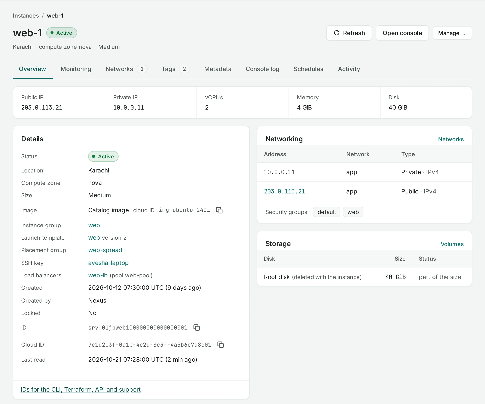

<section class="guide-hero" markdown>

YOUR CLOUD, EXPLAINED

# Build with NubeStack Cloud.

Practical guides for the things you want to build. Launch compute, connect your services and put your data to work — in the console or through the API.

[Create your first instance :material-arrow-right:](get-started/first-instance.md){ .docs-primary }
[Explore tutorials :material-arrow-top-right:](get-started/index.md)

<!-- diagram: project-overview -->

A typical application, built from connected cloud resources.

</section>

<section class="guide-start" markdown>

## Start here. Build from there.

[All getting started guides :material-arrow-right:](get-started/index.md)

01

### [Create a project](get-started/create-a-project.md)

Give your application a home. Choose a location and set your resource quota.

02

### [Launch an instance](get-started/first-instance.md)

Pick an image and size, connect a network, then sign in with SSH.

03

### [Publish your application](tutorials/publish-web-application.md)

Allow web traffic and bring your service online with a public IP.

</section>

## Find your service

Go from understanding a building block to creating, connecting and managing it.

:material-server-outline:

### [Compute](compute/index.md)

Instances, reusable images and groups of application replicas.

[Instances](compute/instances.md) · [Launch templates](compute/launch-templates.md)

:material-lan:

### [Networking](networking/index.md)

Private connectivity, public endpoints and traffic distribution.

[Networks](networking/networks.md) · [Load balancers](networking/load-balancers.md)

:material-database-outline:

### [Storage](storage/index.md)

Persistent data disks, snapshots and recurring schedules.

[Volumes](storage/volumes.md) · [Recovery](tutorials/persistent-storage.md)

:material-shield-check-outline:

### [Security](security/index.md)

HTTPS certificates, firewall rules and access controls.

[Certificates](security/certificates.md) · [Firewall rules](networking/security-groups.md)

:material-account-group-outline:

### [Organization](organization/index.md)

People, projects, automation identities and provisional usage.

[Members](organization/members.md) · [Projects](organization/projects.md)

:material-code-braces:

### [API & native tools](api/index.md)

Automate through the API or use a location’s OpenStack tools.

[API guide](api/index.md) · [OpenStack CLI](native-access/openstack-cli.md)

<section class="guide-feature" markdown>

TWO WAYS TO GET THINGS DONE

## Follow along. Your way.

Every resource guide puts **Console** and **API** instructions beside the action. Start visually, switch to a request when you need it, and keep your preferred method across guides.

[Explore instance actions :material-arrow-right:](compute/manage-instances.md)

ConsoleAPI

</section>

## Turn a goal into a working application

COMPUTE + NETWORKING

### [Publish a web application](tutorials/publish-web-application.md)

Create a server with cloud-init, allow HTTP and verify the public endpoint.

NETWORKING + SECURITY

### [Serve an application over HTTPS](tutorials/https-load-balancer.md)

Add a certificate, healthy backends, a public IP and your domain.

COMPUTE + STORAGE

### [Use persistent storage](tutorials/persistent-storage.md)

Attach a data disk, identify it inside your instance and mount it safely.

COMPUTE + AUTOMATION

### [Scale application replicas](tutorials/scale-an-application.md)

Create a template, maintain a group and schedule its desired count.

## Built in Pakistan. Located where you choose.

NubeStack Cloud is a public cloud with independent locations in Pakistan. Each resource stays in the location you choose; cross-location replication and failover need to be designed into your application.

:material-map-marker-outline: **Karachi** `pak-khi-1`

:material-map-marker-outline: **Islamabad** `pak-isb-1`

[Understand locations →](concepts/locations.md) · [Roles and permissions](concepts/roles-and-permissions.md) · [Troubleshooting](help/troubleshooting.md)
