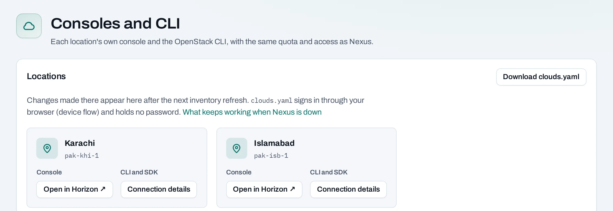

# Horizon single sign-on

Horizon is a location's native OpenStack dashboard. Use it for direct access to that cloud with your NubeStack account. Your project role and the location's supported services determine what you can do.

## Open the dashboard

1. In NubeStack Cloud, open your project and choose **Consoles and CLI**.
2. Find the location and choose **Open in Horizon**.
3. On the dashboard sign-in page, choose **Nexus** as the sign-in method. This is the name currently displayed by the native dashboard.
4. Sign in with your NubeStack account, choose the organization and complete the second-factor check if requested.
5. Check the selected project before creating or deleting anything.

From an instance's page, **Console in Horizon** opens that instance in the native dashboard. For the instance's screen and keyboard directly in NubeStack Cloud, use [Open console](/compute/manage-instances.md#open-the-instances-console).

## Switch organizations

The native dashboard signs you in for one organization at a time. To use another, sign out and wait three minutes before signing in again, or use a private browser window. A stale native session can otherwise keep showing the previous organization.

## Missing access or resources

Confirm you hold a project grant, have selected the correct organization and location, and have waited for a recent access change to finish. An organization role alone does not permit native project access. Changes made in Horizon may need a console **Refresh** before they appear in NubeStack.

Use the same caution as in the customer console: a native delete changes the same resource. It is counted in usage and included in project deletion and retention behavior.

## API connection details

Authorized callers can read a location entry's connection and dashboard details through `GET .../placements/{placement_id}/connection` and `/console`. These return connection information, not an API that signs you in as another user. See the [reference](/api/reference/index.md) for the exact response.
