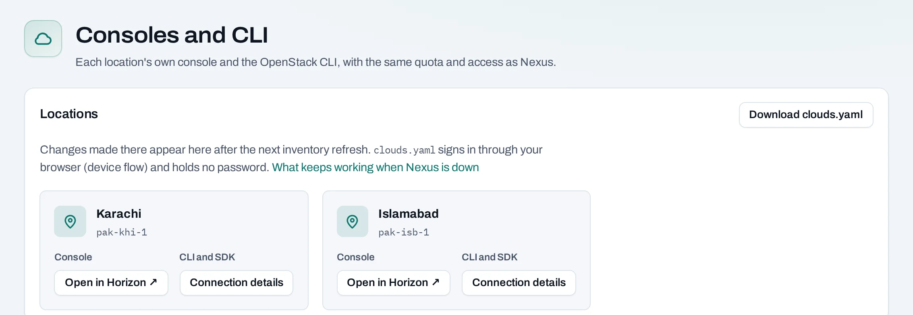

# Native OpenStack access

Each location is an OpenStack cloud. You can use its own dashboard, Horizon, and the OpenStack CLI with the same organization, project access and quota as the NubeStack Cloud console.

## Choose how to connect

- [Horizon](horizon.md): open the location's dashboard through single sign-on.
- [OpenStack CLI](openstack-cli.md): download connection settings and approve sign-in in your browser.
- [Service-account native credentials](../organization/service-accounts.md#native-credentials): non-interactive access for automation in one project location.

A project role is required to use the cloud. An organization role alone can let you read connection details without permitting a native sign-in.

## Same resources, same limits

Resources created through native tools use the same project quota and measured usage. They appear in the NubeStack console after the next inventory read, normally within about an hour, or after **Refresh** on the relevant list. They may be marked **outside Nexus**, the label used by the console for resources made through another tool.

Deleting a project includes resources created through native tools. Do not treat them as outside the project's deletion scope.

## When part of the service is unavailable

| Unavailable service | What to expect |
|---|---|
| NubeStack console and customer API | Native tools can keep working with access already applied to each location; new access and quota changes wait |
| Sign-in service | New sign-ins fail; existing sessions continue only until they expire |
| One location | Resources and native access there are affected; other locations are independent |

Removing native access is not instantaneous: changes normally reach each location within 15 minutes. For an urgent revocation while the console is unavailable, use your supplied support channel.
