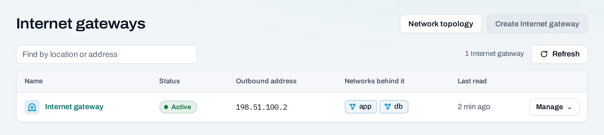

# Internet gateways

An Internet gateway connects a project's routed networks to the Internet in one location. Use one for outbound connections and for instances or load balancers that need a public IP. It serves the project's routed networks there; it does not connect locations.

## Create a gateway

1. In your project, open **Networking → Internet gateways**.
2. Choose **Create Internet gateway** and select **Karachi** or **Islamabad**.
3. Confirm and follow the operation. The gateway's outbound address appears when it is ready.
4. Check that the instance's network is **Routed**. An isolated network gains no Internet access from creating a gateway.

Outbound access uses the gateway's address. For unsolicited inbound traffic, allocate and attach a [public IP](/networking/public-ips.md), then allow the required ports in a [security group](/networking/security-groups.md). Creating a gateway alone does not expose all instances.

## With the API

Set `PLACEMENT_ID` to the ID of the project's chosen location, available in the project response. The API uses this field name for a project's location entry.

<!-- api-example: create_internet_gateway -->

Delete with `DELETE /v1/orgs/{org_id}/projects/{project_id}/placements/{placement_id}/internet-gateway`, with a fresh idempotency key. Read the current gateway through the project's resource inventory or the gateway page.

## Delete and limits

Choose **Manage → Delete gateway** and read which networks lose Internet access. Attached public IPs can block removal; detach them first, including addresses on load balancers. Private traffic between routed networks continues when the gateway is removed.

The console offers one project Internet gateway per location. Gateway hours count while it exists. Release unused public IPs separately, and check [usage](/organization/usage.md) after cleaning up.
