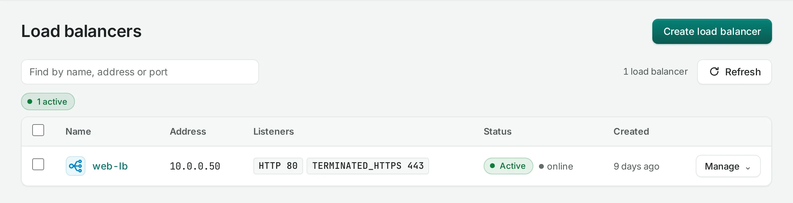
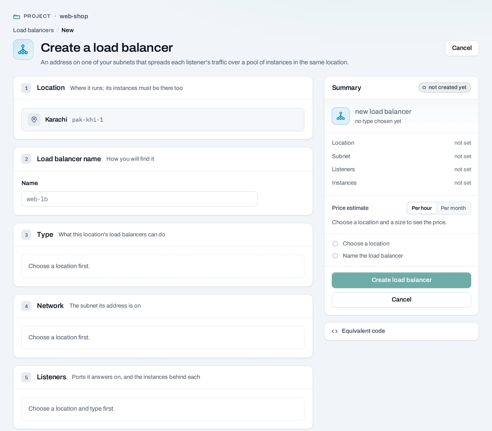
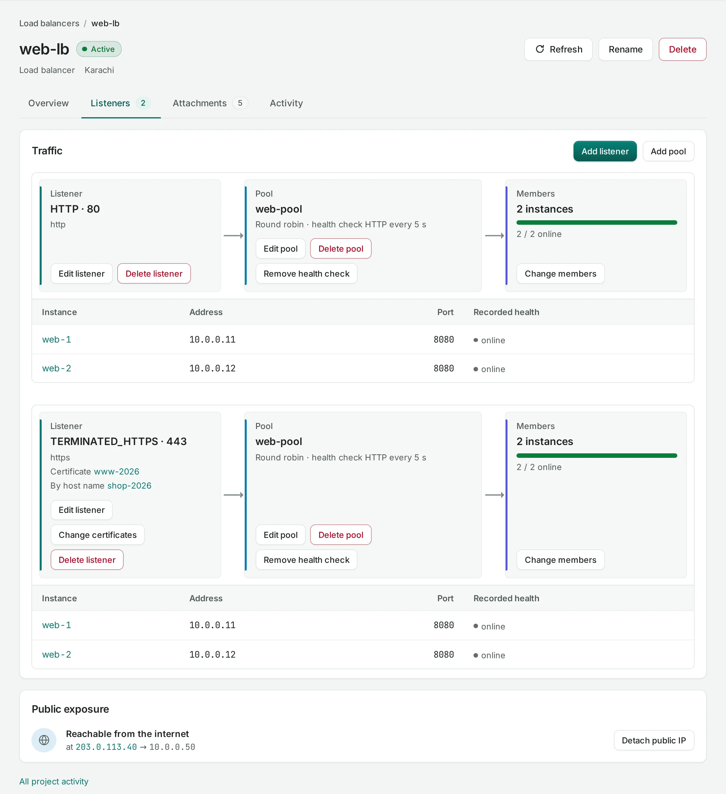
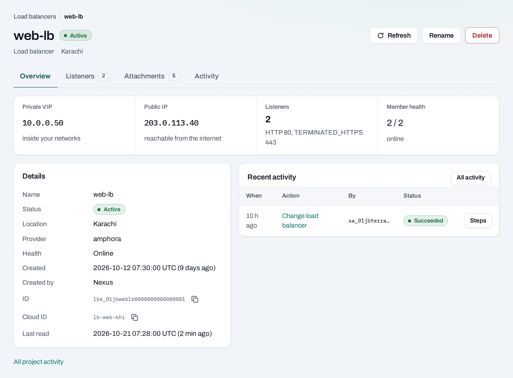

# Load balancers

A **load balancer** gives several instances one address. It answers on the ports you choose
(**listeners**) and spreads each port's traffic over a **pool** of instances. A **health check**
stops traffic to an instance that stops answering.

**Use it for** a site or service run on more than one instance, for replacing instances without
changing the address, and for serving HTTPS with your certificates.

Find them under **Networking → Load balancers**.



## Where they are offered

Load balancers exist only in locations that offer them. The create page lists only those
locations, and each **Type** says which protocols, balancing methods and health checks it
supports. Type names come from the location's catalog. Ending HTTPS on the load balancer with
your certificate is offered only by types that say **HTTPS with your certificate**.

## Before you start

- Instances in the same location, on a network the load balancer can use, serving on a known
  port.
- A [security group](security-groups.md) rule that lets the load balancer reach that port, for
  example TCP 8080 from the network's range.
- For HTTPS that ends on the load balancer, your [certificates](../security/certificates.md),
  uploaded in the same location.

## Create a load balancer

=== "Console"

    1. Choose **Create load balancer**.
    2. **Location**, **Name** and **Type**.
    3. **Subnet**: the network its private address is on. Choose a routed network if you will
       give it a public IP.
    4. **Listeners**, for each port it answers on:
        - **Protocol** and **port**, for example HTTP on 80. Up to 10 listeners, no two on the
          same protocol and port.
        - For **HTTPS, TLS ends here**, the **Certificate**, and optionally **Also serve these
          certificates (by host name)**. Its pool receives plain HTTP. See
          [several certificates on one listener](../security/sni.md).
        - **Add a pool of instances**: the instances and the port each listens on, and the
          **Balancing** method, such as round robin.
        - **Health check**: how often to test each instance (**Every (s)**) and how long to wait
          (**Timeout (s)**). Without one, traffic goes to every instance, answering or not.
    5. Choose **Create load balancer**.

    

=== "API"

    ```bash
    curl -sS -X POST "$NUBESTACK_API/v1/orgs/$ORG/projects/$PROJECT/load-balancers" \
      -H "Authorization: Bearer $NUBESTACK_API_KEY" \
      -H "Idempotency-Key: $(uuidgen)" \
      -H "Content-Type: application/json" \
      -d '{
        "location": "loc_01jbkhi",
        "display_name": "web-lb",
        "subnet_id": "sbn_01jbapp",
        "listeners": [{
          "protocol": "HTTP", "port": 80,
          "pool": {
            "algorithm": "ROUND_ROBIN",
            "members": [{"server_id": "srv_01jbweb1", "port": 8080}, {"server_id": "srv_01jbweb2", "port": 8080}],
            "health_monitor": {"type": "HTTP", "delay": 5, "timeout": 3, "max_retries": 3}
          }
        }]
      }'
    ```

    `offering` picks the type (default `default`). An HTTPS listener uses `"protocol":
    "TERMINATED_HTTPS"`, `certificate_id` and optional `sni_certificate_ids`; see
    [Serve an application over HTTPS](../tutorials/https-load-balancer.md).

## Change a load balancer

Open it. The **Listeners** tab shows each port, its pool, the instances behind it and their
recorded health.



=== "Console"

    - **Add listener**: another port on the same address. A listener's protocol and port cannot
      change; add a new listener instead.
    - **Add pool**: a pool of instances, which you then connect to a listener.
    - **Edit listener** / **Edit pool**: its pool or balancing method, and its name.
    - **Change certificates**, on an HTTPS listener that ends TLS: its default certificate and
      the ones it serves by host name.
    - **Change members**: add or take out instances. One taken out stops getting new traffic; it
      is not changed or deleted.
    - **Add health check** and **Remove health check**.
    - **Attach a public IP**, under **Public exposure** on the **Overview** tab.
    - **Rename**: only the name changes.

=== "API"

    Listener and pool changes carry the version you read, in `expected`: the
    `lb_configuration.version` of the listener or pool. A stale version is refused; read again.

    ```bash
    curl -sS -X POST "$NUBESTACK_API/v1/orgs/$ORG/projects/$PROJECT/load-balancers/lbs_01jbweblb/pools/lbp_01jbwebpool/members:replace" \
      -H "Authorization: Bearer $NUBESTACK_API_KEY" \
      -H "Idempotency-Key: $(uuidgen)" \
      -H "Content-Type: application/json" \
      -d '{"members": [{"server_id": "srv_01jbweb1", "port": 8080}, {"server_id": "srv_01jbweb3", "port": 8080}]}'
    ```

    Other changes: `POST …/listeners`, `PATCH`/`DELETE …/listeners/{id}`, `POST …/pools`,
    `PATCH`/`DELETE …/pools/{id}`, and `POST`/`DELETE …/pools/{id}/health-monitor`.



The page warns when some instances fail their health checks, and when none pass, so traffic has
nowhere to go.

## How load balancers connect

| Connected to | How |
|---|---|
| [Instances](../compute/instances.md) | Members of a pool, by instance and port. An instance can join a pool when it is created. |
| [Instance groups](../compute/instance-groups.md) | A group keeps its instances in a pool. |
| [Public IPs](public-ips.md) | One public IP reaches the load balancer's private address. |
| [Certificates](../security/certificates.md) | HTTPS listeners that end TLS serve them. |
| [Networks](networks.md) | The load balancer's address comes from a network's range. |

## Delete a load balancer

=== "Console"

    Choose **Delete** and confirm. The dialog lists what goes and what stays.

=== "API"

    ```bash
    curl -sS -X DELETE "$NUBESTACK_API/v1/orgs/$ORG/projects/$PROJECT/load-balancers/lbs_01jbweblb" \
      -H "Authorization: Bearer $NUBESTACK_API_KEY" \
      -H "Idempotency-Key: $(uuidgen)"
    ```

Its listeners, pools and health checks go with it. The instances behind it and its certificates
are not touched. A public IP on it is detached and stays allocated until you release it.

**What blocks a delete**

| Refusal | Why | Resolve |
|---|---|---|
| `lb_child_in_use` | Deleting a pool that a listener uses, or that still has members or a health check | Point the listener elsewhere, change its members to none, remove the health check |

Nothing blocks deleting the whole load balancer.

## Limits and good practice

- Up to 10 listeners per load balancer and 100 members per pool.
- Counted as **Load balancer hours** for as long as it exists, whatever its state.
- Always add a health check that tests the application, not just the port.
- Not offered: client certificates, choosing TLS versions and ciphers, and routing by path or
  header (L7 policies). Where a location's types cannot end TLS, use TCP on 443 and end TLS on
  the instances.

## Related

- [Serve an application over HTTPS](../tutorials/https-load-balancer.md)
- [Certificates](../security/certificates.md) · [Several certificates on one listener](../security/sni.md)
- [API reference: Load balancers](../api/reference/load-balancers.md)
