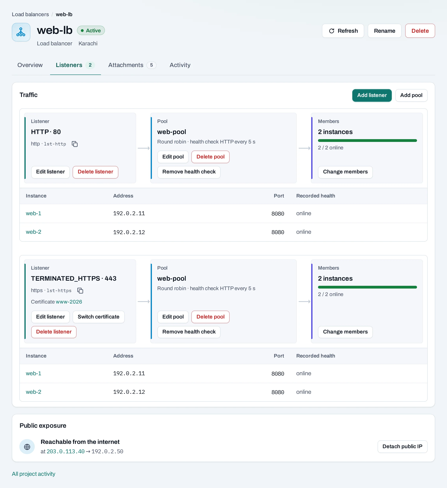
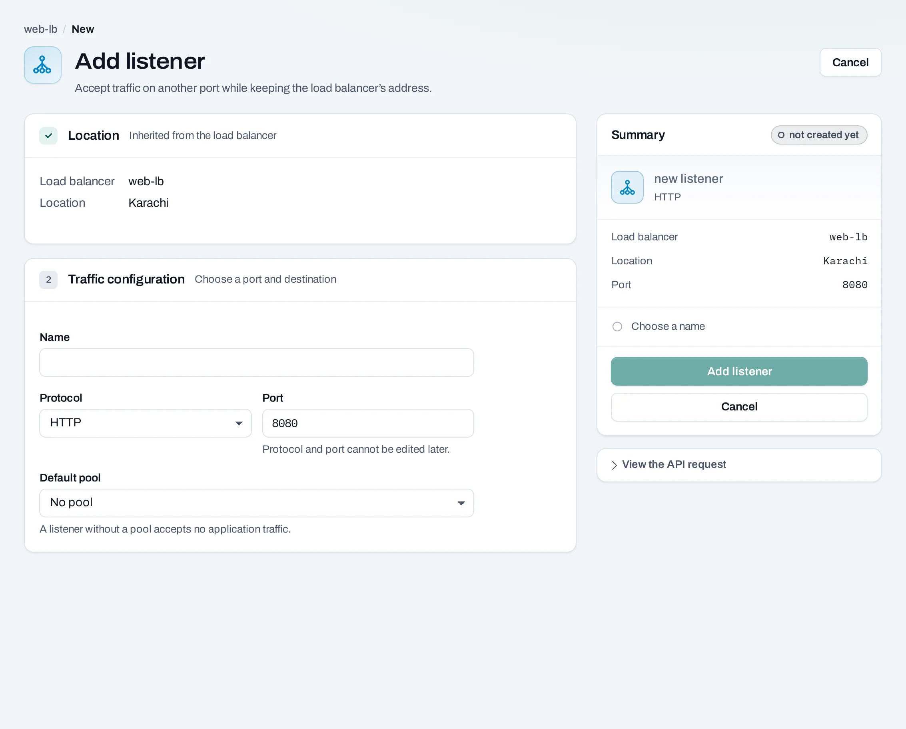

# Load balancers

A load balancer distributes traffic across instances. Use it when an application has several backends or needs one stable frontend while you replace instances. It lives on a subnet in one location.

| Part | Purpose |
|---|---|
| Listener | Accepts a protocol and port, such as TCP 80 or HTTPS 443 |
| Pool | Chooses how traffic is distributed |
| Member | A backend private address and port |
| Health check | Tests whether a backend should receive traffic |

<figure class="docs-diagram">

<!-- diagram: https-application -->

<figcaption>An HTTPS listener uses a certificate and forwards to healthy, reachable backends.</figcaption>
</figure>

## Create a load balancer

1. Open **Networking → Load balancers → Create load balancer**.
2. Select the location, name and subnet containing the backends.
3. Choose **Standard** for TCP or UDP. Choose **Application** for HTTP or HTTPS where that type is offered.
4. Add a listener and its port. For HTTPS, choose a [certificate](/security/certificates.md) in this project and location.
5. Add a pool, its balancing algorithm, and backend addresses and ports.
6. Add a health check that matches what the application serves. Review and create.
7. Follow the operation. Attach a [public IP](/networking/public-ips.md) if the service should be reachable from the Internet.

The API and catalog determine the protocols each type accepts. HTTPS termination is `TERMINATED_HTTPS` in the API. A Standard TCP listener can pass encrypted bytes to a backend, but does not terminate HTTPS itself.

## Manage listeners, pools and members

Open the load balancer. The overview shows its state, subnet, addresses and linked services. Use the listener and pool sections to add, edit or delete children. Listener ports must be unique on the load balancer.

Choose **Add listener**, select a protocol and port, then associate a pool. Edit a pool's algorithm or replace its members with the desired address and port list. Member addresses must be reachable from the balancer's network. Backend security groups must allow the application's port.

Set a pool's health check with an appropriate interval, timeout and retry count. For HTTP checks, use a path that reports application readiness and the expected success codes. A green instance state alone does not prove its application can serve traffic.

An [instance group](/compute/instance-groups.md) can maintain pool membership as it creates and replaces instances. Manual changes to a group-managed member can be reversed by the group.

## HTTPS and certificate rotation

Upload the replacement certificate first. Edit the HTTPS listener, choose the new certificate and follow the operation. Verify the certificate served at your domain before deleting the old one. Each HTTPS listener currently uses one certificate; multiple certificates on one listener through SNI are coming later.

## With the API

This example creates a TCP listener and pool on the Standard type. Get valid offerings and IDs from your location's catalog and project resources.

<!-- api-example: post_load_balancer -->

Child changes use `/load-balancers/{id}/listeners`, `/pools`, `/pools/{pool_id}/members:replace` and `/pools/{pool_id}/health-monitor`, under the project path. Use [the reference](/api/reference/index.md) for their request bodies and supported fields.

## Delete and limits

Delete the balancer from **Manage → Delete** and review the confirmation. Its listeners, pools, members and health checks are removed; backend instances and uploaded certificates remain. Detach and release public IPs separately as required by the refusal or confirmation.

The create body allows at most 10 listeners, and a pool body at most 100 members. The location's offering and project quota may impose lower limits. Changes can briefly affect connections; wait for each operation before submitting a dependent change.
