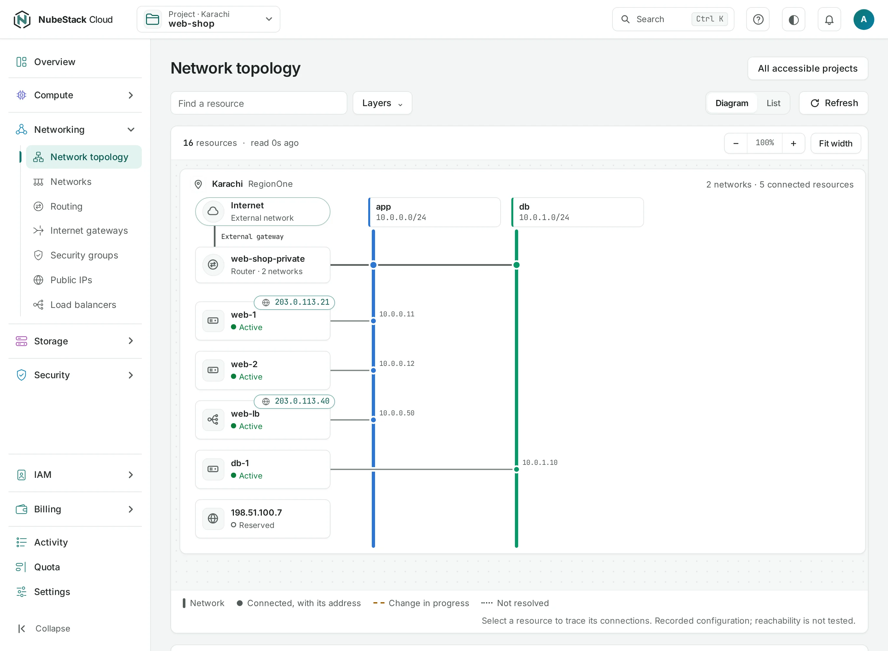

# Network map

The network map shows how your project's networks, routers, instances, load balancers and public IPs connect. Use it to find a missing path or understand which resources a network change affects.

<div class="docs-method-picker" hidden role="group" aria-label="Instruction method">
<span>Show instructions for</span>
<div><button type="button" data-interface-choice="Console" aria-pressed="true">Console</button><button type="button" data-interface-choice="API" aria-pressed="false">API</button></div>
</div>

<div class="docs-method-note" markdown>

[Set up API authentication and variables](/api/overview.md#before-you-start). Replace example IDs and catalog choices. Reuse an idempotency key for retries of one request; use a new key for each new action.

</div>




## Read the map

=== "Console"

    1. Open **Networking → Network topology** in a project, or choose **View topology** on its overview.
    2. Select a location to focus on one cloud.
    3. Follow connections from an instance to its network and router. For an Internet-facing service, check its public IP and gateway as well.
    4. Select a node to open its resource page and inspect the configuration there.

    The organization also has a topology view for resources you are allowed to see. A visible line describes known configuration; it does not test connectivity or show whether a guest firewall accepts traffic.

=== "API"

    <span id="with-the-api" data-docs-method="API"></span>

    ```bash
    curl --fail-with-body -i -X GET "$NUBESTACK_API/v1/orgs/$ORG/projects/$PROJECT/network-topology" \
      -H "Authorization: Bearer $NUBESTACK_API_KEY"
    ```

    Returns `200` directly. Read the returned resource or current state to verify the change.

    [Request fields and responses](/api/reference/networking.md#project-topology).


## Missing or stale data

Read the freshness and partial-data notices. If one location is unavailable, the view can show what was last known and data from the other locations. An empty map can mean an empty project, a filter, missing access or resources not yet read. Use a resource list's **Refresh** before assuming a resource is gone.

The map is most useful for smaller projects. Large-project grouping and operation links are still being improved. Use lists and resource detail pages when the map becomes crowded.
