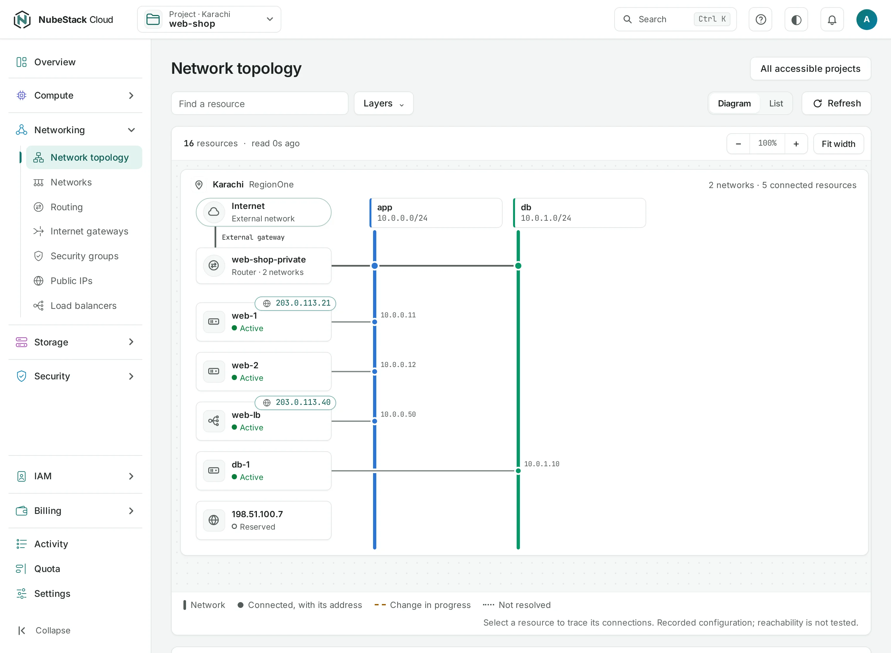

# Network topology

**Network topology** draws a project's networks, routers, instances, load balancers and public
IPs, and the lines between them. Use it to check how a service is wired, or to see what a
network change would affect.

Find it at the top of **Networking**, or with **View topology** on the project's overview. The
organization has a topology page too, across the projects you can see.



## Read the drawing

=== "Console"

    1. Pick a location to see one at a time.
    2. Follow an instance to its network and the router; for a service on the Internet, to its
       public IP and the Internet gateway.
    3. Choose any node to open its own page.

=== "API"

    ```bash
    curl -sS "$NUBESTACK_API/v1/orgs/$ORG/projects/$PROJECT/network-topology?location=pak-khi-1" \
      -H "Authorization: Bearer $NUBESTACK_API_KEY"
    ```

    The answer is `200 OK` with nodes and the edges between them.

A line shows how things are configured. It does not test that traffic flows: security groups and
the firewall inside an instance still decide that.

## Missing or old data

The drawing says when each location was last read. If a location has not answered, its part is
marked stale and shows what was last known; the other location still shows. An empty drawing can
mean an empty project, a filter, or resources not read yet: choose **Refresh** on a list before
you assume something is gone.

## Limits

The drawing suits small and medium projects. Instances are not yet grouped for large projects,
and nodes do not yet link to their operations. In a crowded project, use the lists and each
resource's page.

## Related

- [Networks](networks.md) · [Routing](routing.md) · [Load balancers](load-balancers.md)
