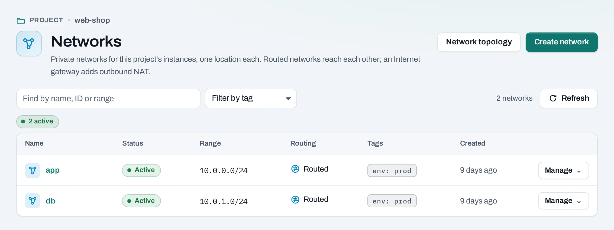
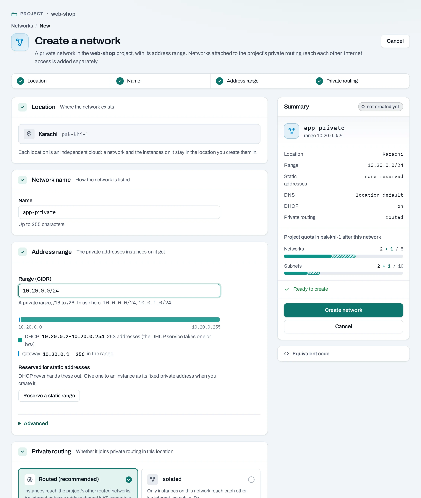
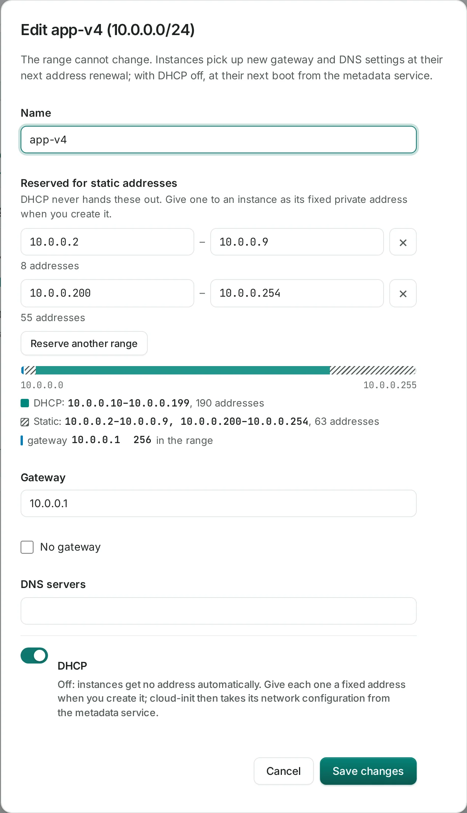

# Networks

A **network** gives the instances on it private addresses from one range, in one location.
**Routed** networks join the project's [private routing](routing.md) there and reach each other.
Reaching the Internet is a separate step: an [Internet gateway](internet-gateways.md).

Find them under **Networking → Networks**.



## The network a project starts with

A project created with **Set up a network** gets one routed network, `default`, in each of its
locations, with the range `10.0.0.0/24` unless the creator chose another. It is yours to change
or delete. A location with no network shows a notice on the **Networks** page; **Set up
network** there makes the same network.

## Before you start

- Plan the range. It cannot change later, and two routed networks in the same location must not
  overlap. A `/24` (256 addresses) suits most networks.
- A role of project admin or project member.

## Create a network

=== "Console"

    1. Choose **Create network**.
    2. **Location** and **Network name**.
    3. **Address range**:
        - **Range (CIDR)**: a private IPv4 range from `/16` to `/28`, inside `10.0.0.0/8`,
          `172.16.0.0/12` or `192.168.0.0/16`. The form warns when it would overlap another
          routed network.
        - **Gateway address** (optional): empty means the range's first address.
        - **DNS servers** (optional): up to four, comma-separated; empty uses the location's.
        - **Static addresses**: ranges DHCP never hands out, for addresses you set yourself.
    4. **Private routing**: **Routed** (recommended), or **Isolated**: only instances on this
       network reach each other, with no Internet and no public IPs.
    5. Choose **Create network**.

    

=== "API"

    ```bash
    curl -sS -X POST "$NUBESTACK_API/v1/orgs/$ORG/projects/$PROJECT/networks" \
      -H "Authorization: Bearer $NUBESTACK_API_KEY" \
      -H "Idempotency-Key: $(uuidgen)" \
      -H "Content-Type: application/json" \
      -d '{
        "location": "loc_01jbkhi",
        "display_name": "db",
        "routed": true,
        "subnet": {"cidr": "10.0.1.0/24", "dns_nameservers": ["10.0.1.2"], "enable_dhcp": true},
        "tags": {"env": "prod"}
      }'
    ```

    `subnet` also takes `gateway_ip`, `no_gateway` and up to 4 `allocation_pools`
    (`{start, end}`). The answer is `202 Accepted`.

## Change a network

=== "Console"

    Open the network. The **Address range** tab shows how the range is used. **Edit ranges**
    changes:

    - the gateway address and DNS servers; instances pick them up at their next address renewal;
    - **DHCP**: with it off, give each instance a fixed address when you create it;
    - the ranges kept for static addresses.

    

    From **Manage**: **Detach from private routing** and **Attach to private routing**.
    **Rename** is on the network's own page.

=== "API"

    ```bash
    curl -sS -X POST "$NUBESTACK_API/v1/orgs/$ORG/projects/$PROJECT/networks/net_01jbdb:set-routing" \
      -H "Authorization: Bearer $NUBESTACK_API_KEY" \
      -H "Idempotency-Key: $(uuidgen)" \
      -H "Content-Type: application/json" \
      -d '{"enabled": false}'
    ```

    `:set-internet-access` with `{"enabled": …}` attaches the network to the location's
    Internet gateway or detaches it. `PATCH …/networks/{id}` renames it.

The range itself cannot change; to use another, create a new network.

## How networks connect

- **Instances** get an address on a network when they are created, or with **Attach network**.
- **Routed** networks of the project in one location reach each other through
  [private routing](routing.md). Isolated networks do not.
- A routed network reaches the Internet through the location's
  [Internet gateway](internet-gateways.md), and is needed for [public IPs](public-ips.md).
- A [load balancer](load-balancers.md) takes its private address from a network's range.

## Delete a network

=== "Console"

    Choose **Manage → Delete** and confirm. Its range and routing attachment go; other networks
    and private routing stay.

=== "API"

    ```bash
    curl -sS -X DELETE "$NUBESTACK_API/v1/orgs/$ORG/projects/$PROJECT/networks/net_01jbdb" \
      -H "Authorization: Bearer $NUBESTACK_API_KEY" \
      -H "Idempotency-Key: $(uuidgen)"
    ```

**What blocks a delete or a detach**

| Refusal | Why | Resolve |
|---|---|---|
| `resource_in_use` | Instances, load balancers or others still have addresses on it; the message names them | Detach or delete them first |
| `public_ips_in_use` | A public IP reaches an instance through it (detaching routing or Internet access) | Detach or release the public IPs |
| `route_uses_network` | A route's next hop is on this network | Remove the route on the **Routing** page |

## Limits and good practice

- IPv4 only, one range per network.
- Leave room to grow: the range never changes.
- Use separate networks for tiers (web, database) and let security groups decide what crosses.
- A network made with a location's own tools that has several ranges or another router is shown
  as found, marked **outside Nexus**, and is not attached to private routing.

## Related

- [Routing](routing.md) · [Internet gateways](internet-gateways.md) · [Network topology](network-topology.md)
- [API reference: Networking](../api/reference/networking.md)
