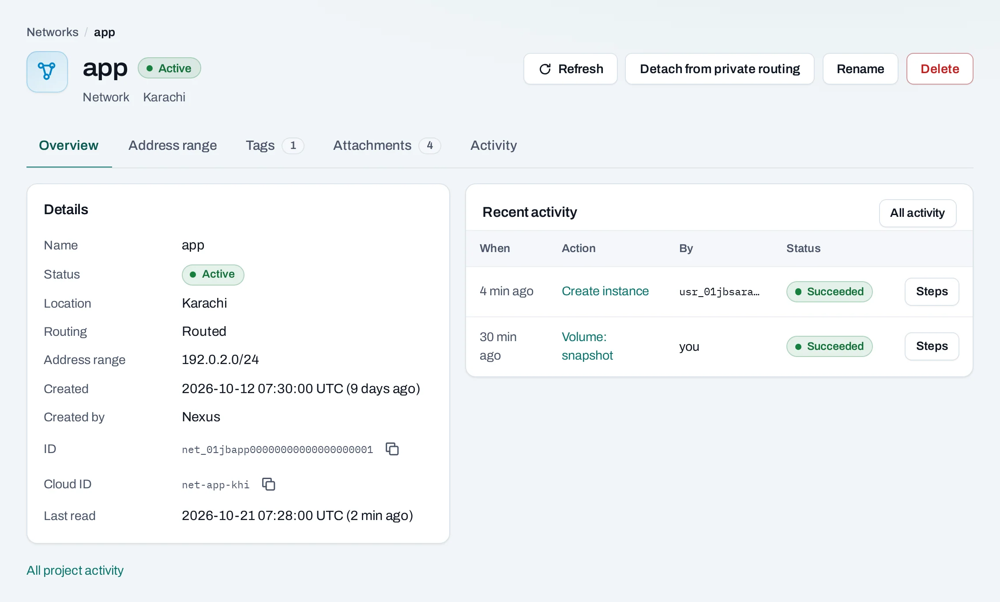

# Networks

A network gives instances a private address range in one location. Use separate networks when services need separate address ranges or different routing. Networks belong to a project; they cannot stretch from Karachi to Islamabad.

Open **Networking → Networks** in your project. The list shows the location, range, routing, attached instances and tags.

## Create a network

1. Choose **Create network** and a location.
2. Name it `app` and enter a CIDR address range. Use a private range that does not overlap the other networks you plan to connect. Example ranges in these docs use reserved documentation addresses.
3. Choose **Routed** to connect it to the project's other routed networks in this location, or **Isolated** to keep traffic within the network.
4. Keep DHCP on unless you will assign a fixed address to every instance. Set DNS servers if your application needs specific resolvers.
5. Optionally reserve a static address range. DHCP will not hand out these addresses; choose one as a fixed private address when launching an instance.
6. Add tags, review the summary and choose **Create network**. Follow the operation until it succeeds.

## Edit an address range

Open the network's detail page, then choose **Edit ranges**. You can change its name, gateway, DNS servers, DHCP and reserved static ranges. The CIDR itself cannot change; create a new network to use another CIDR. A normal network has one address range; networks discovered from native tools may have more.

Instances receive changed DHCP settings at their next renewal. With DHCP off, they receive network configuration at their next boot. Check the guest configuration after a change.

## Connect services

- Choose this network when creating an [instance](/compute/instances.md), or attach it from an instance's **Networks** tab.
- A [load balancer](/networking/load-balancers.md) uses a subnet in this location.
- **Attach to private routing** connects an isolated network to the project's router. An [Internet gateway](/networking/internet-gateways.md) adds Internet access to routed networks.
- [Security groups](/networking/security-groups.md) control allowed traffic even when routing exists.

## With the API

Replace `<private-ipv4-cidr>` with your chosen non-overlapping RFC 1918 range, using a prefix from `/16` to `/28`. Reserved documentation ranges in screenshots are illustrative and are not accepted as private network ranges.

<!-- api-example: post_network -->

List and read with `GET {P}/networks` and `GET {P}/networks/{id}`, where `{P}` is `/v1/orgs/{org_id}/projects/{project_id}`. Edit a range with `PATCH {P}/subnets/{id}`. Set tags with `PUT {P}/networks/{id}/tags`.

## Delete and limits

From **Manage → Delete**, review the resources holding ports on the network. Delete or disconnect the named instances and load balancers first. Detach public IPs before removing routing. A refused delete names what is still using the network; do not repeatedly submit it unchanged.

Quota is per project and location. Connected ranges must not overlap. Keep application networks private unless they need Internet access, and use [tags](/concepts/tags.md) to identify their purpose.
