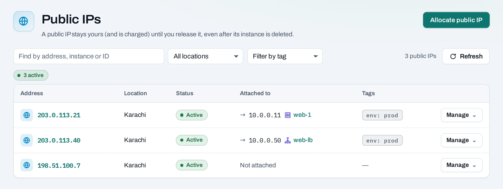
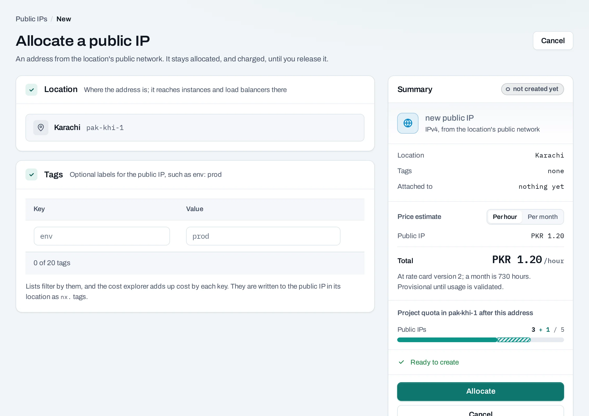
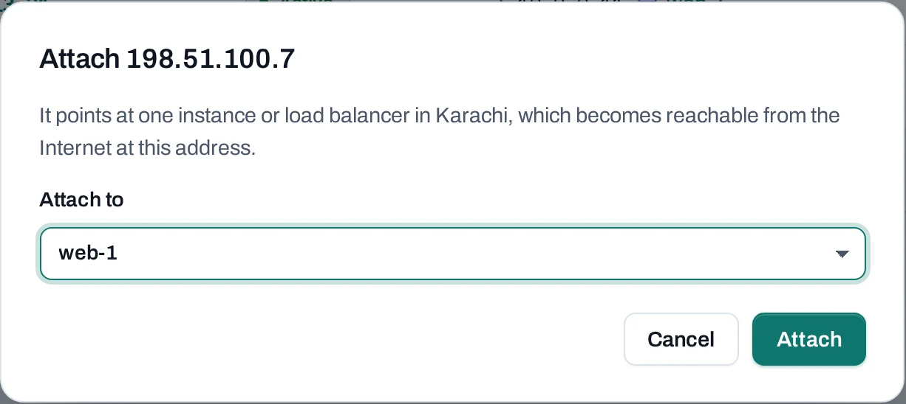

# Public IPs

A **public IP** makes one instance, or one load balancer, reachable from the Internet. It is an
address from the location's public network, allocated to your project. It stays yours, and
counted in your usage, until you release it, even after the instance it was on is deleted.

Find them under **Networking → Public IPs**.



## Before you start

- The instance must be on a routed [network](networks.md), and the location needs an
  [Internet gateway](internet-gateways.md).
- A public IP lets traffic reach the instance; its [security groups](security-groups.md) still
  decide which. Allow only the ports you serve.

## Get one with a new instance

On the instance create page, under **Network → Public IP**, choose **A new public IP**. It is
allocated with the instance and attached to it. In the API, `"public_ip": true`.

## Allocate one on its own

Keeping an address apart from any instance lets you move it between instances without telling
anyone a new address.

=== "Console"

    1. Choose **Allocate a public IP**.
    2. Choose the location, add tags if you like, and confirm.

    

=== "API"

    ```bash
    curl -sS -X POST "$NUBESTACK_API/v1/orgs/$ORG/projects/$PROJECT/floating-ips" \
      -H "Authorization: Bearer $NUBESTACK_API_KEY" \
      -H "Idempotency-Key: $(uuidgen)" \
      -H "Content-Type: application/json" \
      -d '{"location": "loc_01jbkhi", "tags": {"env": "prod"}}'
    ```

    Pass `server_id` to attach it to an instance at once.

## Attach and detach

=== "Console"

    - **Manage → Attach** on the address: choose an instance or load balancer in the same
      location. An instance on several routed networks asks which one the address reaches.
    - **Manage → Add public IP** on an instance does the same from the other side; on a load
      balancer, **Attach a public IP** under **Public exposure**.
    - **Detach**: the instance stops being reachable at this address at once. The address stays
      allocated.

    

=== "API"

    ```bash
    curl -sS -X POST "$NUBESTACK_API/v1/orgs/$ORG/projects/$PROJECT/floating-ips/fip_01jbspare:associate" \
      -H "Authorization: Bearer $NUBESTACK_API_KEY" \
      -H "Idempotency-Key: $(uuidgen)" \
      -H "Content-Type: application/json" \
      -d '{"server_id": "srv_01jbweb2"}'
    ```

    Use `load_balancer_id` for a load balancer, and `network_id` to pick the network. `:disassociate`
    with `{}` detaches it.

An address is attached to one instance or load balancer at a time.

## Release a public IP

=== "Console"

    Choose **Manage → Release** and confirm. If it is still attached, the dialog names what holds
    it; it is detached first.

=== "API"

    ```bash
    curl -sS -X DELETE "$NUBESTACK_API/v1/orgs/$ORG/projects/$PROJECT/floating-ips/fip_01jbspare" \
      -H "Authorization: Bearer $NUBESTACK_API_KEY" \
      -H "Idempotency-Key: $(uuidgen)"
    ```

The address returns to the location and you may not get it again. To keep it, detach it instead.
Nothing blocks a release.

## Limits and good practice

- IPv4 only. An address belongs to one location and cannot move to another.
- Your [quota](../organization/quota.md) limits how many a project holds in each location.
- Release addresses you no longer need: they count in your usage while allocated.
- Put a load balancer, not several public IPs, in front of a set of instances serving the same
  site.

## Related

- [Internet gateways](internet-gateways.md) · [Load balancers](load-balancers.md)
- [API reference: Public IPs](../api/reference/public-ips.md)
