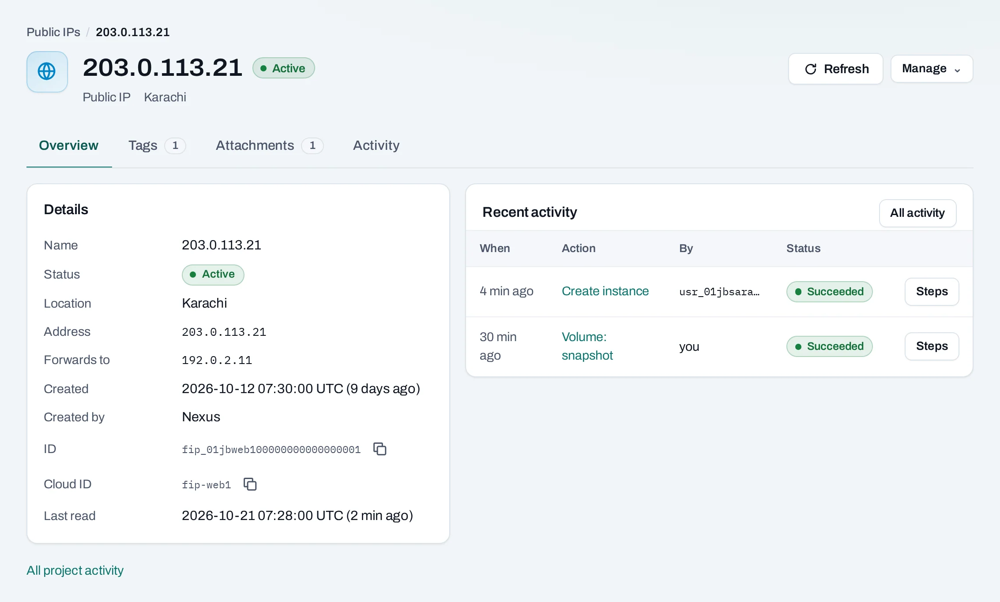

# Public IPs

A public IP is an Internet-facing address allocated to your project in one location. Attach it to an instance or load balancer that needs inbound Internet access. It stays allocated after detaching or deleting the instance, until you release it.

<div class="docs-method-picker" hidden role="group" aria-label="Instruction method">
<span>Show instructions for</span>
<div><button type="button" data-interface-choice="Console" aria-pressed="true">Console</button><button type="button" data-interface-choice="API" aria-pressed="false">API</button></div>
</div>

<div class="docs-method-note" markdown>

[Set up API authentication and variables](/api/overview.md#before-you-start). Replace example IDs and catalog choices. Reuse an idempotency key for retries of one request; use a new key for each new action.

</div>


## Allocate an address

=== "Console"

    1. Open **Networking → Public IPs**, then **Allocate public IP**.
    2. Choose the location. Add tags such as `env: prod` and `team: web`.
    3. Allocate it and follow the operation. The location chooses the address; the example `203.0.113.21` is not an address you can reserve.

    

=== "API"

    <span id="with-the-api" data-docs-method="API"></span>

    ```bash
    curl --fail-with-body -i -X POST "$NUBESTACK_API/v1/orgs/$ORG/projects/$PROJECT/floating-ips" \
      -H "Authorization: Bearer $NUBESTACK_API_KEY" \
      -H "Idempotency-Key: $REQUEST_KEY" \
      -H "Content-Type: application/json" \
      --data '{
      "location": "loc_example",
      "tags": {
        "env": "prod",
        "team": "web"
      }
    }'
    ```

    A `202` accepts the change. Follow `operation.href` to its final result before the next dependent action.

    [Request fields and responses](/api/reference/public-ips.md#post-address).


## Attach or detach

=== "Console"

    Choose **Manage → Attach**, then an instance or load balancer in the same location. For an instance with several interfaces, choose the intended private address when offered. The target network must be routed through an [Internet gateway](/networking/internet-gateways.md).

    

    Follow the operation, then open the address's page to check its target. Instance and load balancer pages link back to the public IP. Allow the application's ports in its [security groups](/networking/security-groups.md); attachment alone does not allow traffic.

    

    **Detach** removes the association and interrupts connections using that address. It keeps the public IP available for another target in this project and location.

=== "API"

    **Attach a public IP**

    ```bash
    curl --fail-with-body -i -X POST "$NUBESTACK_API/v1/orgs/$ORG/projects/$PROJECT/floating-ips/$ADDRESS_ID:associate" \
      -H "Authorization: Bearer $NUBESTACK_API_KEY" \
      -H "Idempotency-Key: $REQUEST_KEY" \
      -H "Content-Type: application/json" \
      --data '{
      "server_id": "srv_example"
    }'
    ```

    A `202` accepts the change. Follow `operation.href` to its final result before the next dependent action.

    [Request fields and responses](/api/reference/public-ips.md#associate-address).

    **Detach a public IP**

    ```bash
    curl --fail-with-body -i -X POST "$NUBESTACK_API/v1/orgs/$ORG/projects/$PROJECT/floating-ips/$ADDRESS_ID:disassociate" \
      -H "Authorization: Bearer $NUBESTACK_API_KEY" \
      -H "Idempotency-Key: $REQUEST_KEY" \
      -H "Content-Type: application/json" \
      --data '{}'
    ```

    A `202` accepts the change. Follow `operation.href` to its final result before the next dependent action.

    [Request fields and responses](/api/reference/public-ips.md#disassociate-address).


## Release and limits

=== "Console"

    Detach an attached address, then choose **Manage → Release**. Release returns it to the location's pool and stops its allocated-IP usage. You cannot rely on getting the same address again. Update DNS and external allowlists before releasing an address in use.

    Public IP quota is per project and location. Unattached addresses still count toward quota and measured usage. Use [tags](/concepts/tags.md) to find unused allocations.

=== "API"

    ```bash
    curl --fail-with-body -i -X DELETE "$NUBESTACK_API/v1/orgs/$ORG/projects/$PROJECT/floating-ips/$ADDRESS_ID" \
      -H "Authorization: Bearer $NUBESTACK_API_KEY" \
      -H "Idempotency-Key: $REQUEST_KEY"
    ```

    A `202` accepts the change. Follow `operation.href` to its final result before the next dependent action.

    [Request fields and responses](/api/reference/public-ips.md#release-address).

## Change public IP tags

=== "Console"

    Open the allocated address, choose **Tags** and save the complete intended set. Tags do not retroactively change earlier cost attribution.

=== "API"

    ```bash
    curl --fail-with-body -i -X PUT "$NUBESTACK_API/v1/orgs/$ORG/projects/$PROJECT/floating-ips/$RESOURCE_ID/tags" \
      -H "Authorization: Bearer $NUBESTACK_API_KEY" \
      -H "Idempotency-Key: $REQUEST_KEY" \
      -H "If-Match: $ETAG" \
      -H "Content-Type: application/json" \
      --data '{
      "tags": {
        "env": "prod"
      }
    }'
    ```

    A `202` accepts the change. Follow `operation.href` to its final result before the next dependent action.

    [Request fields and responses](/api/reference/public-ips.md#set-floating-ip-tags).
