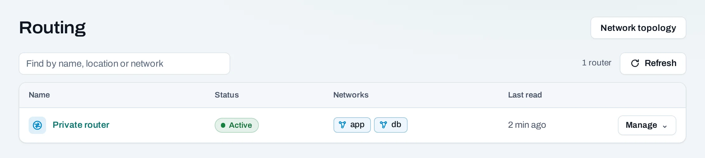

# Routing

Each project has one private router in its location. It is set up with the project, without a
public address, and every **routed** [network](networks.md) of the project is attached to it, so
instances on one routed network reach instances on another.

Find it under **Networking → Routing**, with the networks behind it.



You do not create or delete this router; it comes and goes with the project. Nothing
on it reaches the Internet until you add an [Internet gateway](internet-gateways.md).
[Security groups](security-groups.md) decide what traffic is allowed; the router only carries it.

## Attach and detach networks

A network joins private routing when you create it as **Routed**. To change that later, use the
network's **Manage** menu: **Detach from private routing** or **Attach to private routing**. A
network must not overlap another routed network of the project to attach.

## Send a range through an instance

A **route** sends traffic for a range to one of your instances, for example a VPN instance that
reaches your office.

=== "Console"

    1. On **Routing**, choose **Manage → Routes and attached networks** on the router.
    2. On the **Routes** tab, choose **Add a route**.
    3. **Destination**: the range, such as `192.168.50.0/24`. Not `0.0.0.0/0`, which goes
       through the Internet gateway, and not the range of an attached network.
    4. **Next hop**: the instance's private address, on an attached network.
    5. Choose **Add route**, then **Save routes**.

=== "API"

    The list replaces the router's routes:

    ```bash
    curl -sS -X POST "$NUBESTACK_API/v1/orgs/$ORG/projects/$PROJECT/routers/rtr_01jbkhi:set-routes" \
      -H "Authorization: Bearer $NUBESTACK_API_KEY" \
      -H "Idempotency-Key: $(uuidgen)" \
      -H "Content-Type: application/json" \
      -d '{"routes": [{"destination": "192.168.50.0/24", "nexthop": "10.0.0.40"}]}'
    ```

The instance at the next hop must also be allowed to forward traffic for addresses other than
its own; otherwise the location drops it.

## Let an instance forward traffic

Where the location offers it, an instance's interface can forward for private ranges behind it.

=== "Console"

    1. Open the instance's **Networks** tab. **Forwards for** shows what each interface forwards
       for now; the column is missing where the location does not offer forwarding.
    2. Choose **Manage → Forwarding…** on the network.
    3. Enter the ranges, comma-separated, such as `192.168.50.0/24, 10.8.0.0/16`. Leave it empty
       to stop forwarding.
    4. Choose **Save forwarding**.

=== "API"

    ```bash
    curl -sS -X POST "$NUBESTACK_API/v1/orgs/$ORG/projects/$PROJECT/servers/srv_01jbvpn:set-forwarding" \
      -H "Authorization: Bearer $NUBESTACK_API_KEY" \
      -H "Idempotency-Key: $(uuidgen)" \
      -H "Content-Type: application/json" \
      -d '{"network_id": "net_01jbapp", "cidrs": ["192.168.50.0/24"]}'
    ```

Then, inside and around the instance:

- Turn on IP forwarding in its system (on Linux, `sysctl -w net.ipv4.ip_forward=1`, kept in
  `/etc/sysctl.d/`).
- Add a route for the ranges with the instance as the next hop (above).
- Allow the forwarded ranges by address in the security groups of the instances they reach.

**What is refused**

| Refusal | Why |
|---|---|
| A range that is not private | Only ranges inside `10.0.0.0/8`, `172.16.0.0/12` or `192.168.0.0/16`, never `0.0.0.0/0`: an instance cannot be a NAT to the Internet |
| A range of a network the instance is not on | The instance could then send as instances on that network |
| An interface with port security off | It already sends and receives for any address |
| More than ten ranges on an interface | Including address pairs set with the location's own tools |

## Routers made outside NubeStack Cloud

A router made with a location's own tools is listed too, marked **outside Nexus** and **extra
router**. Its page shows its interfaces and gateway; you can attach and detach ranges and set its
gateway there. Your routed networks are not attached to it. Deleting one with interfaces needs
them removed first (`DELETE …/routers/{id}?remove_interfaces=true` in the API).

## Limits

- One private router per project; up to 16 routes on it.
- The project's own router cannot be deleted (`router_managed`).

## Related

- [Networks](networks.md) · [Internet gateways](internet-gateways.md) · [Connect private services](../tutorials/private-networking.md)
- [API reference: Networking](../api/reference/networking.md)
