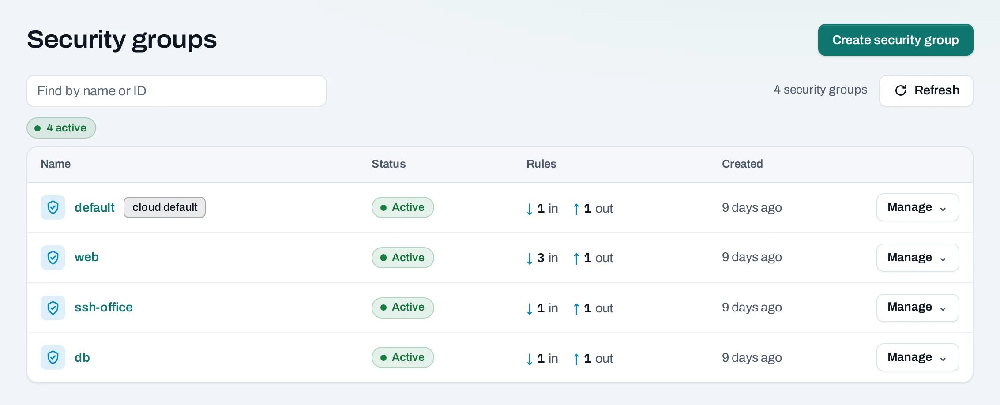
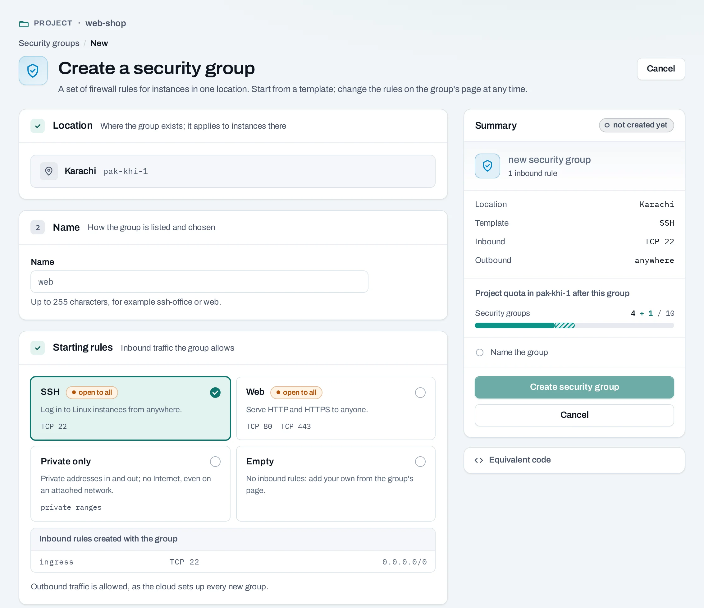
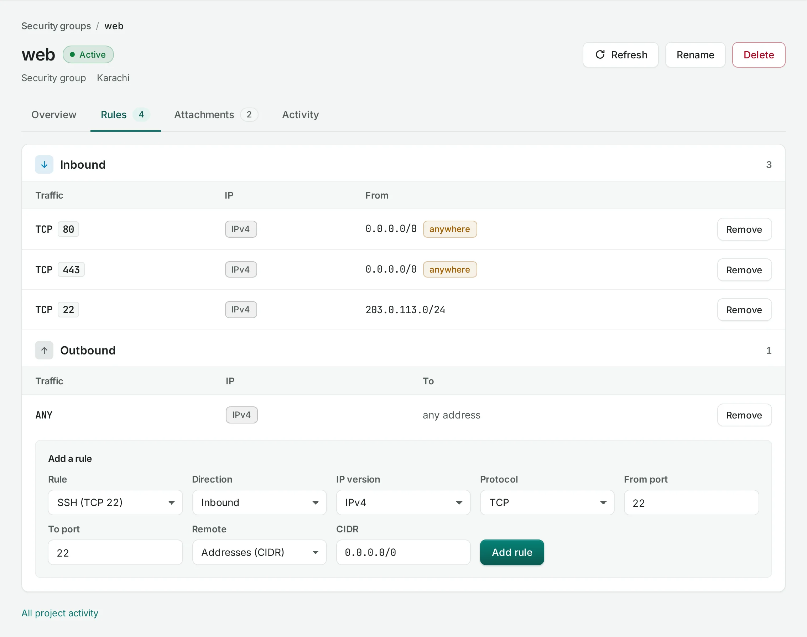

# Security groups

A security group is a set of firewall rules for an instance's network interfaces. Use groups to allow only the traffic an application needs. Rules are additive: traffic permitted by any attached group is permitted. An Internet gateway or public IP provides a path; the group decides which traffic may use it.

<div class="docs-method-picker" hidden role="group" aria-label="Instruction method">
<span>Show instructions for</span>
<div><button type="button" data-interface-choice="Console" aria-pressed="true">Console</button><button type="button" data-interface-choice="API" aria-pressed="false">API</button></div>
</div>

<div class="docs-method-note" markdown>

[Set up API authentication and variables](../api/index.md#before-you-start). Replace example IDs and catalog choices. Reuse an idempotency key for retries of one request; use a new key for each new action.

</div>

Open **Networking → Security groups** in a project.




## Create a group

=== "Console"

    1. Choose **Create security group**.
    2. Select its location and give it a name such as `web-access`.
    3. Choose a starting template if appropriate: SSH, web or private traffic.
    4. Review the rules and create it. Follow the operation.

    

=== "API"

    <span id="with-the-api" data-docs-method="API"></span>

    ```bash
    curl --fail-with-body -i -X POST "$NUBESTACK_API/v1/orgs/$ORG/projects/$PROJECT/security-groups" \
      -H "Authorization: Bearer $NUBESTACK_API_KEY" \
      -H "Idempotency-Key: $REQUEST_KEY" \
      -H "Content-Type: application/json" \
      --data '{
      "location": "loc_example",
      "display_name": "web-access",
      "template": "web"
    }'
    ```

    A `202` accepts the change. Follow `operation.href` to its final result before the next dependent action.

    [Request fields and responses](../api/reference/security-groups.md).


## Add and remove rules

=== "Console"

    1. Open a group and choose **Add rule**.
    2. Select ingress for traffic entering an instance, or egress for traffic leaving it.
    3. Choose the IP version and protocol. For TCP or UDP, set the port or port range.
    4. Set the remote CIDR or remote security group. Use your own office CIDR for SSH rather than `0.0.0.0/0`.
    5. Save and follow the operation. Remove an obsolete rule from its row's menu.

    

    To attach the group, choose it during [instance creation](../compute/instances.md) or use **Manage → Security groups** on an existing instance. A group must belong to the same project and location.

    !!! warning "Shared groups affect every attached instance"

        Changing the `default` group changes access for every instance using it. The create-instance shortcuts show which group receives the SSH and web rules. Check that summary before confirming.

=== "API"

    **Add a security group rule**

    ```bash
    curl --fail-with-body -i -X POST "$NUBESTACK_API/v1/orgs/$ORG/projects/$PROJECT/security-groups/$GROUP_ID:add-rule" \
      -H "Authorization: Bearer $NUBESTACK_API_KEY" \
      -H "Idempotency-Key: $REQUEST_KEY" \
      -H "Content-Type: application/json" \
      --data '{
      "direction": "ingress",
      "ethertype": "IPv4",
      "protocol": "tcp",
      "port_min": 443,
      "port_max": 443,
      "remote_ip_prefix": "0.0.0.0/0"
    }'
    ```

    A `202` accepts the change. Follow `operation.href` to its final result before the next dependent action.

    [Request fields and responses](../api/reference/security-groups.md).

    **Remove a security group rule**

    ```bash
    curl --fail-with-body -i -X POST "$NUBESTACK_API/v1/orgs/$ORG/projects/$PROJECT/security-groups/$GROUP_ID:remove-rule" \
      -H "Authorization: Bearer $NUBESTACK_API_KEY" \
      -H "Idempotency-Key: $REQUEST_KEY" \
      -H "Content-Type: application/json" \
      --data '{
      "direction": "ingress",
      "ethertype": "IPv4",
      "protocol": "tcp",
      "port_min": 443,
      "port_max": 443,
      "remote_ip_prefix": "0.0.0.0/0"
    }'
    ```

    A `202` accepts the change. Follow `operation.href` to its final result before the next dependent action.

    [Request fields and responses](../api/reference/security-groups.md).


## Delete and good practice

=== "Console"

    Detach the group from all instances before choosing **Delete**. A refusal names its users; the default group has additional restrictions. Keep separate groups for SSH administration, public application ports and private database traffic. Review egress rules as well as ingress rules, and check project and location quota before adding many groups or rules.

=== "API"

    ```bash
    curl --fail-with-body -i -X DELETE "$NUBESTACK_API/v1/orgs/$ORG/projects/$PROJECT/security-groups/$GROUP_ID" \
      -H "Authorization: Bearer $NUBESTACK_API_KEY" \
      -H "Idempotency-Key: $REQUEST_KEY"
    ```

    A `202` accepts the change. Follow `operation.href` to its final result before the next dependent action.

    [Request fields and responses](../api/reference/security-groups.md).

## Attach a group to an instance

=== "Console"

    Select the groups during instance creation or use **Manage → Security groups** on an existing instance. Save the complete intended set; their allow rules are additive.

=== "API"

    ```bash
    curl --fail-with-body -i -X POST "$NUBESTACK_API/v1/orgs/$ORG/projects/$PROJECT/servers/$SERVER_ID:set-security-groups" \
      -H "Authorization: Bearer $NUBESTACK_API_KEY" \
      -H "Idempotency-Key: $REQUEST_KEY" \
      -H "Content-Type: application/json" \
      --data '{
      "security_group_ids": [
        "sgr_example"
      ]
    }'
    ```

    A `202` accepts the change. Follow `operation.href` to its final result before the next dependent action.

    [Request fields and responses](../api/reference/instances.md).
