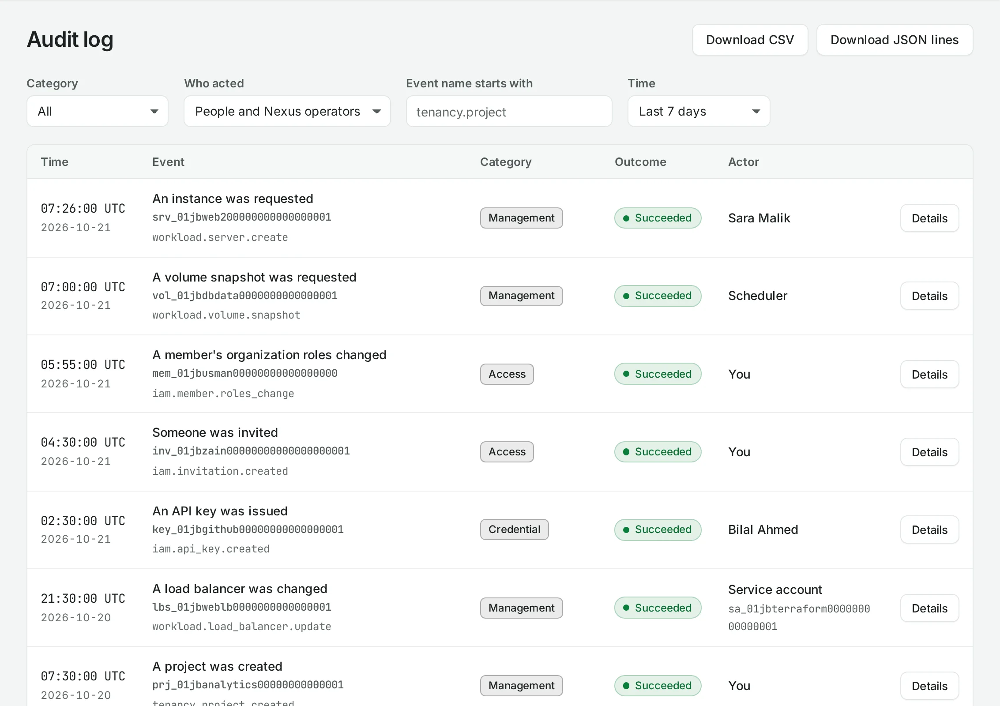

# Activity and audit log

Activity helps answer who changed a resource, what happened and which operation carried it out. Use the organization audit log for access and security events, and project activity for work on that project's resources.



## Find a change

1. Open **Activity** at the organization or project level.
2. Choose a time range and filter by the available actor, category, outcome or resource controls.
3. Open an event to inspect its target, result and request ID.
4. Follow an operation link to see whether the accepted change finished, failed or partly succeeded.

An accepted request and a successful final operation are different events. A refused request may appear in the audit log without creating an operation. Resource detail pages also have their own **Activity** tab.

Actors appear as a person, service account, former member or system action. Visibility of names and email addresses depends on your role. Do not infer a human action from a system-scheduled event.

## Export

When allowed by organization policy, export the selected audit events as CSV or JSON lines. Narrow the time range to the incident or review you need. The readable window is configured in [organization settings](/organization/settings.md); it may not cover the organization's entire history.

Protect exports because they can contain member addresses and resource information. Events do not provide a way to recover private keys or one-time credential secrets.

## With the API

```bash
curl --fail-with-body "$NUBESTACK_API/v1/orgs/$ORG/audit-events" \
  -H "Authorization: Bearer $NUBESTACK_API_KEY"
```

The response is `200` with events and pagination metadata. Read one event at `/audit-events/{event_id}`, and use `/audit-events:export` with the documented format and filters for export. Project operations are listed at `/v1/orgs/{org_id}/operations` with the supported project filter. See [Requests](/api/requests.md) for pagination and [Operations](/api/operations.md) for polling.

## When asking for help

Record the event time, request ID, operation ID, project and location. Include the problem code and the text of the refusal. Never include an API key, invitation secret, private key or console URL in a support request.
