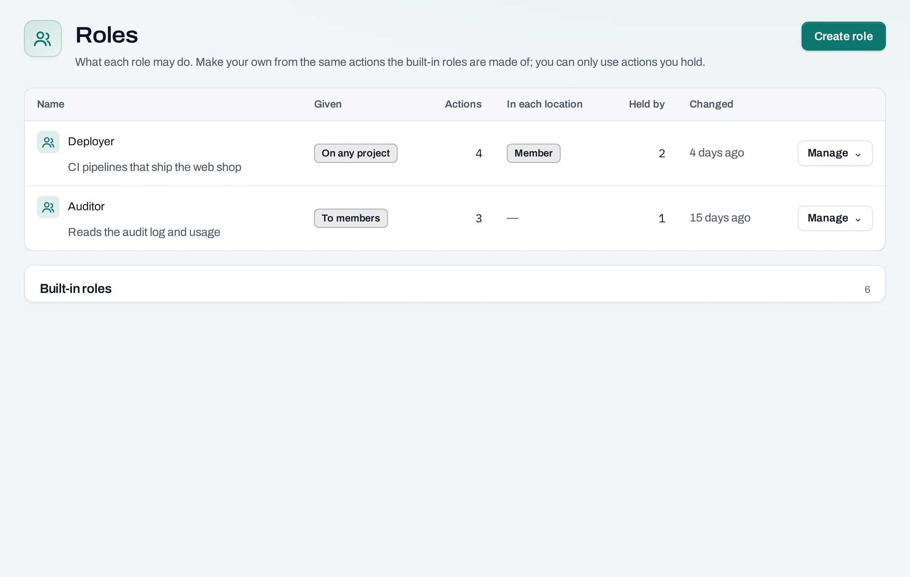
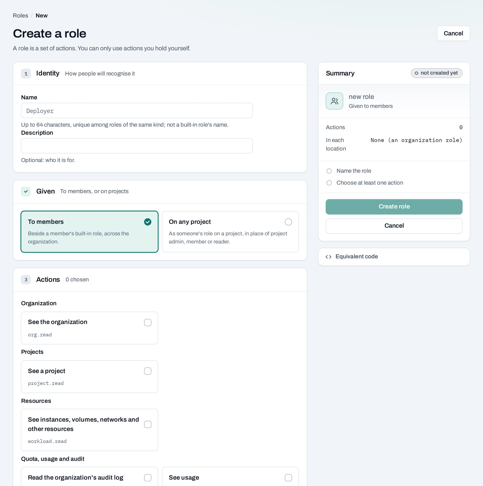

# Custom roles

Custom roles combine selected actions when the built-in roles are too broad. Use one for a deployment team that may create and update instances but must not manage access, or an auditor who only reads activity and usage.

## Create a role

1. Open the organization's **Roles** page, or the project's role settings for a project-local role.
2. Choose **Create role**, give it a name and explain its purpose.
3. Choose its scope: organization or project. Select actions from the offered list.
4. Check the summary and save. The picker only offers assignable actions you are permitted to delegate.
5. Assign the role to a member or service account using an organization role assignment or project grant, as appropriate.

Some security-sensitive actions are unavailable in custom roles. The action list is authoritative; a role cannot be used to give access you do not hold. See [Roles and permissions](/concepts/roles-and-permissions.md) for the organization/project distinction and native access behavior.

## Edit a role safely

Open the role to see its actions and holders. Review every affected holder before adding or removing actions. If the role supplies native project access, changes can take time to reach each location. The console reports any operation required by an update.

Updates use a version check. If someone else changed the role, refresh and review their version before saving your changes again.

## With the API

<!-- api-example: create_role -->

Organization-wide definitions use `/v1/orgs/{org_id}/roles`; project-local definitions use `/v1/orgs/{org_id}/projects/{project_id}/roles`. Discover allowable actions through the corresponding `/role-actions` endpoint. Read the current role and use its ETag in `If-Match` for edits and deletes. An update can return `200` or `202` depending on whether changes must be applied to native access.

## Delete and limits

Built-in roles cannot be edited or deleted. Remove or replace assignments before deleting a custom role; a role still held by a member or service account is refused. Prefer a small set of clearly named roles over one per person, and review role holders regularly.
