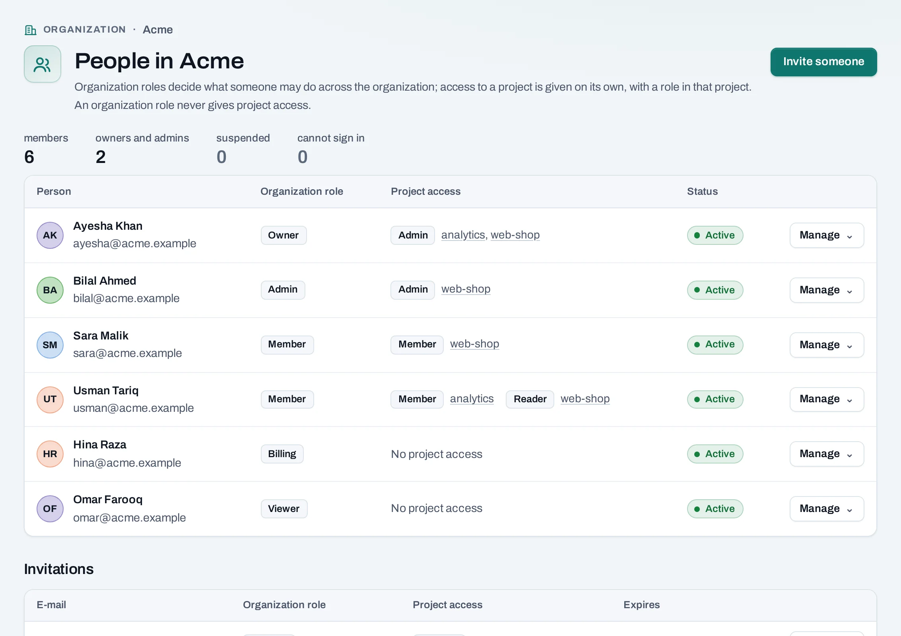
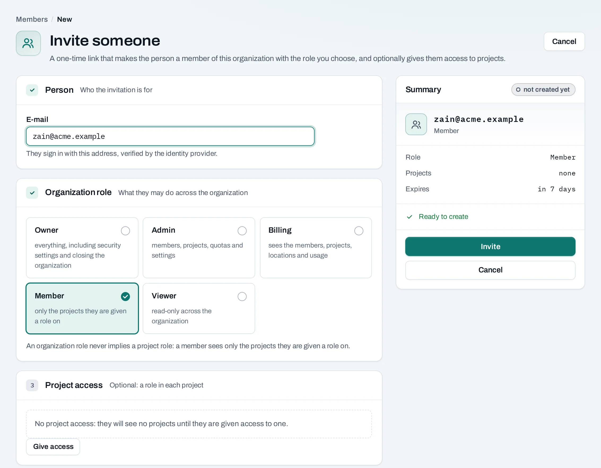
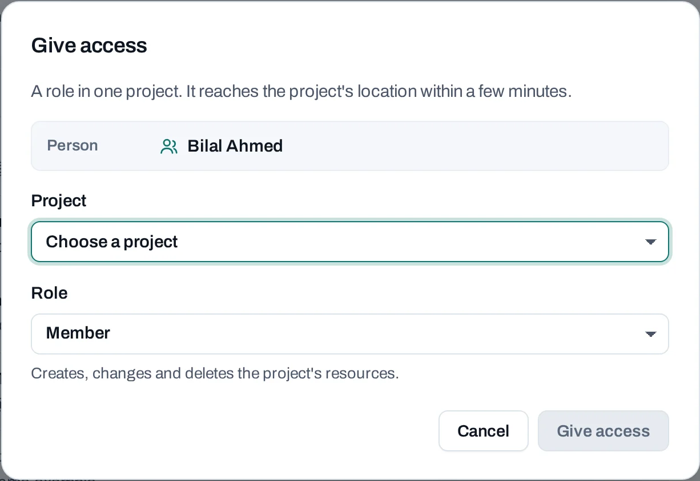

# People and invitations

Everyone in an organization has an **organization role**. To use a project's instances, networks
and volumes, they also need a **project role** on that project. Owners and admins manage people in
the organization's **IAM → People**.

In a project, **IAM → People** lists only who can use that project; see
[Projects](projects.md#who-can-use-a-project).

## Before you start

- Owners and admins invite. Admins cannot invite or change owners.
- If the organization limits invitations to some e-mail domains
  ([Settings](settings.md#security)), the address must be in one of them.

## Invite someone

1. Choose **Invite someone**.
2. **E-mail**: they sign in with this address.
3. **Organization role**: **Member** is usual. See [the roles](../get-started/organizations.md).
4. **Project access** (optional): choose **Give access** for each project they should use, with a
   role there. Without one, a member sees no projects.
5. Choose **Invite**.

The invitation goes by e-mail where NubeStack sends e-mail, and the page also shows the link once
so you can send it yourself. The link works once, for that address only, for seven days.

Under **Pending invitations**, from the invitation's **Manage** menu:

- **New link**: the old link stops working and a new one is shown once. The role and project
  access stay as invited.
- **Withdraw**: the link stops working at once.

If, by the time they accept, you can no longer give the role you invited them with, the
invitation is refused; someone who can give that role chooses **New link**.

## Change someone's roles

From the person's **Manage** menu:

- **Organization roles**: their organization role, and any [custom roles](custom-roles.md).
- **Give access**: a role on a project. Their existing access is listed under **Project
  access**; the project's own **IAM → People** changes or removes it.
- **Make owner**: owners only. The organization keeps at least one active owner.

!!! note "Making an owner asks for a fresh sign-in"

    Making someone an owner, by a role change, an invitation or a **New link** for an owner's
    invitation, asks you to sign in again with your second factor first if your sign-in is not
    recent. The console takes you to the sign-in page and back.

## Suspend, resume or remove someone

- **Suspend**: refused in this organization at once and signed out of every location within
  minutes. Their roles and resources stay. **Resume** gives access back.
- **Remove**: they lose every project role, their personal SSH keys and service accounts are
  deleted, and they are signed out of every location within minutes. What they made stays.

Access ends in the console and API at once. Each location's Horizon and the OpenStack CLI follow
within 15 minutes; a session already open there keeps working until then.

## Leave an organization

Choose **Leave organization** from your own **Manage** menu, or from **Settings → Danger zone**.
Your access ends at once and your personal SSH keys here are deleted. The only owner cannot leave:
make someone else an owner first.

## Through the API

People and invitations are managed by people in the console. A service account's API key cannot
invite, change roles or remove anyone (`403`). The routes are in
[API reference: Members and invitations](../api/reference/members-and-invitations.md).

## Related

- [Roles and permissions](../concepts/roles-and-permissions.md) · [Custom roles](custom-roles.md)
- [Sign up and sign in](../get-started/account.md)
