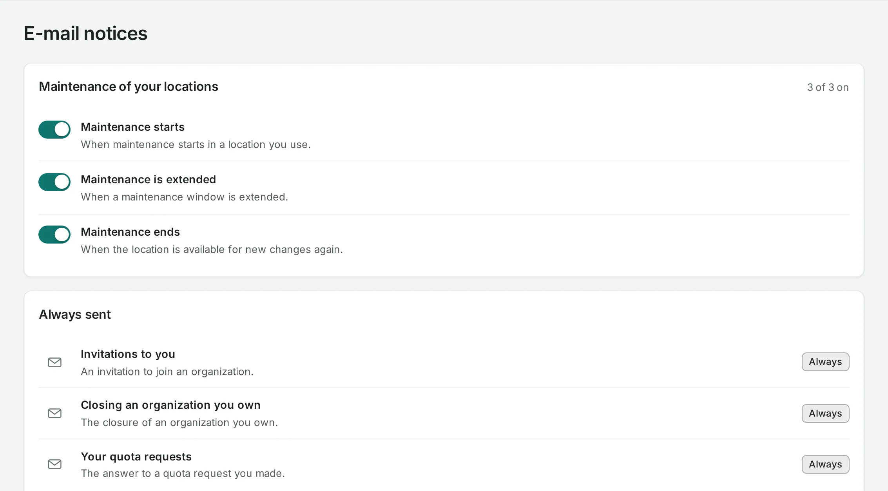

# E-mail notices

NubeStack Cloud e-mails you about things that need your attention. Your choices are yours alone
and apply to the organization you are in.

Open your account menu at the top right and choose **E-mail notices**.

## What you can turn off

Notices about maintenance of the locations you use:

- when maintenance starts;
- when a maintenance window is extended;
- when the location takes new changes again.

Maintenance notices go to owners and admins.

## Always sent

- An invitation to you.
- The closure of an organization you own.
- The answer to a quota request you made.
- A [schedule](../storage/schedules.md) that failed or paused itself, to the person it runs as
  (or the owners and admins, if that person has left).

## Good to know

E-mail delivery is being brought into service. Until it is, the page says so, and your choices
apply once e-mail is sent. The console shows the same events meanwhile: operations in
**Activity**, schedules' runs, and quota requests' answers.

## Related

- [Schedules](../storage/schedules.md) · [Quota](quota.md) · [Locations](../concepts/locations.md)
