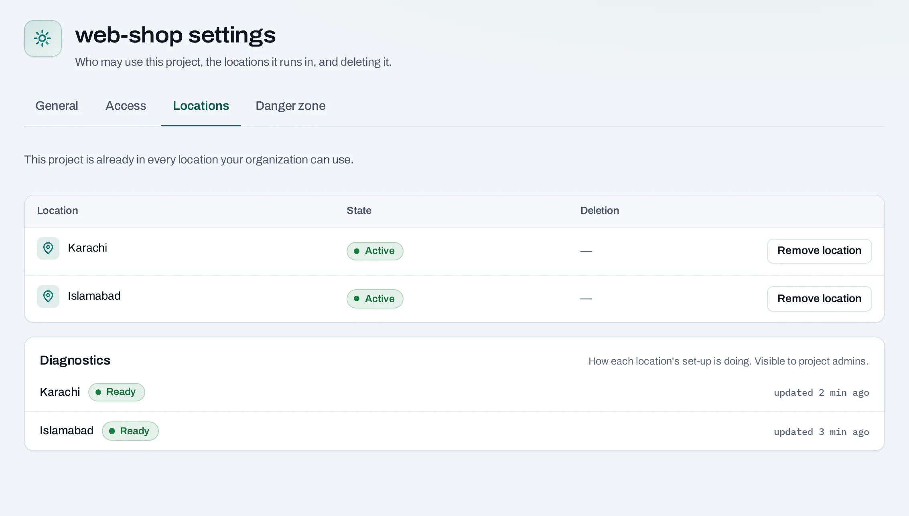

# Projects

A project groups what you run and who may use it. It runs in one or more locations, with its own
quota in each. Find them under **Projects** in the organization's side panel; each project's own
**Settings** has tabs **General**, **Access**, **Locations** and **Danger zone**.

To create one, see [Create a project](../get-started/create-a-project.md).

## Who can use a project

An organization role alone does not let anyone use a project's resources. People and service
accounts use a project through a project role, which applies in every location of the project.

| Project role | What it allows |
|---|---|
| Project admin | Everything a member can, plus giving and taking access, removing a location, deleting the project, sharing SSH keys and cancelling operations |
| Project member | Create, change and delete instances, networks, volumes and the rest |
| Project reader | See everything in the project, change nothing |

To give access:

1. Open the project's **Settings → Access**.
2. Choose **Grant access**, pick a member or a service account, and a role.

**Revoke access** beside someone takes the role away in every location within minutes. What they
made stays. A project's own [custom roles](custom-roles.md) are under **Settings → Access →
Project roles**.

## Add or remove a location

On **Settings → Locations**:

- **Add location**: owners and admins only, as it draws on the organization's budget there. You
  can set up a network (`10.0.0.0/24`) and an Internet gateway at the same time. Nothing is
  copied from the project's other locations.
- **Remove location**: project admins, owners and admins. It works like deleting the project, for
  that location only (below).

## Delete a project

Project admins, owners and admins delete projects from **Settings → Danger zone**, or **Delete
project** in the **Projects** list.

1. Choose **Delete project**. The dialog lists what the project holds in each location.
2. **What to delete**:
    - **Delete only if empty**: refused while anything is left.
    - **Delete everything in it**: instances, load balancers, public IPs, routers, networks and
      security groups go within minutes. Volumes, snapshots and images are kept for the
      recovery period.
3. Type the project's name and choose **Delete project**.

During the recovery period (7 days unless NubeStack agreed another with you):

- the project is suspended: nothing new can be made in it;
- **Cancel deletion** stops it. The project stays suspended until a project admin chooses
  **Resume project**. After **Delete everything**, only volumes, snapshots and images come back;
- **Delete now** ends the period early. You may be asked for your second factor.

When the period ends, everything left is deleted in every location. Once that has started, it
cannot be cancelled. If something stops it, such as a resource made with a location's own tools
that cannot be deleted for you, the page names it and why. See
[Deletion and retention](../concepts/deletion-and-retention.md).

<figure class="ns-diagram">
--8<-- "deletion-timeline.svg"
<figcaption>A project's deletion beside the organization's closure, from the moment it is requested to afterwards.</figcaption>
</figure>

**What blocks a delete**

| Refusal | Why | Resolve |
|---|---|---|
| Delete only if empty, and something is left | The project still holds resources | Delete them, or choose **Delete everything in it** |
| `second_factor_required` | Deleting everything, or deleting now, asks for your second factor | Confirm with your authenticator app |

## Through the API

A service account's API key cannot create or delete projects or add and remove locations. With a
role that allows it, it can read projects and manage what is inside them.

## Related

- [Projects and quotas](../concepts/projects-and-quotas.md) · [Quota](quota.md)
- [Deletion and retention](../concepts/deletion-and-retention.md)
