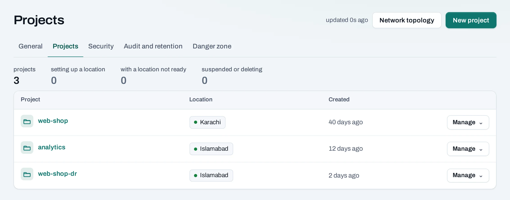
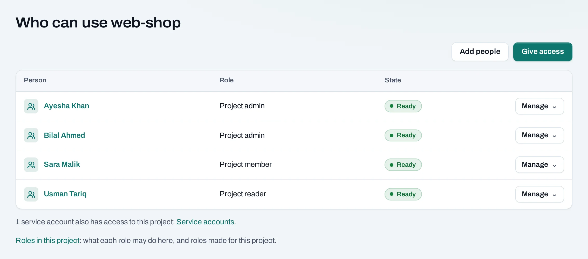
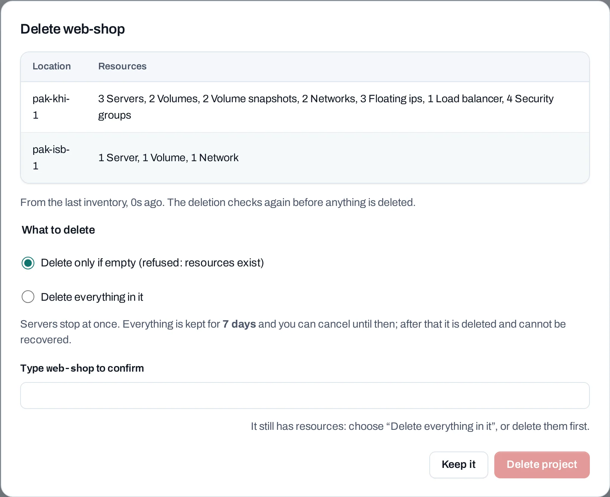

# Projects

A project groups what you run and who may use it. It runs in one location, with its own quota
there. Owners and admins find every project in the organization's **Settings → Projects**; each
project's own **Settings** has the tabs **General**, **Consoles and CLI** and **Danger zone**.

To create one, see [Create a project](../get-started/create-a-project.md).

## The projects list

**Settings → Projects** lists every project with its location and state. A location still
setting up, or not ready, says so beside the project. From a project's **Manage** menu:

- **Edit quotas**: owners and admins; see [Quota](quota.md).
- **Open project**: the project itself, as the scope selector does.
- **Copy ID**.
- **Delete project**: see below.

Choose a project's name for its settings, **General** and **Danger zone**, without leaving the
organization.

## Who can use a project

An organization role alone does not let anyone use a project's resources. People and service
accounts use a project through a project role.

| Project role | What it allows |
|---|---|
| Project admin | Everything a member can, plus giving and taking access, deleting the project, sharing SSH keys and cancelling operations |
| Project member | Create, change and delete instances, networks, volumes and the rest |
| Project reader | See everything in the project, change nothing |

To give access:

1. In the project, open **IAM → People**.
2. Choose **Give access**, pick a person and a role, and confirm.

A service account is given access on its own page: see [Service accounts](service-accounts.md).

The role reaches the project's location within a few minutes; the **State** column says when it
has. From a row's **Manage** menu, **Change access** gives another role in one change, and
**Remove access** takes it away. What they made stays. You change or remove only the access of someone whose organization role holds nothing you
don't: a project admin manages members' access, never an owner's, an admin's, a viewer's or
the billing role's; an admin never an owner's. Owners and admins also see **Add people**,
to invite someone who is not in the organization yet with a role on this project.

**Roles in this project**, under the list, shows what each role may do there and the
[custom roles](custom-roles.md) made for this project.

## Delete a project

Project admins, owners and admins delete projects from the project's **Settings → Danger zone**,
or with **Delete project** in **Settings → Projects**.

1. Choose **Delete project**. The dialog lists what the project holds.
2. **What to delete**:
    - **Delete only if empty**: refused while anything is left.
    - **Delete everything in it**: instances, load balancers, public IPs, routers, networks and
      security groups go within minutes. Volumes, snapshots and images are kept for the
      recovery period. Only owners and admins have this choice; a project admin deletes a
      project once it is empty.
3. Type the project's name and choose **Delete project**.

During the recovery period (7 days unless NubeStack agreed another with you):

- the project is suspended: nothing new can be made in it;
- **Cancel deletion** stops it. The project stays suspended until a project admin chooses
  **Resume project**. After **Delete everything**, only volumes, snapshots and images come back;
- **Delete now** ends the period early. You may be asked to sign in again with your second
  factor. Owners and admins only.

When the period ends, everything left is deleted. Once that has started, it cannot be cancelled.
If something stops it, such as a resource made with the location's own tools that cannot be
deleted for you, the page names it and why. See
[Deletion and retention](../concepts/deletion-and-retention.md).

<figure class="ns-diagram">
--8<-- "deletion-timeline.svg"
<figcaption>A project's deletion beside the organization's closure, from the moment it is requested to afterwards.</figcaption>
</figure>

**What blocks a delete**

| Refusal | Why | Resolve |
|---|---|---|
| Delete only if empty, and something is left | The project still holds resources | Delete them, or choose **Delete everything in it** |
| `second_factor_required` | Deleting everything, or deleting now, asks for your second factor | Sign in again with your authenticator app |

## Through the API

A service account's API key cannot create or delete projects. With a role that allows it, it
can read projects and manage what is inside them. People can create projects with the
[NubeStack CLI](../tools/cli.md) signed in as themselves; deleting one is done in the console.

## Related

- [Projects and quotas](../concepts/projects-and-quotas.md) · [Quota](quota.md)
- [Deletion and retention](../concepts/deletion-and-retention.md)
