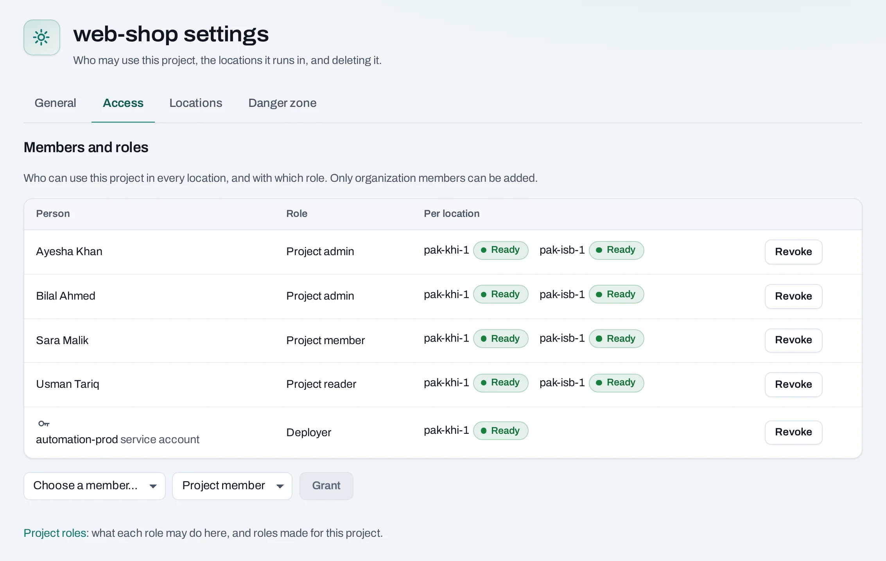
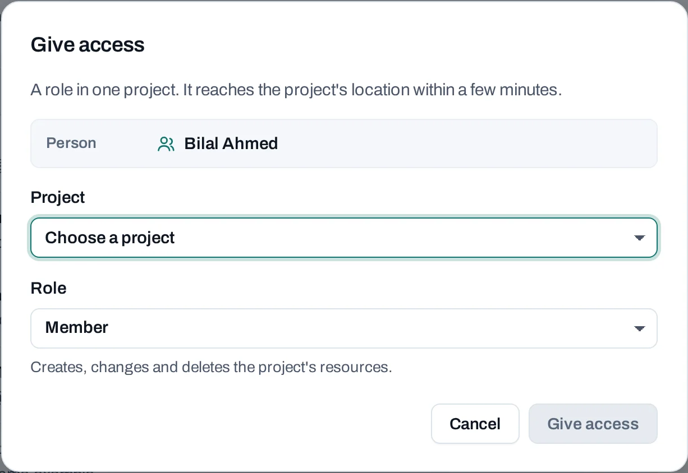

# Manage projects

Use projects to separate applications or teams while keeping membership and budgets in one organization. Each project can use one or more locations, with separate quota allocations and resources in each.

## Before changing a project

Confirm whether you are administering its access and locations or changing its workloads. An organization owner or admin can manage project settings; creating or deleting resources needs the corresponding project permission. A project reader cannot make these changes.

<!-- methods -->
## Manage access and locations

1. Open **Projects** at the organization level, then the project's management page, or choose **Settings** from inside the project.
2. Use **General** to confirm its name, IDs and current lifecycle state before working on it.
3. Open **Access** to add a person or service account and select a role. Use project reader for inspection, member for permitted resource changes, or project admin for broader project control. A custom role can narrow the actions.
4. Open **Locations** to add an offered location. Review the quota allocation and follow its setup operation before creating resources there.
5. To remove a location, review the deletion report for that location. This is a resource-deletion workflow, not a way to move its instances or disks elsewhere.

You can also manage a person's grants from **Members → Manage → Project roles**. Review each selected project rather than treating organization membership as access to every workload.

## With the API

Read a project with `GET /v1/orgs/{org_id}/projects/{project_id}`. Project grants are listed and changed under that project's `/grants` path; organization members and service accounts identify the recipients.

The API names a project's location entries `placements`. Use their IDs when adding or removing locations or reading a location's project quota. The [Projects](/api/reference/projects.md), [Project access](/api/reference/project-access.md) and [Quota](/api/reference/quota.md) reference pages document the bodies and concurrency headers.

Follow returned operations for changes that reach a location. A newly saved grant or location request is not proof that native access is already ready there.

## Quota and resource boundaries

Quota is allocated per project and location from organization budgets. Owners and admins can review allocations from the organization's quota controls. More quota does not guarantee that the location currently has capacity for a particular size.

Adding Islamabad to a project that uses Karachi does not copy its instances, networks, images or data. Re-create the application and arrange data replication explicitly when you need both locations.

## Delete, cancel or resume

Use **Danger zone → Delete project** only after checking retained data and automatic groups or schedules. Review **Delete only if empty** versus **Delete everything in it** and the displayed recovery window.

During that window, **Cancel deletion** stops further deletion but does not recreate resources already removed. The project remains suspended until an authorized person chooses **Resume project**. **Delete now** ends recovery early and can require a fresh second-factor check. Read [deletion and retention](/concepts/deletion-and-retention.md) before confirming.

For an application you are retiring without deleting the project, follow [resource cleanup](/tutorials/clean-up-resources.md).
