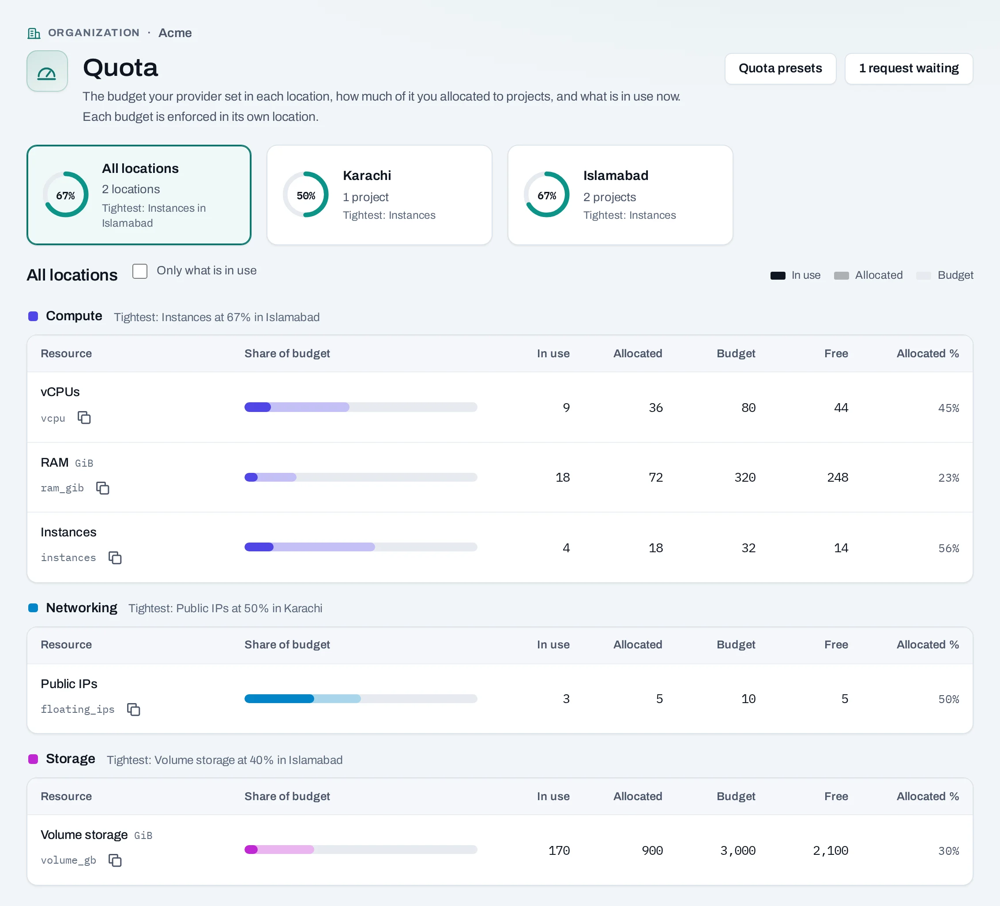
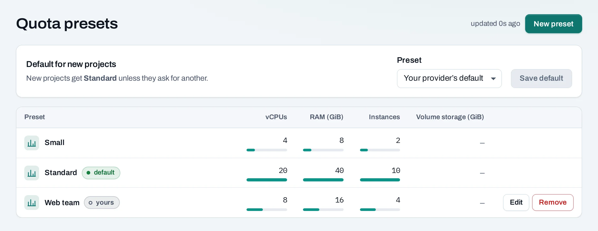
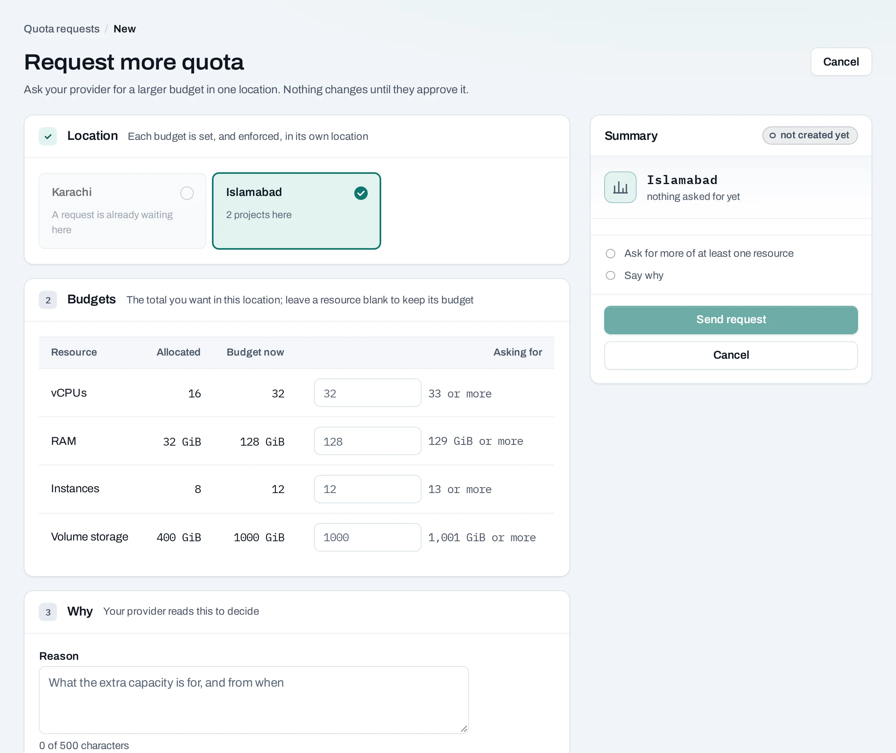

# Quota

Quota is how much a project may hold in a location: instances, vCPUs, memory, volumes and the
rest. It is set in two layers:

1. **NubeStack sets the organization's budget** in each location: how much the organization may
   hand out there.
2. **Your owners and admins share that budget between projects**: each project gets its own quota
   in each of its locations. Only owners and admins set project quota.

## See quota

- **Owners and admins**: **Quota** in the organization's side panel. **Show quotas for** picks
  one location or all together. The page warns when a budget is nearly or fully allocated.
- **Everyone with a project role**: **Quota and usage** at the bottom of the project's side
  panel shows the project's quota and what it uses.

## Set a project's quota

1. On **Projects**, choose **Manage → Edit quotas** for the project.
2. **Location**: quota is set per location.
3. Change the figures under **Quota per resource**. **Budget left** beside each says how much
   more the organization can give there.
4. Choose **Save quota**. The location applies it within a few minutes.

Project quota is set by people in the console. A service account's API key can read a project's
quota (`GET …/projects/{project_id}/quota`) but not change it.

Lowering a figure below what the project uses needs **Lower anyway**. Nothing running is removed, but nothing new of that kind can be made until use falls
below it. A figure marked **not enforced in this cloud** is one that location does not limit.

**What blocks a change**

| Refusal | Why | Resolve |
|---|---|---|
| `budget_exceeded` | More than the organization's budget has left in that location | Lower another project's quota, or request more |
| Below what is in use | The project already uses more | Choose **Lower anyway**, or free resources first |

The resources: instances, vCPUs, RAM (GiB), volumes, volume storage (GiB), volume snapshots,
networks, subnets, ports, routers, public IPs, security groups, security group rules, images and
image storage (GiB), and load balancers where the location offers them.

## Quota presets

A **quota preset** is the quota a new project starts with in each of its locations: the preset's
figure, or what is left of the budget there, whichever is less. Owners and admins manage them
from **Quota → Quota presets**.

- **Default for new projects**: pick one and **Save default**.
- **New preset**: a name and a starting figure for each resource.
- **Edit** reaches only projects created afterwards. **Remove** leaves projects made from it as
  they are; the default cannot be removed.

## Request more quota

When a budget runs short, owners and admins ask NubeStack for more, one location at a time.

1. From **Quota**, choose **Request more quota**.
2. Choose the location, and for each resource the **total** you want there.
3. Say what the capacity is for and from when.
4. Choose **Send request**.

The answer, and any note, appears under **Quota requests**; an approved request applies at once.
One request per location can wait at a time; **Cancel request** withdraws it.

## Quota is not capacity

Quota says how much you may use. Whether a location has room right now is separate: a request
within quota can still fail when a location has no room for that size. The operation says so;
try another size, later, or the project's other location.

## Related

- [Projects and quotas](../concepts/projects-and-quotas.md) · [Limits](../concepts/limits.md)
- [API reference: Quota](../api/reference/quota.md)
