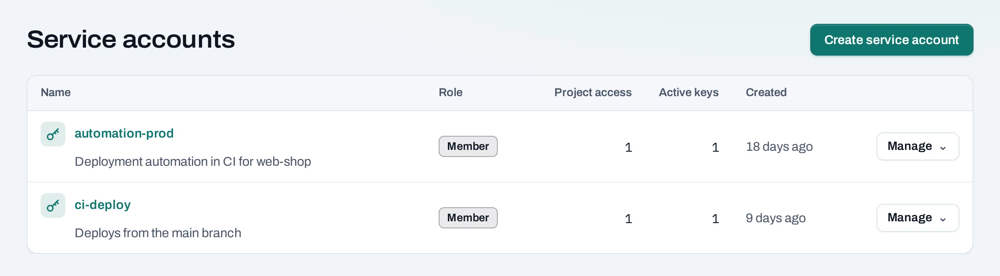
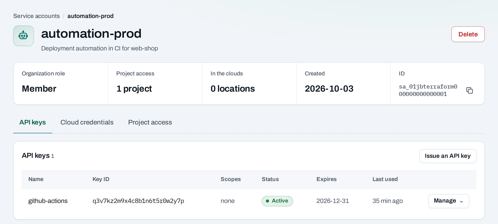
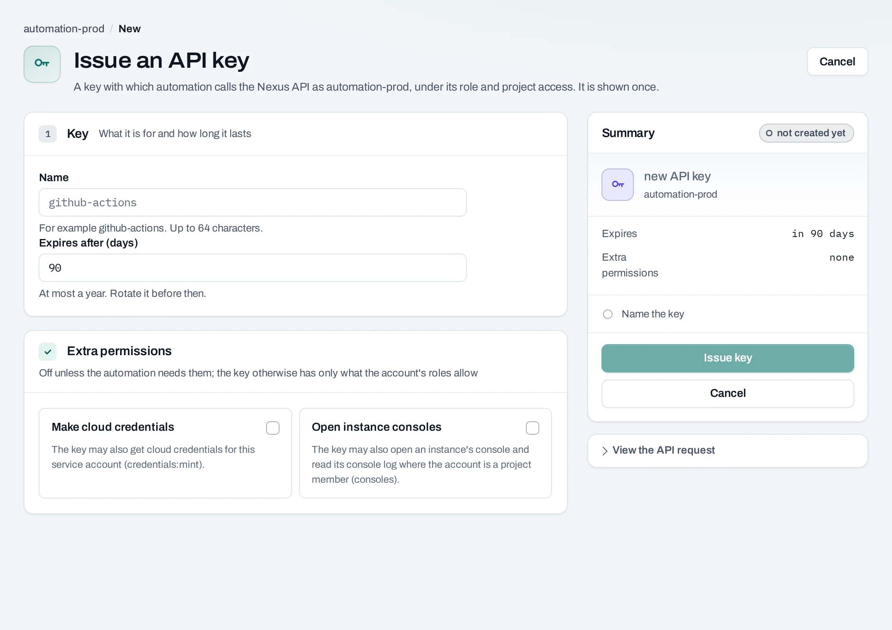

# Service accounts and API keys

A **service account** is an identity for automation: a CI pipeline, a deploy script, a backup
job. It has an organization role and project access like a person, but never signs in to the
console. It works with two kinds of credential:

- **API keys**, to call the [NubeStack Cloud API](../api/index.md);
- **Cloud credentials**, for the OpenStack CLI, an SDK or Terraform's OpenStack provider in one
  location of a project.

Owners and admins manage them under **Service accounts** in the organization's side panel.



## Create a service account

1. Choose **Create service account**.
2. **Name**: up to 64 characters, unique in the organization, for example `ci-deploy`.
3. **Description** (optional): what it is for and who looks after it.
4. **Organization role**: **Member** or **Viewer**.
5. Choose **Create service account**.

Then give it access to each project it works in: the project's **Settings → Access → Grant
access**, with project member or project reader.

Whatever its roles, a service account never manages people, access, roles, keys or settings, and
never creates or deletes projects or their locations.



## Issue an API key

1. Open the service account and choose **Issue an API key**.
2. **Name**: what the key is for, for example `github-actions`.
3. **Expires after (days)**: 1 to 365, 90 by default.
4. **Extra permissions** (optional):
    - **Open instance consoles**: the key may open an instance's console and read its console log.
    - **Make cloud credentials**: the key may make cloud credentials for this service account.
5. Choose **Issue key**.



**Copy the key now** and store it where your automation reads secrets. It is shown once; only a
hash is kept. Send it with every request:

```bash
curl -sS "$NUBESTACK_API/v1/me" -H "Authorization: Bearer $NUBESTACK_API_KEY"
```

Issuing, rotating and revoking keys may ask for your second factor.

## Rotate or revoke a key

Under **API keys** on the service account:

- **Rotate**: a new key with the same name and permissions is shown once. Choose how long the old
  key keeps working while you switch: **24 hours**, **1 hour**, or it stops now.
- **Revoke**: anything using it is refused from the next request.

A service account holds at most 2 active keys, so you can rotate without a gap. An unknown,
revoked or expired key is refused with `401 api_key_invalid`.

## Get a cloud credential

A cloud credential is an OpenStack application credential for one project in one location, for
unattended tools that cannot use the [CLI's browser sign-in](../native-access/openstack-cli.md).

1. Give the service account member access to the project first.
2. Open the service account and choose **Get a credential**.
3. Choose the project's location and when the cloud stops accepting it (at most a year, 90 days
   by default).
4. Choose **Get credential**.

A `clouds.yaml` entry with the secret is shown once. Add it to `~/.config/openstack/clouds.yaml`:

```bash
openstack --os-cloud acme-web-shop-pak-khi-1 server list
```

The credential has a project member's access in that location, under the project's quota. Each
location holds two per service account, so you can make the next before revoking the old.
**Revoke** deletes it; tools using it are refused within minutes. An expired one stays listed as
**expired**.

## Delete a service account

Choose **Delete service account** on its page. Its API keys stop at once, its project access
ends, and its cloud credentials in every location are deleted.

## Limits and good practice

- One service account per system or pipeline, with only the projects and role it needs.
- Rotate keys before they expire; store them in your CI's secret store, never in a repository.
- Up to 100 service accounts per organization unless NubeStack set another limit.

## Related

- [API authentication](../api/authentication.md) · [Automate with the API](../tutorials/automate-with-api.md)
- [API reference: Service accounts and API keys](../api/reference/service-accounts-and-api-keys.md)
