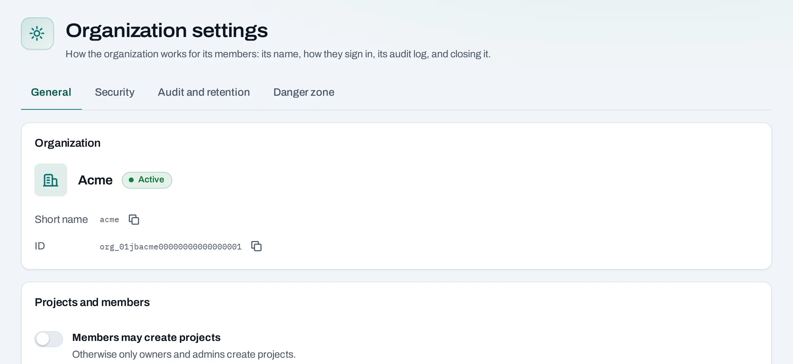

# Organization settings

Organization settings control membership policy, sign-in requirements, activity visibility and closure. Open **Settings** at the organization level. Project settings are separate and affect one project.

<div class="docs-method-picker" hidden role="group" aria-label="Instruction method">
<span>Show instructions for</span>
<div><button type="button" data-interface-choice="Console" aria-pressed="true">Console</button><button type="button" data-interface-choice="API" aria-pressed="false">API</button></div>
</div>

<div class="docs-method-note" markdown>

[Set up API authentication and variables](/api/overview.md#before-you-start). Replace example IDs and catalog choices. Reuse an idempotency key for retries of one request; use a new key for each new action.

</div>




## General and security {#security}

=== "Console"

    Review the **General** and **Security** tabs. Settings include whether members may create projects, which email domains may receive invitations and whether a second factor is required for members.

    Owners and admins always need a second factor; a platform requirement may also enforce it. Some controls are owner-only or fixed by the provider. The console explains a fixed value rather than offering an edit that cannot succeed.

    To change a setting:

    1. Read the current value and its explanation.
    2. Change the permitted control and complete any fresh sign-in or second-factor check requested.
    3. Save, then confirm the new value. If another administrator changed settings first, reload and review before retrying.

    New second-factor requirements can have a displayed grace deadline. Members should enroll before that deadline. If a member is locked out, use the support route supplied at onboarding rather than sharing another person's account.

=== "API"

    <span id="with-the-api" data-docs-method="API"></span>

    ```bash
    curl --fail-with-body -i -X PATCH "$NUBESTACK_API/v1/orgs/$ORG/settings" \
      -H "Authorization: Bearer $NUBESTACK_API_KEY" \
      -H "If-Match: $ETAG" \
      -H "Content-Type: application/json" \
      --data '{
      "members_create_projects": false
    }'
    ```

    Returns `200` directly. Read the returned resource or current state to verify the change.

    [Request fields and responses](/api/reference/organizations.md#patch-settings).


## Audit and retention

=== "Console"

    The **Audit and retention** tab controls how far back authorized members may read the audit log, whether export is allowed and whether organization viewers can read it. Read access and retention bounds come from the provider's policy; use the options shown in the console.

    Export needed records before shortening a read window. The audit read window is distinct from resource-deletion retention and from retained accounting records.

=== "API"

    Read the current audit settings first. Replace the example `audit_version: 0` with their returned version.

    ```bash
    curl --fail-with-body -i -X PATCH "$NUBESTACK_API/v1/orgs/$ORG/settings" \
      -H "Authorization: Bearer $NUBESTACK_API_KEY" \
      -H "If-Match: $ETAG" \
      -H "Content-Type: application/json" \
      --data '{
      "audit_export_enabled": true,
      "audit_lookback_days": 90,
      "audit_version": 0
    }'
    ```

    Returns `200` directly. Read the returned resource or current state to verify the change.

    [Request fields and responses](/api/reference/organizations.md#patch-settings).

## Take a copy of your data

=== "Console"

    Under the organization's **Danger zone**, choose **Request data export**. Follow the preparation operation, then download the export when its link is ready. Keep the download securely; it can contain membership, resource and activity information. The export is a record of your organization, not a backup of guest disks or application data.

=== "API"

    ```bash
    curl --fail-with-body -i -X POST "$NUBESTACK_API/v1/orgs/$ORG/data-export" \
      -H "Authorization: Bearer $NUBESTACK_API_KEY" \
      -H "Idempotency-Key: $REQUEST_KEY"
    ```

    A `202` accepts the change. Follow `operation.href` to its final result before the next dependent action.

    [Request fields and responses](/api/reference/organizations.md#request-data-export).


## E-mail notices

Use your notification preferences to choose optional messages. Required service or security notices may remain enabled. Check the affected location and time zone in a maintenance notice, and plan application work around the published window.

## Danger zone

=== "Console"

    The owner can transfer ownership or request organization closure. Closure affects every project and all resources across locations. Review the report and deadlines, and request a data export if needed. See [Deletion and retention](/concepts/deletion-and-retention.md) before using these actions.

=== "API"

    **Close the organization**

    ```bash
    curl --fail-with-body -i -X POST "$NUBESTACK_API/v1/orgs/$ORG:close" \
      -H "Authorization: Bearer $NUBESTACK_API_KEY" \
      -H "Idempotency-Key: $REQUEST_KEY" \
      -H "Content-Type: application/json" \
      --data '{}'
    ```

    A `202` accepts the change. Follow `operation.href` to its final result before the next dependent action.

    [Request fields and responses](/api/reference/organizations.md#close-org).

    **Cancel the organization's closure**

    ```bash
    curl --fail-with-body -i -X POST "$NUBESTACK_API/v1/orgs/$ORG:cancel-closure" \
      -H "Authorization: Bearer $NUBESTACK_API_KEY" \
      -H "Idempotency-Key: $REQUEST_KEY"
    ```

    A `202` accepts the change. Follow `operation.href` to its final result before the next dependent action.

    [Request fields and responses](/api/reference/organizations.md#cancel-org-closure).
