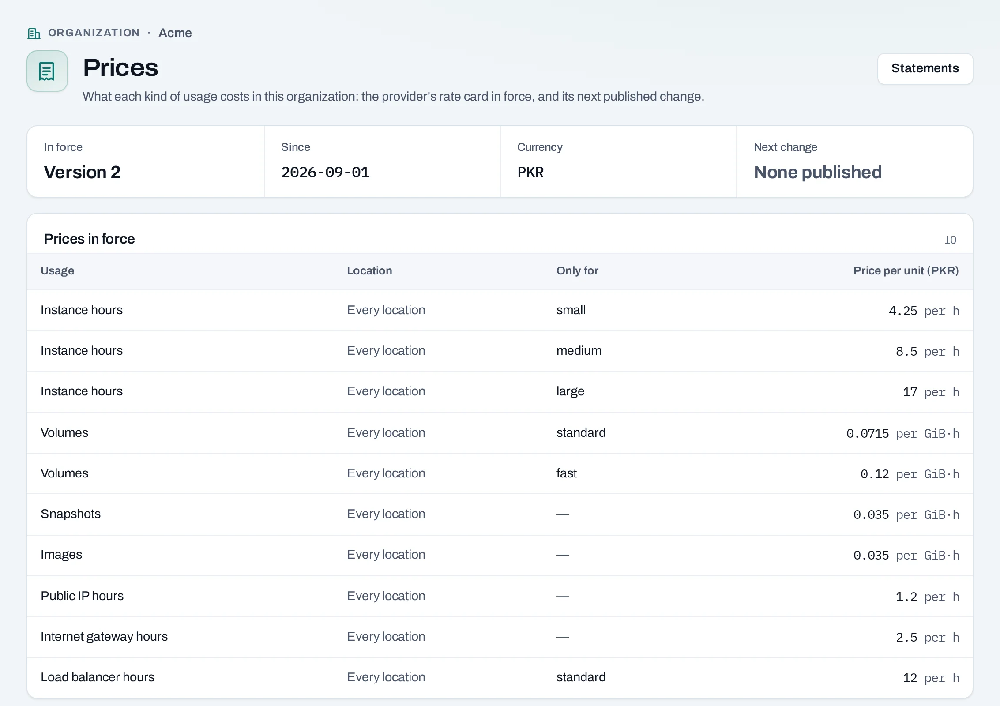

# Statements, prices and costs

A **statement** is what your organization's usage cost in one calendar month, at NubeStack's
published rates. It is not an invoice: invoices come separately, and while statements are marked
**Provisional — not an invoice**, the invoice is the one that counts.

Owners, admins and the billing role see them, and anyone with a custom role that includes seeing
the monthly statements.

## Statements

In the organization, open **Billing → Statements** and pick the month at the top right. **All
months** lists every statement with its state and total.

- **Total of rated usage**: every rated line, in NubeStack's currency, shown to the cent.
- **Not rated**: usage no rate covers, shown with its quantity and no amount. It is never shown as
  free and is not in the total.
- **State**: **Open** while the month runs and for five days after; then **Closed**, and it never
  changes.
- One line per measure and location, and for instances, volumes and load balancers per size or
  volume type: quantity, unit price, rates version, amount and days.
- **Corrections** to an open month change its statement. A correction to a closed month appears
  on the next open statement as an **adjustment**, which can be negative.
- **Hours not counted**: the month's usage that has not been measured yet, so is not on the
  statement. See [Usage](usage.md#why-the-figures-are-provisional).
- **Rates in force**, at the bottom: the rate card's version, the next scheduled change, and a
  link to **Prices**.

Before NubeStack publishes a rate card, the page says **No statements yet**.

## Prices

**Billing → Prices** shows what each kind of usage costs: NubeStack's rate card in force, and its
next published change. A price for one size names the size, volume type or load balancer type as
the create pages show it, and applies wherever that is offered.

The same rates give the **price estimate** on the console's create pages, and the rate in the
Internet gateway and snapshot dialogs.

## Cost explorer

**Billing → Cost explorer** shows where the money goes: the month's cost so far by
**Project**, **Service**, **Location** or **Tag**, as a bar for each day. In a project, the same
page shows that project's cost.

- At the top: the total so far, **Projected for the month** (the cost so far plus the average of
  the last seven full days for each day left, from the third day) and last month's total.
- **Tag** groups cost by one tag key's values, with resources without that key as **Untagged**.
  See [Tags](../concepts/tags.md).
- Usage no rate covers is listed above the chart, never counted as free.
- A month's daily costs add up to its statement's total.

## Through the API

| What | Route |
|---|---|
| Statements, newest first | `GET /v1/orgs/{org_id}/statements` |
| One statement with its lines | `GET /v1/orgs/{org_id}/statements/{statement_id}` |
| The usage behind a line | `GET /v1/orgs/{org_id}/statements/{statement_id}/lines/{line_id}/usage` |
| The rates in force | `GET /v1/orgs/{org_id}/rate-card` |
| A month's cost by day | `GET /v1/orgs/{org_id}/costs?period=2026-10&group_by=project` |

Amounts, prices and quantities are decimal strings.

## Related

- [Usage](usage.md) · [Usage and costs](../concepts/usage-and-costs.md) · [Tags](../concepts/tags.md)
