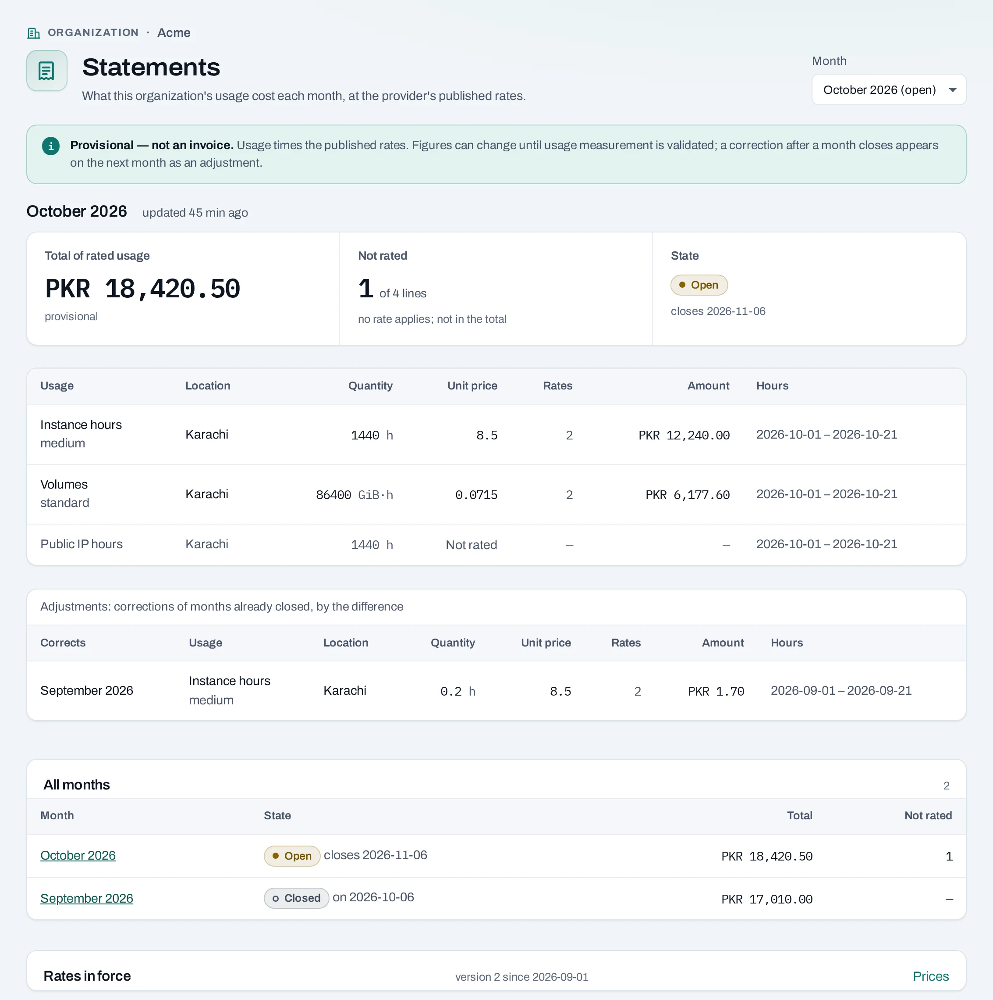
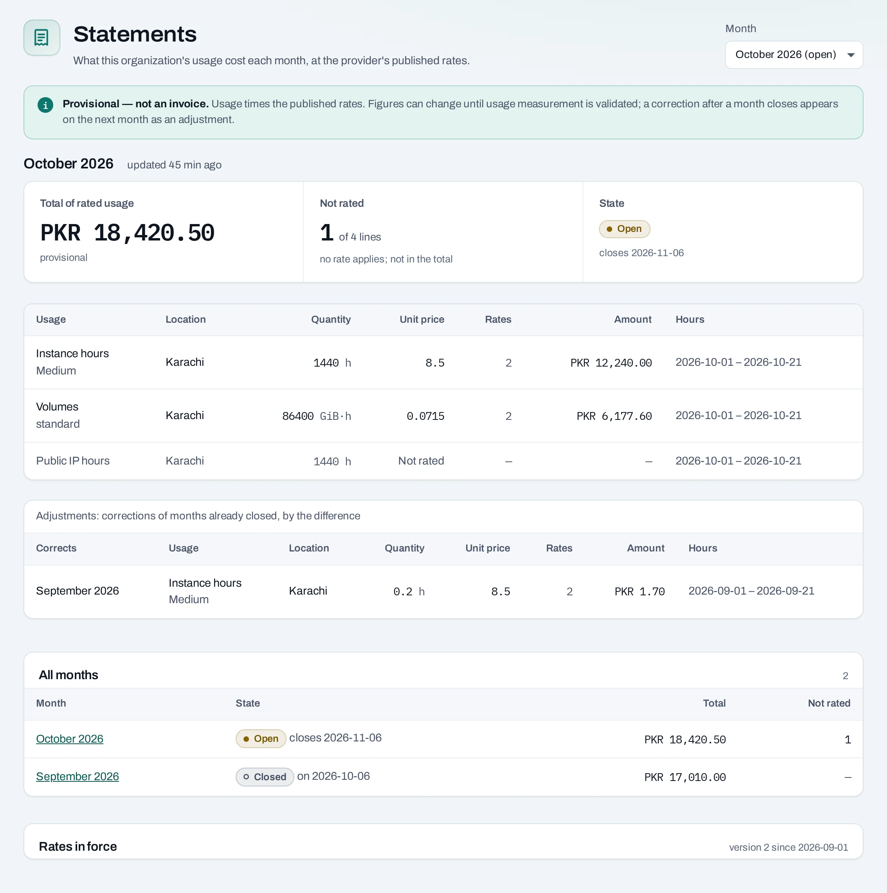
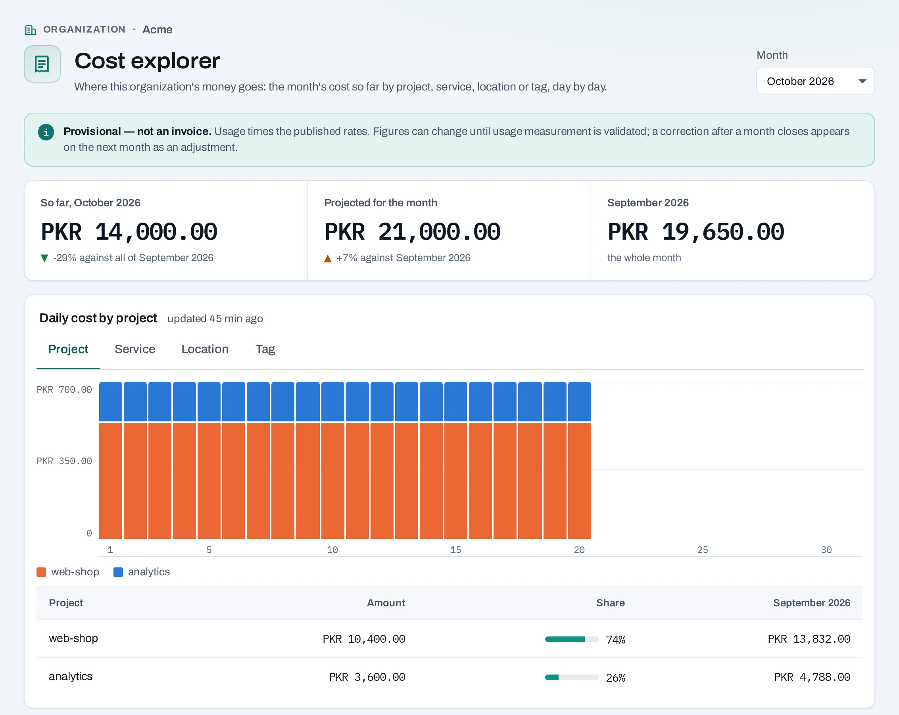

# Statements and cost explorer

Statements summarize rated usage for a month. The cost explorer groups estimated costs to help you understand where resources are going. Both are **provisional**, as the console labels them. These features do not provide payment collection, taxes or a final invoice.

## Read a statement

1. Open the organization's **Statements** page.
2. Select a month. Check whether the statement is open or closed, its currency and data-as-of time.
3. Inspect each line's metric, quantity, unit and price. Follow a line's usage detail when you need to understand the observations behind it.
4. Check for unrated lines and adjustments before comparing the total with another period.

An open statement changes as usage arrives. A closed statement fixes that period's statement; late corrections can appear as adjustments in a later statement. Unrated usage has no applicable price and is not a zero-cost promise.

## The cost explorer

Open **Cost explorer**, choose a month and group by project, service, location or an available tag key. The page can show daily amounts, the prior period and a projection when enough information exists. Read unavailable and partial-data explanations before drawing a conclusion.

Tag grouping uses the tags in effect when usage occurred. Adding a tag now does not rewrite the history of earlier untagged use. The **Untagged** group helps find resources that were not assigned a value.

## Rate card and projections

The rate card describes prices currently in force and any published next version. Sample figures in these documentation screenshots are invented, not published NubeStack prices. A projected month total is an estimate based on observed use; it is not a budget limit or guaranteed charge.

## With the API

| View | Read endpoint |
|---|---|
| Monthly list | `/v1/orgs/{org_id}/statements` |
| One statement | `/v1/orgs/{org_id}/statements/{statement_id}` |
| Line usage | `.../statements/{statement_id}/lines/{line_id}/usage` |
| Rate card | `/v1/orgs/{org_id}/rate-card` |
| Explorer | `/v1/orgs/{org_id}/costs` |

These are `GET` requests returning `200`, without operations. Use the [reference](/api/reference/index.md) for period and grouping parameters, and preserve decimal amounts as decimal values in your integrations. Consult [Usage and costs](/concepts/usage-and-costs.md) for what is measured.
