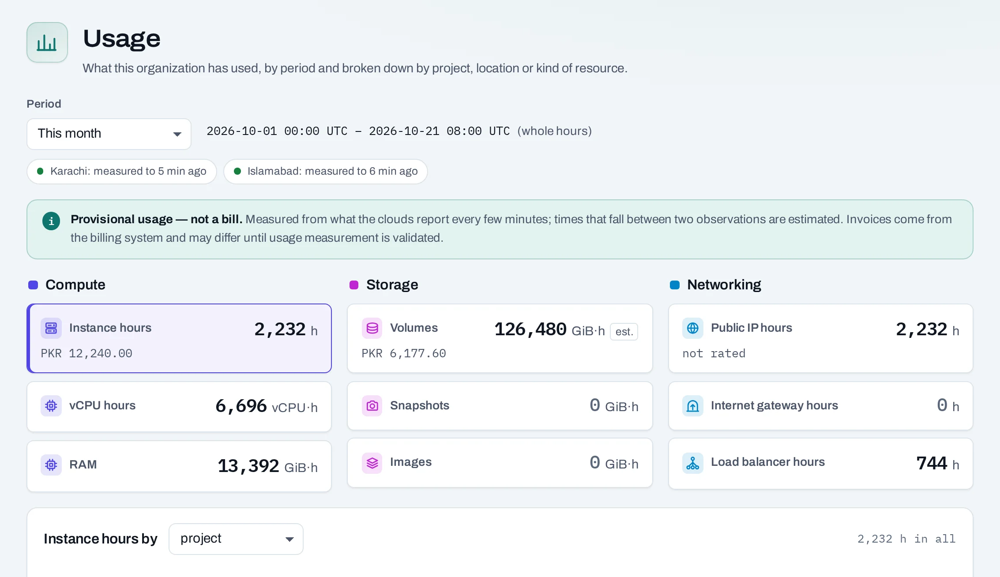

# Usage

NubeStack Cloud measures what your organization uses: how long each instance existed, how much
storage you kept and for how long, how long you held public IPs. Every figure is marked
**Provisional usage — not a bill**.



## Where to see it

- **Billing → Usage**, in the organization: owners, admins and the billing role. Pick a
  **Period** (this month, last month, the last 7 or 30 days), then a measure to break down by
  project, location or kind of resource. For this month and last month, each measure also shows
  its cost so far at the published rates.
- **Billing → Usage** in a project: that project's usage this month, for the same roles.
- **Quota**, at the bottom of a project's menu: that project's usage this month, for anyone with
  a role on the project.

Periods run in whole hours, in UTC.

## What is measured

| Measure | Unit | Counted while |
|---|---|---|
| Instance hours | hours | the instance exists, in any state, including stopped and shelved |
| vCPU hours | vCPU·hours | the instance is running or starting |
| RAM | GiB·hours | the instance is running or starting |
| Volumes | GiB·hours | the volume exists, attached or not |
| Volume snapshots | GiB·hours | the snapshot exists |
| Images | GiB·hours | one of your own images exists |
| Public IP hours | hours | the public IP is allocated, attached or not |
| Internet gateway hours | hours | the gateway exists |
| Load balancer hours | hours | the load balancer exists, in any state |

Which measures are charged, and at what price, is NubeStack's rate card: see
[Statements and cost explorer](statements-and-costs.md).

## Why the figures are provisional

- Usage is built from what each location reports every few minutes. When something starts or
  stops between two reports, the moment is estimated; such hours are marked **partly estimated**.
- Measurement is still being checked against each location's own records. Until then, your bill
  can differ from this page, and the bill is the one that counts.

A location that has not reported recently shows the time of its last report at the top of the
page. Missing hours are never filled in as zero: **Hours not counted** shows them by project, as
**Not counted yet** (measured late, counted once the location catches up), **Skipped** (a repair
can still count them) or **Unknown** (before measurement reached the project; never counted).

## Month by month, and exports

Under the breakdown, the chosen measure is shown month by month. **Export** asks for a month's
usage as a JSON lines file, every hour counted up to that moment; **Download** fetches it when it
is ready, and **Export again** makes a newer one. Exports are provisional, like the page.

Usage is kept by the hour for 13 months, and as monthly totals for good.

## Through the API

```bash
curl -sS "$NUBESTACK_API/v1/orgs/$ORG/projects/$PROJECT/usage?from=2026-10-01T00:00:00Z&to=2026-11-01T00:00:00Z" \
  -H "Authorization: Bearer $NUBESTACK_API_KEY"
```

`GET /v1/orgs/{org_id}/usage` gives the whole organization, for callers who may see it. Quantities
are decimal strings.

## Good to know

- Usage covers everything in your projects, including what you make with a location's own tools.
- A resource that failed to create may have been counted for the time it existed.
- A volume moved to another project counts in the new project from the move.
- After a project is deleted or the organization closed, its usage records are kept.

## Related

- [Usage and costs](../concepts/usage-and-costs.md) · [Statements and cost explorer](statements-and-costs.md)
