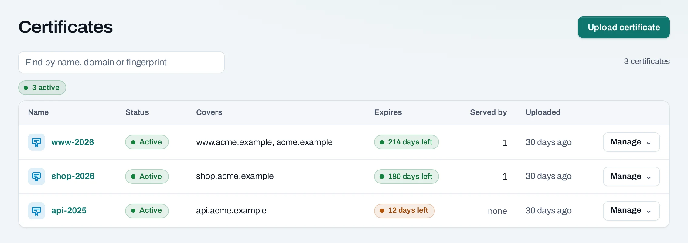
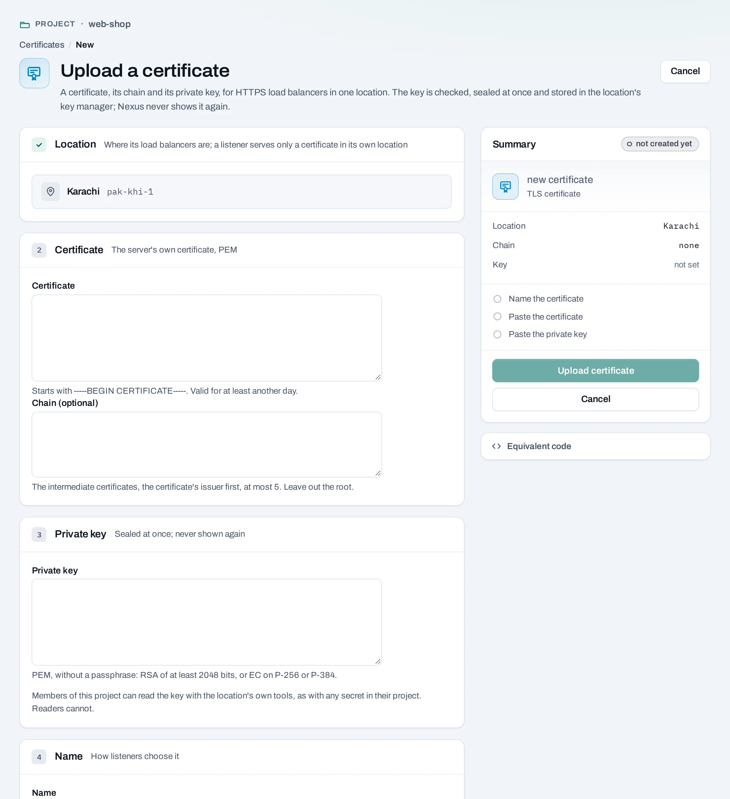
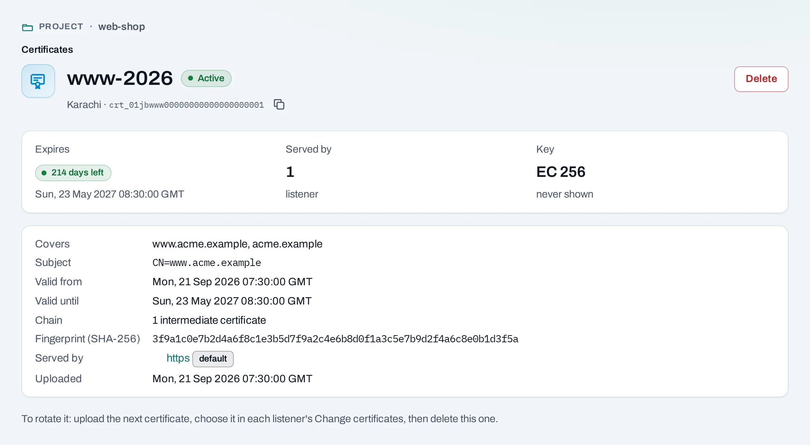

# Certificates

A certificate lets an Application load balancer terminate HTTPS for your domain. Certificates belong to a project and location; select one on an HTTPS listener in that same project and location.

<div class="docs-method-picker" hidden role="group" aria-label="Instruction method">
<span>Show instructions for</span>
<div><button type="button" data-interface-choice="Console" aria-pressed="true">Console</button><button type="button" data-interface-choice="API" aria-pressed="false">API</button></div>
</div>

<div class="docs-method-note" markdown>

[Set up API authentication and variables](../api/index.md#before-you-start). Replace example IDs and catalog choices. Reuse an idempotency key for retries of one request; use a new key for each new action.

</div>




## Upload a certificate

=== "Console"

    1. Obtain a certificate for your domain and its matching private key. NubeStack Cloud does not issue a certificate for you through this page.
    2. Open **Security → Certificates → Upload certificate**.
    3. Select the location and a name that identifies the domain and renewal, such as `shop-2026-11`.
    4. Paste the PEM leaf certificate, unencrypted PEM private key and intermediate chain if required. Order intermediates from the leaf's issuer outward; omit the leaf from the chain.
    5. Upload and follow the operation. The private key is accepted once and is never shown back.

    

    Supported keys are RSA of at least 2,048 bits or EC on P-256 or P-384. Each PEM field accepts at most 32,768 characters; the chain allows up to five intermediate certificates. The certificate and key must match, and the certificate must be valid for its intended use.

=== "API"

    <span id="with-the-api" data-docs-method="API"></span>

    ```http
    POST /v1/orgs/{org_id}/projects/{project_id}/certificates
    ```

    Prepare a local JSON file containing `location`, `display_name`, the PEM `certificate`, matching `private_key` and optional `chain`. Keep it private and send it with `--data-binary @certificate.json`.

    A `202` accepts the change. Follow `operation.href` to its final result before the next dependent action.

    [Request fields and responses](../api/reference/certificates.md).


## Use and rotate

=== "Console"

    Open the certificate to see its domains, expiry, fingerprint and linked listeners. Add or edit an HTTPS listener under [Load balancers](../networking/load-balancers.md) and select this certificate. The API protocol is `TERMINATED_HTTPS`.

    

    To rotate, upload a new certificate, choose **Switch certificate** on each HTTPS listener, select the replacement and follow the operations. Verify the served certificate at your application domain before deleting the old resource. Uploading a replacement alone does not change listeners, and renewal is not automatic.

    !!! note "One certificate per listener"

        Multiple certificates on one listener using SNI are coming later. Each HTTPS listener currently selects one certificate; a wildcard or multi-domain certificate can cover names included in that certificate.

=== "API"

    ```bash
    curl --fail-with-body -i -X PATCH "$NUBESTACK_API/v1/orgs/$ORG/projects/$PROJECT/load-balancers/$LB_ID/listeners/$CHILD_ID" \
      -H "Authorization: Bearer $NUBESTACK_API_KEY" \
      -H "Idempotency-Key: $REQUEST_KEY" \
      -H "Content-Type: application/json" \
      --data '{
      "expected": "0000000000000000000000000000000000000000000000000000000000000000",
      "certificate_id": "crt_replacement"
    }'
    ```

    A `202` accepts the change. Follow `operation.href` to its final result before the next dependent action.

    [Request fields and responses](../api/reference/load-balancers.md).

    Where the body has `expected`, the all-zero hash is an example: replace it with the current `lb_configuration.version` you read. Protocol and port are fixed after listener creation.


## Delete and good practice

=== "Console"

    A certificate used by a listener cannot be deleted. Switch or remove every named listener first. Keep a secure original copy of the key and certificate; the console cannot recover the private key. Monitor expiry and allow enough time to upload, switch and verify a renewal. Do not paste private keys into support requests or screenshots.

=== "API"

    ```bash
    curl --fail-with-body -i -X DELETE "$NUBESTACK_API/v1/orgs/$ORG/projects/$PROJECT/certificates/$CERTIFICATE_ID" \
      -H "Authorization: Bearer $NUBESTACK_API_KEY" \
      -H "Idempotency-Key: $REQUEST_KEY"
    ```

    A `202` accepts the change. Follow `operation.href` to its final result before the next dependent action.

    [Request fields and responses](../api/reference/certificates.md).
