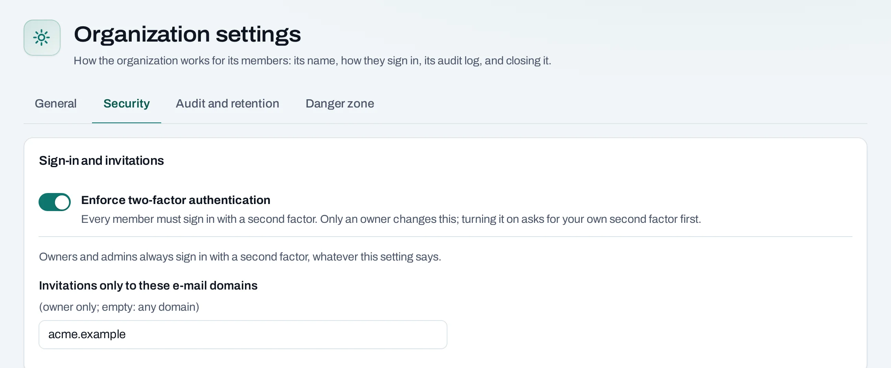

# Second factor

A **second factor** is a six-digit code from an authenticator app on your phone, asked for after
your password. It keeps your account safe when a password leaks.

## When you are asked for it

| Situation | Second factor |
|---|---|
| You are an owner or admin of the organization | Always |
| You sign in to a location's Horizon dashboard or the OpenStack CLI | Always |
| Your organization requires it for every member | Always, after the grace period |
| Sensitive actions: closing the organization, deleting a project with everything in it, inviting an owner or admin | Asked again at that moment |
| Otherwise | Not asked |

NubeStack can also require it for everyone on the platform; the settings page then says so.

## Set it up

You are asked to set it up the first time you need it: when you accept an invitation that needs
it, or sign in after your organization starts requiring it.

1. Install an authenticator app on your phone, such as one that supports time-based codes (TOTP).
2. Scan the code the sign-in page shows.
3. Type the six-digit code the app shows, and continue.

To change phones or apps later, choose your initial at the top right of the console, then
**Password and sign-in**.

## Require it for every member

Owners only. Changing it asks for your own second factor first.

1. In the organization, open **Settings → Security**.
2. Turn on **Enforce two-factor authentication**.

Members without a second factor are warned until the date shown (a grace period of 0 to 30 days,
7 by default), then refused until they set one up. Owners and admins always need it, whatever this
setting says.

The same tab has **Invitations only to these e-mail domains**: list your domains, for example
`acme.example`, to refuse invitations to any other address.

## Through the API

API keys of service accounts do not use a second factor. A request made with a person's session
that needs one is refused with `403 second_factor_required`.

## Lost your phone

Contact [NubeStack support](../help/support.md). Support sends a one-time reset link; opening it
signs you in once, your old password and second factor stop working, and you set new ones.

## Related

- [Sign up and sign in](../get-started/account.md) · [Settings](../organization/settings.md)
