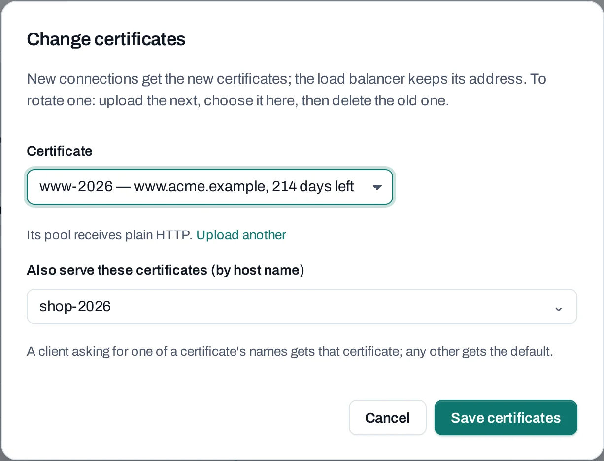

# Several certificates on one listener

One HTTPS listener can serve a different certificate for each of your domains, on the same address
and port. Each listener has one **default** certificate, and can serve up to ten more **by host
name**. A client that asks for one of a certificate's names gets that certificate; any other
client gets the default.

The client says which name it wants during the TLS handshake. This is **SNI** (Server Name
Indication), and every current browser and HTTP library sends it.

<figure class="ns-diagram">
--8<-- "https-sni.svg"
<figcaption>The listener on 203.0.113.40:443 serves shop-2026 to clients asking for shop.acme.example, and its default, www-2026, to everyone else.</figcaption>
</figure>

**Use it for** several sites or brands behind one load balancer and one public IP, without a
wildcard or multi-domain certificate.

## Before you start

- An HTTPS listener that ends TLS (**HTTPS, TLS ends here**, `TERMINATED_HTTPS` in the API).
  Other protocols take no certificate.
- Each certificate [uploaded](certificates.md) to the load balancer's project, valid for at least
  another 24 hours.
- DNS for each domain pointing at the load balancer's public IP.

## Choose certificates when you create a listener

=== "Console"

    On the load balancer create page, or **Add listener** on an existing one:

    1. **Protocol**: **HTTPS, TLS ends here**, port `443`.
    2. **Certificate**: the default, for example `www-2026`.
    3. **Also serve these certificates (by host name)**: pick up to ten more, for example
       `shop-2026`. Each shows the names it covers and the days it has left. Leave it at **None:
       every client gets the default** to serve one certificate.

=== "API"

    ```bash
    curl -sS -X POST "$NUBESTACK_API/v1/orgs/$ORG/projects/$PROJECT/load-balancers/lbs_01jbweblb/listeners" \
      -H "Authorization: Bearer $NUBESTACK_API_KEY" \
      -H "Idempotency-Key: $(uuidgen)" \
      -H "Content-Type: application/json" \
      -d '{
        "display_name": "https",
        "protocol": "TERMINATED_HTTPS",
        "port": 443,
        "pool_id": "lbp_01jbwebpool",
        "certificate_id": "crt_01jbwww",
        "sni_certificate_ids": ["crt_01jbshop"]
      }'
    ```

    The same two fields go in each listener of a new load balancer's `listeners`.

## Change a listener's certificates

=== "Console"

    1. Open the load balancer's **Listeners** tab.
    2. On the HTTPS listener, choose **Change certificates**.
    3. Change the **Certificate** (the default) or the certificates served by host name.
    4. Choose **Save certificates**. New connections get the new set; the address stays.

    

=== "API"

    Send the listener's current version in `expected` (its `lb_configuration.version`) and the
    **whole** new set: `sni_certificate_ids` replaces the list, and `[]` removes them all. Add
    `certificate_id` to change the default too.

    ```bash
    curl -sS -X PATCH "$NUBESTACK_API/v1/orgs/$ORG/projects/$PROJECT/load-balancers/lbs_01jbweblb/listeners/lbl_01jbhttps" \
      -H "Authorization: Bearer $NUBESTACK_API_KEY" \
      -H "Idempotency-Key: $(uuidgen)" \
      -H "Content-Type: application/json" \
      -d '{
        "expected": "8c1f0b6e2d4a9f3e7b5c1a0d6e8f2b4c9a7e3d1f5b0c8e6a2d4f9b1e7c3a5d0f",
        "sni_certificate_ids": ["crt_01jbshop", "crt_01jbapi"]
      }'
    ```

The **Listeners** tab shows each listener's **Certificate** and **By host name** lines, and a
certificate's page marks each listener that serves it **default** or **by host name**.

## What is refused

The checks run when the request arrives. Each refusal is `422 validation_failed`, with the field
and one of these reasons in `errors[]`; the console shows it under the picker.

| Reason | Why |
|---|---|
| `certificate_not_allowed` | The listener does not end TLS |
| `certificate_required` | No default certificate |
| `certificate_is_default` | A certificate is both the default and served by host name |
| `certificate_duplicate` | The same certificate twice in the list |
| `certificate_is_sni` | Making a by-host-name certificate the default without sending the new list |
| `certificate_not_found` | Not a certificate of this project |
| `certificate_expired` | Expired, or expiring within 24 hours |

More than ten by host name is refused too. A certificate uploaded but not stored yet answers
`409 certificate_not_ready`: wait for its upload to finish.

## How a client is matched

- A client asking for a name in one of the by-host-name certificates (its common name or
  subject alternative names) gets that certificate.
- Any other client, including one that sends no SNI, gets the default. Make the certificate for
  your main domain the default.
- Keep each name in only one of a listener's certificates: which one is served when two cover
  the same name is not defined.

## Rotate one of them

Upload the renewed certificate, then **Change certificates** and pick it in place of the old one,
whether it is the default or served by host name. Then delete the old one. See
[Rotate a certificate](certificates.md#rotate-a-certificate).

## Limits

- One default and up to 10 certificates by host name per listener.
- Not offered: client certificates (mutual TLS), choosing TLS versions or ciphers, and routing by
  host name to different pools. Every name on a listener reaches the same pool.

## Related

- [Certificates](certificates.md) · [Load balancers](../networking/load-balancers.md)
- [Serve an application over HTTPS](../tutorials/https-load-balancer.md)
- [API reference: Load balancers](../api/reference/load-balancers.md)
