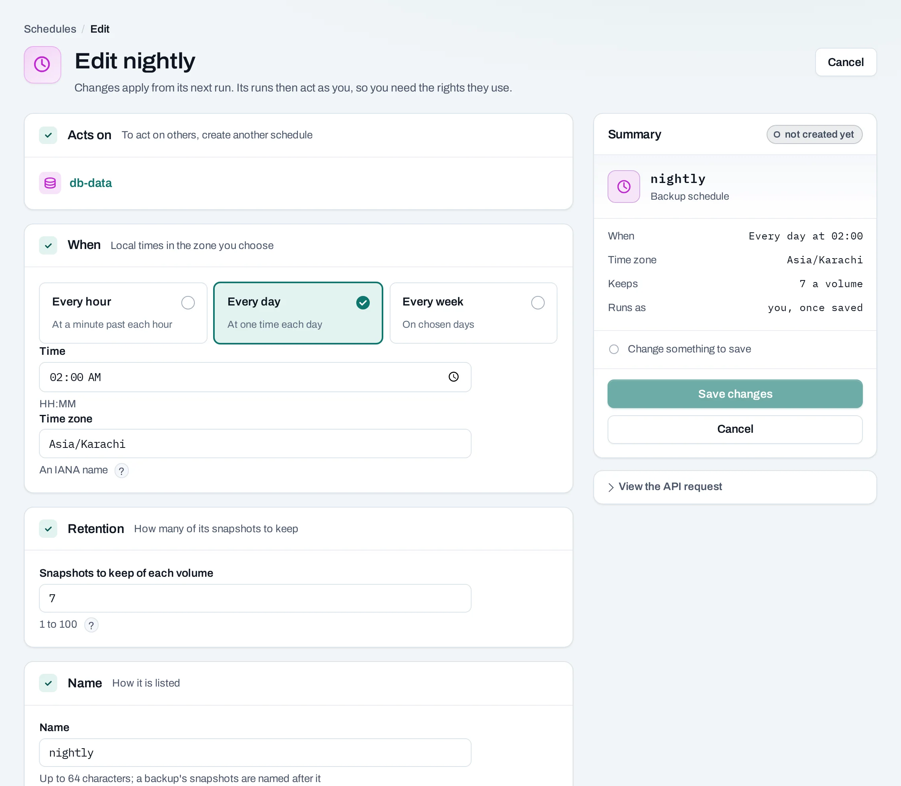

# Schedules

Schedules run recurring work for a project. Use backup schedules for volume snapshots, power schedules to stop and start instances, and size schedules to change an instance group's desired count.

<div class="docs-method-picker" hidden role="group" aria-label="Instruction method">
<span>Show instructions for</span>
<div><button type="button" data-interface-choice="Console" aria-pressed="true">Console</button><button type="button" data-interface-choice="API" aria-pressed="false">API</button></div>
</div>

<div class="docs-method-note" markdown>

[Set up API authentication and variables](/api/overview.md#before-you-start). Replace example IDs and catalog choices. Reuse an idempotency key for retries of one request; use a new key for each new action.

</div>


## Create a backup schedule

=== "Console"

    1. Open **Storage → Schedules → Create schedule**. You can also start from an instance's or volume's **Schedules** tab.
    2. Choose **Back up volumes** or **Back up instances**.
    3. Select targets in one location. An instance backup snapshots its attached volumes; it does not save its image-backed system disk. Use [Create image](/compute/images.md) when you need that disk.
    4. Choose a time zone and timetable. Backups can be hourly, daily or weekly.
    5. For backups, choose how many snapshots of each volume to keep. The schedule prunes only snapshots it created.
    6. Name the schedule, review the next run and save.

    

    The saved schedule takes effect for future runs. It is not a request to run the action immediately. Check its **Next run**, time zone, last result and linked operation.

=== "API"

    <span id="with-the-api" data-docs-method="API"></span>

    This example creates a nightly volume snapshot schedule.
    ```bash
    curl --fail-with-body -i -X POST "$NUBESTACK_API/v1/orgs/$ORG/projects/$PROJECT/schedules" \
      -H "Authorization: Bearer $NUBESTACK_API_KEY" \
      -H "Idempotency-Key: $REQUEST_KEY" \
      -H "Content-Type: application/json" \
      --data '{
      "kind": "backup",
      "name": "nightly",
      "target_type": "volume",
      "target_ids": [
        "vol_example"
      ],
      "time_zone": "Asia/Karachi",
      "recurrence": {
        "frequency": "daily",
        "time": "02:00"
      },
      "keep": 7
    }'
    ```

    Returns `201` directly. Read the returned resource or current state to verify the change.

    [Request fields and responses](/api/reference/schedules.md#create-schedule).


## Create a power schedule

=== "Console"

    Choose **Create schedule → Stop and start instances**. Select instances in one location, their weekly stop and start times, days, time zone and a name. Review the next-run time before saving. A stopped instance retains its allocation, disks and public IPs.

=== "API"

    ```bash
    curl --fail-with-body -i -X POST "$NUBESTACK_API/v1/orgs/$ORG/projects/$PROJECT/schedules" \
      -H "Authorization: Bearer $NUBESTACK_API_KEY" \
      -H "Idempotency-Key: $REQUEST_KEY" \
      -H "Content-Type: application/json" \
      --data '{
      "kind": "power",
      "name": "office-hours",
      "target_type": "server",
      "target_ids": [
        "srv_example"
      ],
      "time_zone": "Asia/Karachi",
      "power": {
        "days": [
          "mon",
          "tue",
          "wed",
          "thu",
          "fri"
        ],
        "stop_at": "20:00",
        "start_at": "08:00"
      }
    }'
    ```

    Returns `201` directly. Read the returned resource or current state to verify the change.

    [Request fields and responses](/api/reference/schedules.md#create-schedule).

## Schedule group sizes

=== "Console"

    Open an [instance group](/compute/instance-groups.md) and its **Scheduled sizes** section. Choose the desired size, local time, days and time zone. The size must remain within the group's minimum and maximum. After the scheduled run, the group creates or removes instances until it reaches that desired count.

=== "API"

    ```bash
    curl --fail-with-body -i -X POST "$NUBESTACK_API/v1/orgs/$ORG/projects/$PROJECT/schedules" \
      -H "Authorization: Bearer $NUBESTACK_API_KEY" \
      -H "Idempotency-Key: $REQUEST_KEY" \
      -H "Content-Type: application/json" \
      --data '{
      "kind": "resize",
      "name": "morning-size",
      "target_type": "instance_group",
      "target_ids": [
        "igr_example"
      ],
      "time_zone": "Asia/Karachi",
      "desired": 3,
      "recurrence": {
        "frequency": "daily",
        "time": "08:00"
      }
    }'
    ```

    Returns `201` directly. Read the returned resource or current state to verify the change.

    [Request fields and responses](/api/reference/schedules.md#create-schedule).

## Edit, pause and delete

=== "Console"

    Use **Edit** on a schedule to change the supported target and timetable settings, retention or desired count. Review the next run after editing. **Pause** stops future runs; **Resume** enables them again. Runs act with the creator's current permissions; removing access can prevent a later run.

    

    Deleting a backup schedule leaves its snapshots in place and stops pruning them. Delete unwanted snapshots separately. Deleting a power schedule does not start stopped instances. Deleting a size schedule does not undo the last desired count it set.

    !!! note "Understand backup consistency"

        The console calls these backup schedules, but they create snapshots in the source storage, not independent backup copies. Scheduled snapshots of attached volumes do not pause applications. Database or multi-volume consistency needs application coordination and a tested restore procedure.

=== "API"

    **Change a schedule**

    ```bash
    curl --fail-with-body -i -X PATCH "$NUBESTACK_API/v1/orgs/$ORG/projects/$PROJECT/schedules/$SCHEDULE_ID" \
      -H "Authorization: Bearer $NUBESTACK_API_KEY" \
      -H "Idempotency-Key: $REQUEST_KEY" \
      -H "If-Match: $ETAG" \
      -H "Content-Type: application/json" \
      --data '{
      "name": "nightly",
      "keep": 7
    }'
    ```

    Returns `200` directly. Read the returned resource or current state to verify the change.

    [Request fields and responses](/api/reference/schedules.md#change-schedule).

    **Pause a schedule**

    ```bash
    curl --fail-with-body -i -X POST "$NUBESTACK_API/v1/orgs/$ORG/projects/$PROJECT/schedules/$SCHEDULE_ID:pause" \
      -H "Authorization: Bearer $NUBESTACK_API_KEY" \
      -H "Idempotency-Key: $REQUEST_KEY" \
      -H "If-Match: $ETAG"
    ```

    Returns `200` directly. Read the returned resource or current state to verify the change.

    [Request fields and responses](/api/reference/schedules.md#pause-schedule).

    **Resume a schedule**

    ```bash
    curl --fail-with-body -i -X POST "$NUBESTACK_API/v1/orgs/$ORG/projects/$PROJECT/schedules/$SCHEDULE_ID:resume" \
      -H "Authorization: Bearer $NUBESTACK_API_KEY" \
      -H "Idempotency-Key: $REQUEST_KEY" \
      -H "If-Match: $ETAG"
    ```

    Returns `200` directly. Read the returned resource or current state to verify the change.

    [Request fields and responses](/api/reference/schedules.md#resume-schedule).

    **Delete a schedule**

    ```bash
    curl --fail-with-body -i -X DELETE "$NUBESTACK_API/v1/orgs/$ORG/projects/$PROJECT/schedules/$SCHEDULE_ID" \
      -H "Authorization: Bearer $NUBESTACK_API_KEY" \
      -H "Idempotency-Key: $REQUEST_KEY" \
      -H "If-Match: $ETAG"
    ```

    Returns `200` directly. Read the returned resource or current state to verify the change.

    [Request fields and responses](/api/reference/schedules.md#delete-schedule).


## Limits

At most 20 schedules per project and 10 targets per schedule are supported. Backup retention is 1–100 snapshots per volume. Choose an IANA time zone such as `Asia/Karachi`, and inspect the next-run display rather than assuming the browser's zone applies. Missed work and failures need attention in the schedule's last result and [activity](/organization/activity.md).
